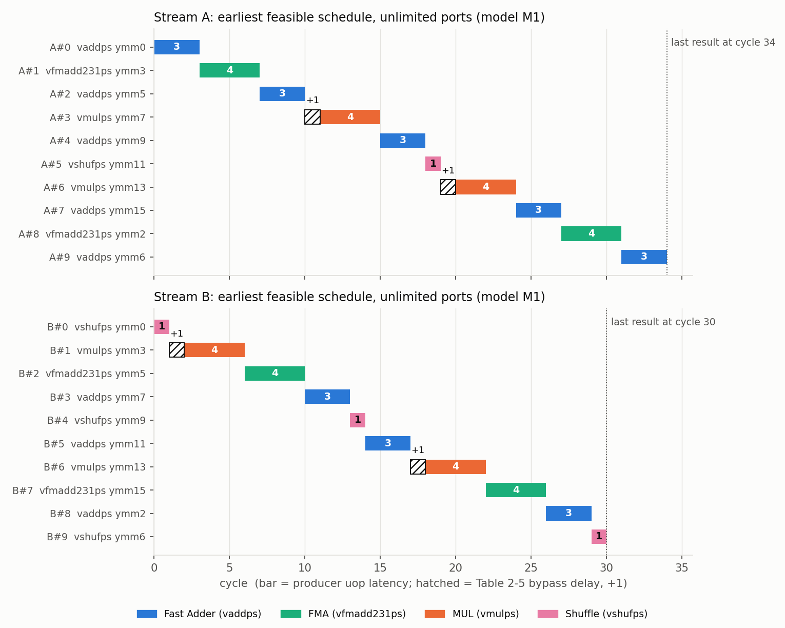
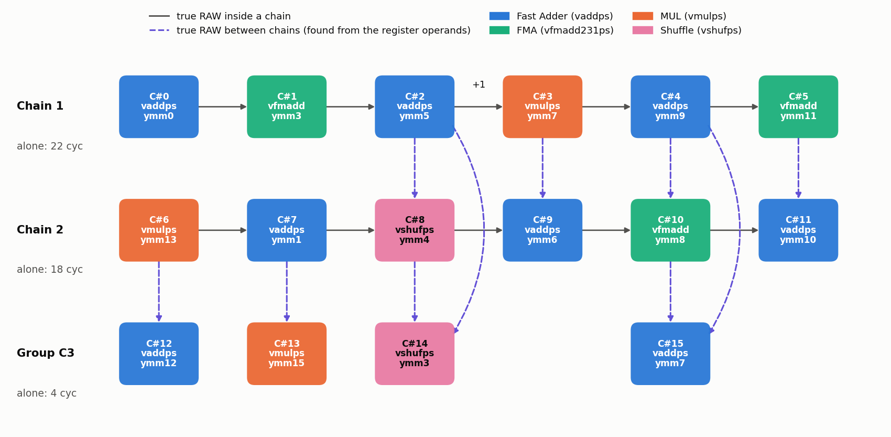
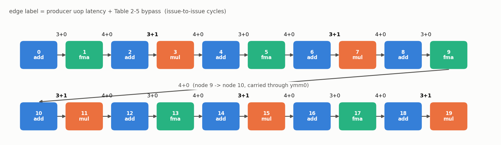
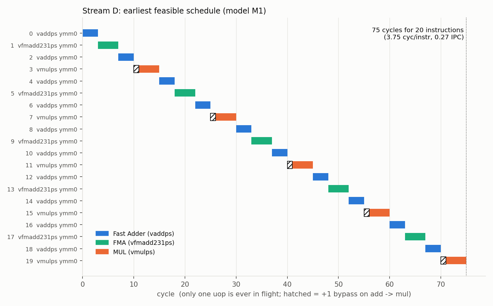
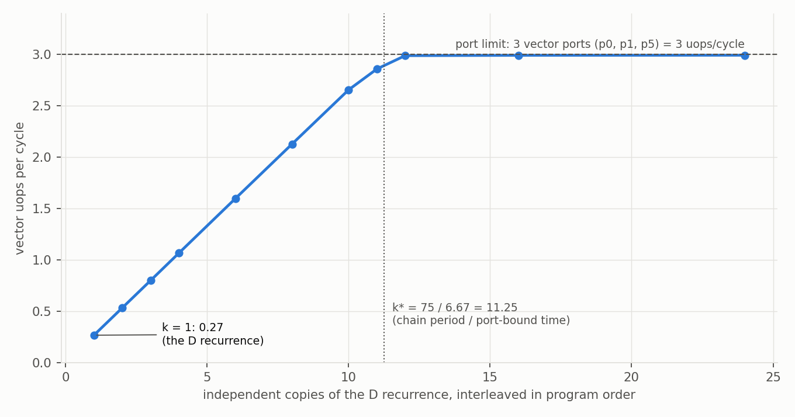

## 1. Aim, Method and What Counts as Evidence

**Question.** If an execution unit can produce results at a certain rate, what decides whether dependent
instructions can *consume* those results fast enough to sustain that rate?

**Method.** This is an analytical experiment. No hardware counters were read (the machine used for this report is not a
Golden Cove core). Every number comes from one of three sources, and the report keeps them apart:

| Tag | Source | Used for |
|------|-------------------------------------------------|---------------------------|
| **[T2-5]** | Intel Optimization Reference Manual Vol. 1, rev. 050, Table 2-5 (page 2-14), checked against the rendered page | bypass delays |
| **[ILT]** | Intel *Golden Cove Instruction Throughput and Latency* (350392-002, `tpt_lat-glc-client.json/.csv`) | unit, ports, uop latency, "Latency" column |
| **[model]** | `src/exp10.py`: dependences read from the register operands, earliest-issue schedules, a greedy port scheduler | schedules, recurrence bound, independent-chain curve |

Anything that is neither documented nor derived from those is listed as an *assumption* in Section 9.
All results are regenerated by `python3 src/exp10.py && python3 src/make_plots.py`; raw tables are in `results/`.

## 2. Producer-Consumer Result Delivery

A *producer* writes a register; a *consumer* reads it. The consumer's earliest issue time is not "when the producer's
unit is free" but "when the value can reach the consumer's input". Intel's Table 2-5 gives, for a producer class (row)
and a consumer class (column), a **bypass delay in cycles**; a row/column label is a triplet `unit/ports/latency`.

**Table 2-5 as printed (Golden Cove, rev. 050)**

\begingroup\footnotesize

| FROM \\ TO | SIMD/0,1/1 | FMA/0,1/4 | MUL/0,1/4 | Fast Adder/1,5/3 | SIMD/5/1,3 | SHUF/1,5/1,3 | V2I/0/3 |
|--------------------|:-----:|:-----:|:-----:|:-----:|:-----:|:-----:|:-----:|
| SIMD/0,1/1 | 0 | 1 | 1 | 1 | 0 | 0 | 0 |
| **FMA/0,1/4** | 1 | **0** | 1 | **0** | 0 | 0 | 0 |
| **MUL/0,1/4** | 1 | **0** | **1** | **0** | 0 | 0 | 0 |
| **Fast Adder/0,1/3** | 1 | **0** | **1** | **-1** | 0 | **0** | 0 |
| SIMD/5/1,3 | 0 | 1 | 1 | 1 | 0 | 0 | 0 |
| **SHUF/1,5/1,3** | 0 | 0 | **1** | **0** | 0 | 0 | 0 |
| V2I/0/3 | 0 | 0 | 1 | 0 | 0 | 0 | 0 |
| I2V/5/1 | 0 | 1 | 1 | 0 | 0 | 0 | 0 |

\endgroup

Bold = the rows/columns the four streams touch. The manual prints the Fast Adder *row* as `0,1` but its *column* as
`1,5`; [ILT] gives ports 1,5 for `vaddps ymm`, so I treat both as the same Fast Adder unit (a typo in the row label).

**Mapping of the instructions used** (from [ILT] `duops`, cross-read with Table 2-4 of the manual):

| Instruction (ymm, reg-reg) | Table 2-5 class | Ports | uop latency | [ILT] "Latency" |
|---|---|:-:|:-:|:-:|
| `vaddps` | Fast Adder | 1, 5 | 3 | **2** |
| `vmulps` | MUL | 0, 1 | 4 | 4 |
| `vfmadd231ps` | FMA | 0, 1 | 4 | 4 |
| `vshufps` (imm, in-lane) | SHUF (1-cycle case) | 1, 5 | 1 | 1 |

Two things in this table matter for everything below.

1. **Latency and bypass are different quantities.** The row label carries the *unit's* latency; the matrix carries the
   *extra* (or, for Fast Adder to Fast Adder, *negative*) delay on that particular hand-off.
2. **`vaddps` has two latencies in Intel's own data.** The uop latency is 3 (Table 2-5 label), but [ILT] reports 2.
   The manual says "back-to-back ADD/SUB operations, both executed on the Fast Adder unit, perform the operations in two
   cycles", which is exactly 3 + (-1) from the Fast Adder to Fast Adder cell. The 2 is therefore the
   add-feeds-add figure (the [ILT] file does not state its measurement method; this reading is an inference). It must not
   be used for an add that feeds a multiply, FMA or shuffle, and the bypass entry must not be added on top of it.

**Timing convention used (model M1, primary).** For a true dependence P -> C,

> earliest issue of C = issue of P + (uop latency of P) + (Table 2-5 bypass, P-class to C-class)

The manual defines this additivity explicitly only for the Fast Adder pair (3 + (-1) = 2); I extend it to every cell
(assumption A1, Section 9). Three alternative models are reported for sensitivity: **M2** latency only (ignore Table
2-5), **M3** [ILT] "Latency" column only, **M4** [ILT] latency + bypass (counts the Fast Adder discount twice; shown only
as the wrong way to do it).

## 3. Annotated Streams

Each instruction is tagged `class [ports, uop latency]` and, for every consumed register, its producer and the
Table 2-5 entry. `FMA` also *reads its destination* (`vfmadd231ps d, a, b` computes `a*b + d`); initial values are
"in".

**Stream A** (one chain, 9 true dependences)

```
A#0 vaddps ymm0, ymm1, ymm2        ; FA  [1,5; 3]  in
A#1 vfmadd231ps ymm3, ymm0, ymm4   ; FMA [0,1; 4]  ymm0<-A#0   FA->FMA   0
A#2 vaddps ymm5, ymm3, ymm6        ; FA  [1,5; 3]  ymm3<-A#1   FMA->FA   0
A#3 vmulps ymm7, ymm5, ymm8        ; MUL [0,1; 4]  ymm5<-A#2   FA->MUL  +1
A#4 vaddps ymm9, ymm7, ymm10       ; FA  [1,5; 3]  ymm7<-A#3   MUL->FA   0
A#5 vshufps ymm11, ymm9, ymm12, 0x4E ; SHUF [1,5; 1] ymm9<-A#4  FA->SHUF  0
A#6 vmulps ymm13, ymm11, ymm14     ; MUL [0,1; 4]  ymm11<-A#5  SHUF->MUL +1
A#7 vaddps ymm15, ymm13, ymm1      ; FA  [1,5; 3]  ymm13<-A#6  MUL->FA   0
A#8 vfmadd231ps ymm2, ymm15, ymm4  ; FMA [0,1; 4]  ymm15<-A#7  FA->FMA   0
A#9 vaddps ymm6, ymm2, ymm8        ; FA  [1,5; 3]  ymm2<-A#8   FMA->FA   0
```

**Stream B** (one chain, 9 true dependences)

```
B#0 vshufps ymm0, ymm1, ymm2, 0x4E ; SHUF [1,5; 1] in
B#1 vmulps ymm3, ymm0, ymm4        ; MUL [0,1; 4]  ymm0<-B#0   SHUF->MUL +1
B#2 vfmadd231ps ymm5, ymm3, ymm6   ; FMA [0,1; 4]  ymm3<-B#1   MUL->FMA   0
B#3 vaddps ymm7, ymm5, ymm8        ; FA  [1,5; 3]  ymm5<-B#2   FMA->FA    0
B#4 vshufps ymm9, ymm7, ymm10, 0xB1 ; SHUF [1,5; 1] ymm7<-B#3  FA->SHUF   0
B#5 vaddps ymm11, ymm9, ymm12      ; FA  [1,5; 3]  ymm9<-B#4   SHUF->FA   0
B#6 vmulps ymm13, ymm11, ymm14     ; MUL [0,1; 4]  ymm11<-B#5  FA->MUL   +1
B#7 vfmadd231ps ymm15, ymm13, ymm1 ; FMA [0,1; 4]  ymm13<-B#6  MUL->FMA   0
B#8 vaddps ymm2, ymm15, ymm4       ; FA  [1,5; 3]  ymm15<-B#7  FMA->FA    0
B#9 vshufps ymm6, ymm2, ymm8, 0x1B ; SHUF [1,5; 1] ymm2<-B#8   FA->SHUF   0
```

**Stream C** and **Stream D** are annotated in Sections 6 and 7, where their dependence structure is the subject.
In A, B and C a register that is *overwritten* after an earlier read (e.g. `ymm2` in A#8 after A#0 read it) is a
name (WAR) dependence, not a data dependence; renaming removes it (A and B: 2 WAR each; C: 10 WAR + 2 WAW).

## 4. Task 1 and 2: Dependency Identification and Timing Table

All 18 true dependences of A and B (**Task 2 asks for at least eight**). "Issue-to-issue" = latency + bypass (M1).
Lat. = producer uop latency, Byp. = Table 2-5 bypass, Total = Lat. + Byp.; add = `vaddps`, mul = `vmulps`,
fma = `vfmadd231ps`, shuf = `vshufps`. The four rows with a non-zero bypass entry are marked `*`.

\begingroup\footnotesize

| # | Producer -> Consumer | Reg | Producer class | Consumer class | Lat. | Byp. | Total | Timing interpretation |
|---|--------------------|-----|---------|---------|:--:|:--:|:--:|------------------------------|
| A1 | A#0 add -> A#1 fma | ymm0 | Fast Adder | FMA | 3 | 0 | 3 | no extra delay; consumer waits the 3-cycle uop latency |
| A2 | A#1 fma -> A#2 add | ymm3 | FMA | Fast Adder | 4 | 0 | 4 | latency only |
| A3* | A#2 add -> A#3 mul | ymm5 | Fast Adder | MUL | 3 | **+1** | 4 | one cycle *later* than the add's own latency |
| A4 | A#3 mul -> A#4 add | ymm7 | MUL | Fast Adder | 4 | 0 | 4 | latency only |
| A5 | A#4 add -> A#5 shuf | ymm9 | Fast Adder | SHUF | 3 | 0 | 3 | latency only |
| A6* | A#5 shuf -> A#6 mul | ymm11 | SHUF | MUL | 1 | **+1** | 2 | 1-cycle shuffle, 2 cycles to its consumer: delay doubles |
| A7 | A#6 mul -> A#7 add | ymm13 | MUL | Fast Adder | 4 | 0 | 4 | latency only |
| A8 | A#7 add -> A#8 fma | ymm15 | Fast Adder | FMA | 3 | 0 | 3 | latency only |
| A9 | A#8 fma -> A#9 add | ymm2 | FMA | Fast Adder | 4 | 0 | 4 | latency only |
| B1* | B#0 shuf -> B#1 mul | ymm0 | SHUF | MUL | 1 | **+1** | 2 | as A6 |
| B2 | B#1 mul -> B#2 fma | ymm3 | MUL | FMA | 4 | 0 | 4 | latency only |
| B3 | B#2 fma -> B#3 add | ymm5 | FMA | Fast Adder | 4 | 0 | 4 | latency only |
| B4 | B#3 add -> B#4 shuf | ymm7 | Fast Adder | SHUF | 3 | 0 | 3 | latency only |
| B5 | B#4 shuf -> B#5 add | ymm9 | SHUF | Fast Adder | 1 | 0 | 1 | shuffle result usable after its 1 cycle |
| B6* | B#5 add -> B#6 mul | ymm11 | Fast Adder | MUL | 3 | **+1** | 4 | as A3 |
| B7 | B#6 mul -> B#7 fma | ymm13 | MUL | FMA | 4 | 0 | 4 | latency only |
| B8 | B#7 fma -> B#8 add | ymm15 | FMA | Fast Adder | 4 | 0 | 4 | latency only |
| B9 | B#8 add -> B#9 shuf | ymm2 | Fast Adder | SHUF | 3 | 0 | 3 | latency only |

\endgroup

Full machine-readable version: `results/timing_table_AB.csv`.

**Zero versus non-zero.** Of 18 dependences, **14 have bypass 0** and **4 have +1**; none has -1, because neither
stream feeds a `vaddps` directly into another `vaddps`. Distinct (producer, consumer) class pairs: 8 (FA->FMA, FMA->FA,
FA->MUL, MUL->FA, FA->SHUF, SHUF->MUL in A; MUL->FMA and SHUF->FA added by B).

**Why the value belongs to a pair, not to an instruction.** `vaddps` is the producer in A3 (+1, into `vmulps`), A1 (0,
into FMA), A5 (0, into a shuffle), and would be -1 into another `vaddps`: *one* instruction, three different values, from
the same Table row. `vmulps` as a *consumer* is the mirror image: it is +1 from the Fast Adder (A3, B6) and from SHUF
(A6, B1). And because `vaddps` produces its result after 3 cycles to an FMA but after 2 to another `vaddps`, even the
producer's "latency" is pair-dependent. A single generic value would be wrong on every edge: a 0 mis-times the 4 edges that are +1, and a +1 mis-times the 14 that are 0.
The zero entries also must not be misread: bypass 0 for FA->FMA does *not* mean the add has zero latency; the consumer
still waits the full 3-cycle uop latency.

## 5. Task 3: Comparing Streams A and B

{width=88%}

| | Stream A | Stream B |
|---|:-:|:-:|
| instructions / true dependences | 10 / 9 | 10 / 9 |
| dependences with bypass +1 / 0 / minus 1 | 2 / 7 / 0 | 2 / 7 / 0 |
| sum of bypass delays | 2 | 2 |
| `vaddps` count (3-cycle producers) / `vshufps` count (1-cycle) | 4 / 1 | 3 / 3 |
| **last result ready (M1)** | **34 cycles** | **30 cycles** |
| M2 (no bypass) / M3 ([ILT] latency only) | 32 / 27 | 28 / 25 |
| dependent-chain IPC (M1) | 0.29 | 0.33 |

**Transitions unique to each stream.** A only: FA->FMA (0), MUL->FA (0). B only: MUL->FMA (0), SHUF->FA (0). Common: FA->MUL
(+1), FA->SHUF (0), FMA->FA (0), SHUF->MUL (+1).

**Transitions whose documented entries differ (needed: at least two).**

* **SHUF->MUL (+1) versus SHUF->FA (0).** Same producer, same 1-cycle latency, different consumer: 2 cycles versus
  1 cycle to the consumer. B#4->B#5 can issue the very next cycle, B#0->B#1 cannot.
* **FA->MUL (+1) versus FA->FMA (0) / FA->SHUF (0).** After a 3-cycle add, a multiply starts at +4, an FMA or shuffle at +3.
* **FA->FA (-1) versus FA->MUL (+1).** Not both present in these streams, but both on the same row of Table 2-5: an add
  feeding an add is ready after 2 cycles, an add feeding a multiply after 4 (a 2-cycle spread from one producer).

**Implication.** A and B are equal in the quantity a naive count would use (instructions, dependences, even the bypass
total of 2). The 4-cycle difference comes from *which* uops sit on the chain (A has four 3-cycle adds and one shuffle; B has
three adds and three 1-cycle shuffles) plus where the +1 lands. M3 shows how much a table of instruction latencies
misleads: it predicts 27 for A, but the add-to-non-add hand-offs actually pay 3, not the 2 that the [ILT] "Latency" column
lists for `vaddps`, so the real chain is 7 cycles (26 %) longer. The bypass entries themselves are a small part (2 of 34
cycles in A); the larger error is using the wrong latency for a pair.

## 6. Task 4: Stream C, Independent Work Next to a Dependency Chain

Dependences are **read from the register operands**, not assumed from the "Chain 1 / Chain 2 / C3" comments.

{width=92%}

**Result: the three groups are not independent as written.** Besides 5 + 5 true dependences *inside* Chain 1 and Chain 2,
the registers create **10 cross-group true dependences**:

| Consumer | reads | produced by |
|---|---|---|
| C#8 `vshufps ymm4,ymm1,ymm5` | ymm5 | C#2 (Chain 1) |
| C#9 `vaddps ymm6,ymm4,ymm7` | ymm7 | C#3 (Chain 1) |
| C#10 `vfmadd231ps ymm8,ymm6,ymm9` | ymm9 | C#4 (Chain 1) |
| C#11 `vaddps ymm10,ymm8,ymm11` | ymm11 | C#5 (Chain 1) |
| C#12 `vaddps ymm12,ymm13,ymm14` | ymm13 | C#6 (Chain 2) |
| C#13 `vmulps ymm15,ymm1,ymm2` | ymm1 | C#7 (Chain 2) |
| C#14 `vshufps ymm3,ymm4,ymm5` | ymm4, ymm5 | C#8 (Chain 2), C#2 (Chain 1) |
| C#15 `vaddps ymm7,ymm8,ymm9` | ymm8, ymm9 | C#10 (Chain 2), C#4 (Chain 1) |

**Independent of Chain 1's data dependency** (no path from any C1 instruction): **C#6, C#7** (the first two of Chain 2) and
**C#12, C#13** (the first two of C3, which hang off Chain 2). Everything else in Chain 2 and C3 transitively depends on Chain 1.
The "independent operations" of C3 are independent of *each other*, not of the chains: they consume results of both.

**How independent work overlaps with a delayed dependency.** Each chain alone has critical path (model M1): Chain 1
**22** cycles, Chain 2 **18**, C3 **4**; run one after another that would be 44. Executed together, the as-written
schedule finishes at **cycle 25**: C#6 and C#7 issue at cycles 0 and 4, inside Chain 1's own waiting time; the Chain 2
instructions that need Chain 1 values start the moment those arrive (C#8 at cycle 10: C#2 issues at 7, has a 3-cycle latency
and the FA->SHUF bypass is 0); and the joins C#11 and C#15 start at 22, when C#5 and C#10 deliver, then add their own 3 cycles.
Chain 1's own latency (22) is untouched; the overlap hides 19 of the 44 standalone cycles behind it. The cross-chain
edges also show the lesson in the other direction: the critical path is 25, not 22, *because* a dependent consumer
(C#11) hangs off the end of Chain 1.

**Data-dependency restriction versus resource restriction.**

* *Data dependency:* C#8 cannot issue before cycle 10 whatever ports exist, because ymm5 is not available until then
  (C#2 issues at 7; 7 + 3 + 0 = 10). No extra port would change that.
* *Resource:* in a counterfactual where the cross-group registers were all distinct (only for isolating this effect; edges inside
  groups kept), six uops are data-ready in cycle 0: C#0, C#6, C#12, C#13, C#14, C#15. Only three vector ports (0, 1, 5)
  exist, so three issue at cycle 0 and **C#13, C#14, C#15 slip to cycle 1** purely for lack of a port (`stream_C_deps.csv`,
  column `portsched_intendedIndependent`). The as-written schedule has no port conflicts (port-constrained and unconstrained
  schedules are both 25 cycles): there the *data dependences*, not the ports, set the length.

**What additional evidence is needed before saying a schedule is feasible on Golden Cove.** My port scheduler assumes: ideal
register renaming (the 10 WAR and 2 WAW name dependences vanish), one uop per port per cycle, oldest-first selection with a
fixed preferred port, an unbounded scheduler, an ideal front end, and Table 2-5 applying to both source operands. To
claim feasibility one would need (i) the real port-binding policy (several of these uops can go to two ports),
(ii) scheduler and reservation-station capacity and allocation width (6 uops/cycle per the [ILT] README), (iii) physical-register availability, (iv) the wake-up/select timing that decides *when* a bypass becomes usable,
and (v) a measurement (per-port uop counters and a dependent-chain latency test of these exact pairs) to confirm that the table
entries apply as modelled.

\newpage

## 7. Task 5: Stream D, the Repeated Dependency

Stream D is one chain through `ymm0`: instruction *k* consumes the result of *k*-1 (the FMA through its accumulator operand,
`ymm0 = a*b + ymm0`). It is five repetitions of the four-instruction group
`vaddps -> vfmadd231ps -> vaddps -> vmulps`. Per group:

| Pair | Class pair | uop lat. | Bypass | Issue-to-issue |
|---|---|:-:|:-:|:-:|
| `vaddps` -> `vfmadd231ps` | FA -> FMA | 3 | 0 | 3 |
| `vfmadd231ps` -> `vaddps` | FMA -> FA | 4 | 0 | 4 |
| `vaddps` -> `vmulps` | FA -> MUL | 3 | **+1** | 4 |
| `vmulps` -> `vaddps` | MUL -> FA | 4 | 0 | 4 |
| **group total** | | | | **15** |

{width=92%}

**Earliest feasible schedule (M1).** The first instruction issues at 0; instruction *k* issues at the running sum of the
edge delays. The 20th (`vmulps`, node 19) issues at cycle **71** and its result is ready at **75**. If the 20-instruction
sequence repeats, the `vmulps` result feeds the next copy's first `vaddps` (MUL->FA, 4+0), so the **recurrence period is 75
cycles per 20 instructions** (3.75 cycles/instruction, **at most 0.267 instructions per cycle**).

{width=78%}

**Sensitivity to the timing model** (period per 20 instructions; `results/summary.txt`):

| Model | Period | Comment |
|---|:-:|---|
| **M1** uop latency + Table 2-5 bypass | **75** | primary; 5 x (3+4+4+4) = 75 |
| M2 uop latency only | 70 | misses the five +1 delays |
| M3 [ILT] "Latency" column | 60 | *wrong for this stream*: uses vaddps = 2, valid only for add -> add; D never has an add feed an add |
| M4 [ILT] + bypass | 65 | mixes conventions; do not use |

So the bound is **75 under the stated assumptions**; models built from the table's own unit latencies give 70-75
(70 if the +1 entries are not additive), and M3's 60 depends on applying `vaddps` = 2 to hand-offs where it does not
hold. The +1 bypass is 5 of 75 cycles (7 %); the larger share is the producers' own latencies.

**Why independent-operation throughput cannot be applied.** [ILT] lists reciprocal throughput 0.5 cycle for each of
`vaddps`, `vmulps`, `vfmadd231ps`. That number says how often an *independent* instruction of that type can *start*;
it says nothing about when the *next dependent* one may start. With this mix (10 adds on ports 1/5, 10 multiply/FMA on ports
0/1) the three vector ports bound independent execution at 20/3 = 6.7 cycles per 20 uops, **about 3 uops per cycle**
(the scheduler model reaches 2.99). The recurrence allows **0.27**. The same 20 instructions take 75 cycles
dependent versus about 7 independent: an **11x** gap, and during the 75 cycles exactly one uop is ever in flight on
three ports that could each start one per cycle.

{width=70%}

**Independent work raises throughput, not the chain's latency.** With k interleaved copies the model gives 0.27 uops/cycle
at k=1, 1.07 at k=4, 2.13 at k=8, 2.86 at k=11 and 2.99 at k>=12 (`results/ipc_vs_chains.csv`). The break point matches
Little's law, k* = 75 / 6.67 = 11.25. Every copy still takes 75 cycles per iteration. Caveat: this assumes an unbounded
scheduler and enough registers (x86 has 16 `ymm` registers, which limits real k); it is a bound, not a prediction for Golden Cove.

## 8. Task 6: Architectural Implications

**1. Can an execution unit be available while a consumer cannot use a required result?** Yes. In Stream D the add in node 2 issues at
cycle 7 and its result exists at cycle 10. At cycle 10 nothing else is in flight, so the multiply's ports 0 and 1 are free, yet
node 3 cannot issue before cycle 11, because FA->MUL is +1 on top of the 3-cycle latency. A free unit is necessary,
not sufficient: the operand must also have been produced *and delivered*.

**2. Why can two sequences with similar instruction counts show different dependency timing?** A and B both have 10
instructions, 9 dependences and bypass total 2, yet finish at 34 and 30 cycles, because the class of every producer on
the chain (3-cycle add versus 1-cycle shuffle) and every producer-consumer pair differ. Even D's four instruction types
cost 3, 4, 4 or 4 depending on the successor.

**3. How can independent work improve useful throughput without reducing the dependency's latency?** The chain of D needs 75
cycles whatever else runs. Stream C finishes three pieces of work (44 cycles standalone) in 25, and 11-12 interleaved
copies of D keep the vector ports ~100 % busy; none of that makes any single chain faster.

**4. What the table establishes about Golden Cove, and what it does not.** *Establishes:* for 8 producer classes and 7
consumer classes of micro-ops, a documented per-hand-off bypass delay of -1, 0 or +1 cycle, and the statement that
Fast Adder pairs run back-to-back in two cycles. *Does not establish:* a result-delivery *bandwidth* (how many values
can be forwarded per cycle, how many bypass paths exist), the physical forwarding network, any
rule for classes outside the table (loads, integer ALU, 512-bit, divides), whether operand position matters
(the FMA accumulator versus a multiplicand), or the additive convention for cells other than FA->FA. The table is a
latency relation, not a throughput limit.

**5. Why "delayed consumer" does not mean "result waiting in a dedicated queue".** The table gives a *time* at which a consumer may
start; it does not say where the value is stored while it waits. A value is in a physical register and/or on a bypass
path, and the delay can equally come from when the consumer is woken up and selected. Inferring a dedicated result queue
would be an assumption that none of the evidence used here supports.

## 9. Assumptions, Ambiguities and Exact References

| # | Assumption / ambiguity | Basis | Effect if wrong |
|---|---|---|---|
| A1 | Issue-to-issue delay = uop latency + Table 2-5 bypass for *every* cell | explicit in the manual only for FA->FA (3-1=2) | D: 75 -> 70 if bypass is not additive |
| A2 | `vaddps ymm` runs on the **Fast Adder**, not the FMA-unit adder (Table 2-4 lists `(v)add*` under both) | manual: "(V)ADDPS ... executed by the Fast Adder"; [ILT] ports 1,5 | it would be an FMA-class uop (latency 4, other bypass entries) |
| A3 | `vshufps ymm, imm` is the 1-cycle in-lane SHUF case, not the 3-cycle cross-lane | [ILT] latency 1 | B/A lengthen by 2 per shuffle |
| A4 | Table 2-5's Fast Adder row ports `0,1` is a typo for `1,5` | [ILT] ports | none (same cell used) |
| A5 | FMA accumulator operand uses the same delivery path as the multiplicands | not documented | D could be shorter if the addend path is faster |
| A6 | Ideal renaming, unbounded scheduler, ideal front end, 1 uop/port/cycle, fixed port preference | modelling choice | schedules in Sections 6-7 are bounds |
| A7 | [ILT] latency 2 for `vaddps` is an add-feeds-add figure | matches 3+(-1) | if it applied to all consumers, M3 (A 27, B 25, D 60) would be the right model |

**Exact references used.** Intel, *64 and IA-32 Architectures Optimization Reference Manual Vol. 1*, rev. 050
(248966-050US): Section 2.4 Golden Cove, **Table 2-3** (dispatch ports), **Table 2-4** (execution units), **Table 2-5**
(bypass delay between producer and consumer micro-ops, page 2-14) and the Fast Adder paragraph that follows it. Intel,
*Processors Based on Golden Cove Microarchitecture: Instruction Throughput and Latency* (350392-002), `tpt_lat-glc-client.json`
for `VADDPS/VMULPS/VFMADD231PS/VSHUFPS` (ymm, reg-reg) and its README for the throughput/latency definitions.

## 10. Conclusion

An execution unit *producing* a result and a dependent instruction being able to *consume* it are two separate events,
and Golden Cove's own documentation prices the gap between them per producer-consumer pair: -1, 0 or +1 cycle on top
of the producer's latency. In Streams A and B the same 10-instruction, 9-dependence shape costs 34 versus 30 cycles, with
a bypass total of 2 in both, so the distinction between instruction *count* and dependency *timing* is already visible
at ten instructions. In Stream D the whole sequence is one recurrence through `ymm0`: 15 cycles per four-instruction
group, **75 cycles per twenty instructions under the stated model (0.27 IPC)**, with the add-to-multiply +1 accounting
for 5 of those cycles and the producers' own latencies for the rest. The same twenty uops, independent, would run at roughly 3
per cycle on the three vector ports, an eleven-fold difference that no amount of execution-unit capacity can close, since
one uop is in flight at a time. Independent work is what closes it: in Stream C overlap compresses 44 standalone cycles
into 25, and the model needs about eleven interleaved copies of D (75 / 6.7) to saturate the ports, while every copy keeps
its own 75-cycle latency. Stream C also shows why dependences must be read from the registers: its "independent" chains
share ten true dependences, which makes its critical path 25 rather than 22. Execution capacity says how many
operations *could* start per cycle; the producer-consumer pairs along the recurrence say how many *may*. Effective
throughput is the smaller of the two, and for D the second one wins by an order of magnitude.

*Limits of this report.* Everything is derived from documentation and a model, with no measurement on silicon; the
additive reading of Table 2-5 (A1) and the FMA accumulator path (A5) are the assumptions that would most change D's 75.
