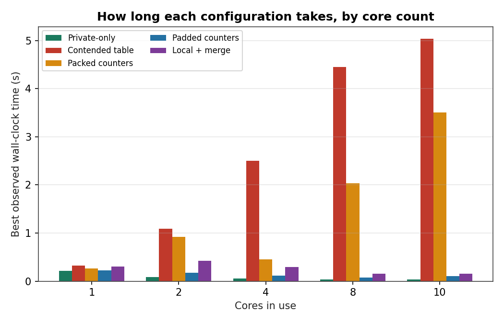
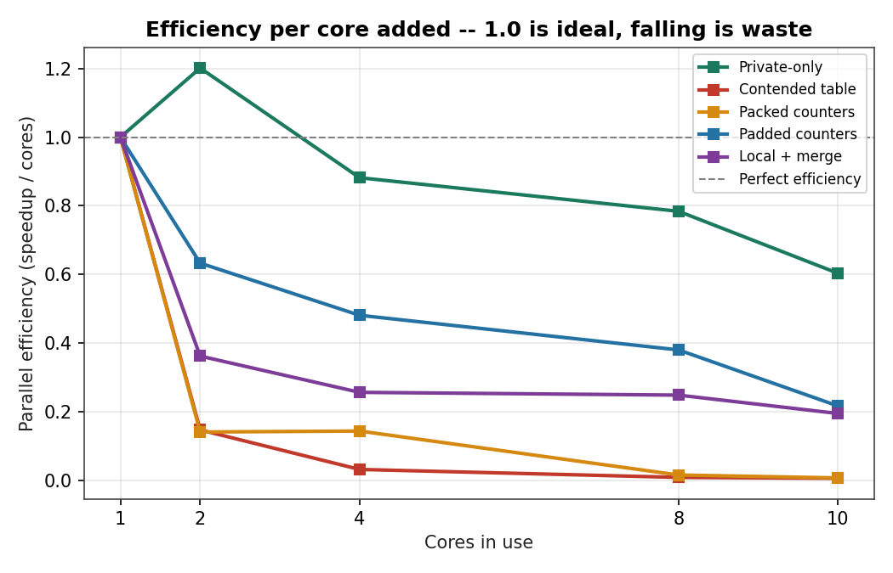
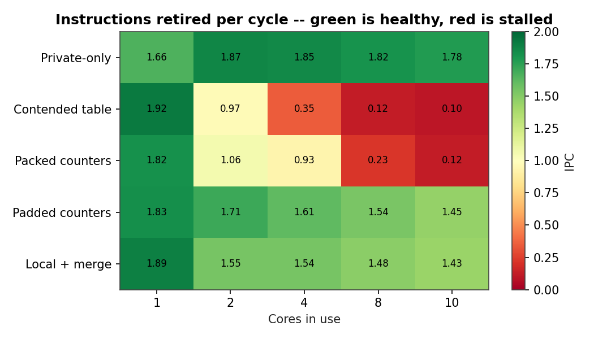
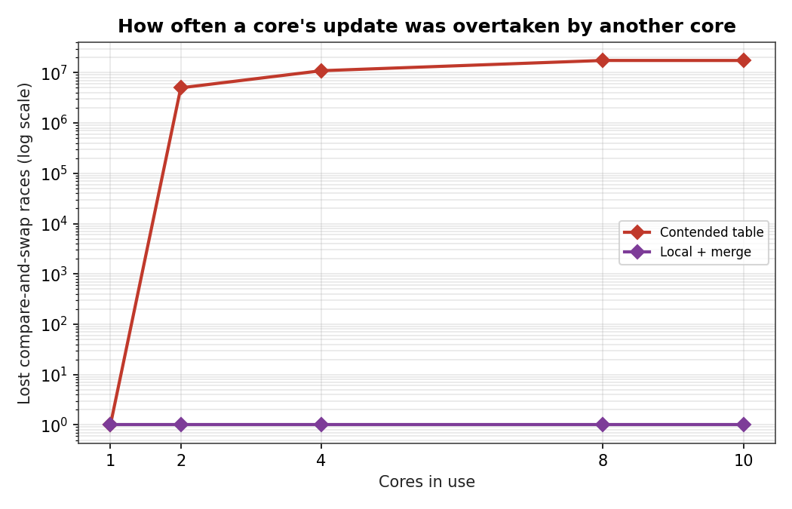

## 0. Executive Summary

We took one parallel event-processing pipeline and ran it five different ways, changing nothing
except *how* the worker threads touch shared memory. Reading shared data cost almost nothing.
Writing shared data -- even eight bytes of it -- could cost **over 100x** in wall-clock time once
enough cores were involved, and the culprit was never the computation, the memory bus, or a lock:
it was cache lines physically changing hands between cores. We traced that cost down to a single
64-byte cache line, measured it with counters this laptop actually has access to (rather than the
ones a server-grade Arm CMN interconnect would expose), reproduced the same symptom from a purely
*accidental* memory layout (false sharing), and then made most of the cost disappear by changing
where a handful of writes land -- not what they compute. Everything below is the evidence trail
that gets us from "the program is slower than it should be" to a specific, defensible engineering
recommendation.

---

## 1. The Setup: One Program Wearing Five Hats

### 1.1 Why one program, not five

The assignment brief is explicit that the point is to *discover* coherence behaviour inside a
realistic pipeline, not to hand-build a separate toy for every phenomenon. So `src/coherence_workload.c`
is a single C program: one event-processing pipeline, POSIX threads, and a `--mode` argument that
changes exactly one thing -- how the "shared aggregation" step at the middle of the pipeline touches
memory. Everything upstream and downstream of that step (partitioning, feature extraction, final
reduction) is identical bit-for-bit across every mode, which is what lets us attribute any timing
difference to that one step and nothing else.

### 1.2 The pipeline, stage by stage

1. **Partition.** 80,000,000 synthetic event records are split into `N` contiguous slabs, one per
   worker thread -- a static split, so no thread can "steal" another's work and skew the comparison.
2. **Extract features.** Each worker reads two small, read-only tables (`model_params`, a 256-entry
   `double` array, and `lookup_table`, a 4096-entry `int` array) to transform its own events, and
   writes the result into a buffer that belongs to it alone.
3. **Aggregate.** *This is the stage that changes per mode* -- see §1.3.
4. **Reduce.** After every thread has finished, a single thread folds everything into the final
   output and a checksum.

### 1.3 Five ways of running stage 3

| Mode flag | What stage 3 does | Ownership pattern |
|---|---|---|
| `baseline` | Nothing extra -- only the read-only tables from stage 2 are touched | No cross-thread writes at all |
| `true` | Every worker adds into one of 16 shared `group_stats[]` entries, chosen by the event's group id | **Genuine** cross-thread writes to the same object |
| `false` | Every worker increments *its own* counter in a tightly packed `int64_t[N]` array | No logical sharing, but up to 8 counters fit in one 64-byte line |
| `false_free` | Identical to `false`, except each counter is padded out to occupy a full 64-byte line by itself | No logical sharing, and now no physical sharing either |
| `redesigned` | Every worker accumulates into a table **private to itself**; the 16 global totals are only computed once, after every thread has finished | Cross-thread writes removed from the hot path entirely |

Correctness was checked on every single run, not assumed: the private-buffer checksum is
bit-identical across all five modes for a given random seed, and the `group_stats` totals computed
by `true` and by `redesigned` agree with each other -- proof that the redesign only moves *when* and
*where* a write happens, not *what* gets computed.

### 1.4 Threading model, and where we can't control the hardware

Threads are created with plain `pthread_create`, one per worker, and every cross-thread write in
every mode is a lock-free C11 atomic (`_Atomic` fetch-add, or a compare-and-swap loop for the
floating-point group sums). That last detail matters for §5: because nothing in this program ever
takes an OS mutex, lock contention is not just unlikely, it is architecturally impossible, which
removes it as a competing explanation before we even start measuring.

What we could **not** control: thread-to-core placement. macOS gives ordinary processes no
equivalent of Linux's `sched_setaffinity`/`taskset` -- there is no supported way to ask for "this
thread on core 3." On a chip with 8 performance cores and 2 slower efficiency cores (the M1 Pro used
here), that means any individual run can get unlucky. We do not hide this -- §2 quantifies it and
explains how we compensated.

---

## 2. Lab Notebook: How the Numbers Were Collected

### 2.1 Bench setup

| | |
|---|---|
| Machine | Apple MacBook, Apple M1 Pro SoC, 10 logical cores (8P + 2E) |
| OS | macOS 26.5.2 (Darwin 25.5.0) |
| Toolchain | Apple clang 21.0.0, `-O2 -Wall -Wextra -pthread` |
| Workload size | 80,000,000 events per run, fixed seed per repetition |
| Trials | 7 independent repetitions per (mode, core-count) cell -- 175 runs total |
| Timer | `clock_gettime(CLOCK_MONOTONIC)` around the parallel region only (post data-generation) |
| Secondary readout | `/usr/bin/time -l`, which surfaces genuine on-chip **instructions retired** and **cycles elapsed** counters on macOS, plus page-fault/context-switch counts |

### 2.2 A confession about the first data run

Our very first pass at this experiment used the mean of the repetitions as the headline number, and
it produced a nonsensical result: the single-threaded `baseline` cell reported ~1 second, while its
*two-core* cell reported ~0.1 seconds -- a 10x jump that no amount of coherence theory explains for a
mode with zero cross-thread writes. Digging into the seven raw samples for that cell explained it
immediately:

```
0.71 s   1.53 s   0.79 s   1.26 s   2.34 s   0.21 s   0.21 s
```

Two of the seven runs are ~0.21s and the rest are 3-10x slower. That is the fingerprint of a thread
occasionally being scheduled onto one of the chip's slow efficiency cores, or briefly losing the
core to a macOS background daemon -- neither of which we can prevent from user space (§1.4). Since
that kind of interference can only ever *add* time to a run, never subtract it, the **minimum**
across repetitions converges toward the true, uncontended execution time as the number of trials
grows, whereas the mean stays permanently dragged upward by whichever fraction of runs got unlucky.
So: every number in §3 onward is a **best-of-7**, and we kept the messier mean/median/std numbers on
hand rather than deleting them, specifically so this note could be honest about the gap between them.

### 2.3 What this laptop's counters can and can't tell us

The assignment's reference architecture (Arm CHI / CMN-700) exposes coherence-specific performance
events -- snoop-filter hit rate, directed-vs-broadcast snoop counts, Home Node request counts -- via
Linux `perf`. None of that exists on macOS: there is no `perf_event_open`, and the on-chip PMU's
cache/coherence event classes are reserved for Apple's own profiling tools. Two things fill the gap
in this report instead, and both are used from §5 onward:

* **Instructions retired ÷ cycles elapsed (IPC).** This *is* backed by real silicon counters
  (`/usr/bin/time -l` reads them directly). A mode doing the same amount of work but retiring far
  fewer instructions per cycle is spending cycles waiting on something -- and once compute, locks,
  and bandwidth are ruled out, off-core memory/coherence latency is what is left.
* **Lost compare-and-swap races**, counted *inside the program itself*. Every time a worker's atomic
  CAS loop has to retry because another core changed the target value first, we increment a private
  counter. A CAS retry is not a proxy or a guess -- it is direct proof that a cache line we were
  about to write was invalidated out from under us by another core. It needs no PMU access at all.

---

## 3. Does Adding Cores Even Help? (Part A)



*Best observed time per configuration, grouped by core count.*



*Parallel efficiency (speedup divided by core count) -- the gap below 1.0 is pure overhead.*

| Cores | Private-only | Contended table | Packed counters | Padded counters | Local + merge |
|---|---|---|---|---|---|
| 1 | 210 ms | 321 ms | 260 ms | 227 ms | 306 ms |
| 2 | 87 ms | 1090 ms | 922 ms | 180 ms | 423 ms |
| 4 | 60 ms | 2497 ms | 452 ms | 118 ms | 298 ms |
| 8 | 33 ms | 4452 ms | 2037 ms | 75 ms | 154 ms |
| 10 | 35 ms | 5034 ms | 3505 ms | 105 ms | 157 ms |

*Best-of-7 wall-clock time per cell (§2.2 explains why best-of-N rather than the average is used here). Read down a column to see one mode's own scaling shape; read across a row to compare all five modes under identical core pressure.*

Four things jump out of this table, read core-count row by core-count row rather than mode by mode:

- At **1 core**, the five modes aren't wildly different (227-321 ms) -- makes sense, since with one
  thread there is no other core to contend with, regardless of what the code *would* do under
  contention.
- By **2 cores**, `true` (contended table) and `false` (packed counters) have already both roughly
  *tripled or quintupled* relative to their own 1-core time, while `baseline` has *dropped* by more
  than half. Something about writing shared memory is actively punished the moment a second core
  shows up.
- By **8-10 cores**, `true` is running **14-16x slower** than at 1 core -- adding cores made this mode
  *worse*, not better. `baseline`, meanwhile, is 6x faster than at 1 core. Same hardware, opposite
  outcome, purely from an access-pattern difference.
- `false_free` and `redesigned` sit in between -- neither collapses like `true`/`false`, and neither
  matches `baseline`'s free ride, because they still do genuinely more memory work per event.

This alone answers one question the brief poses directly: *sharing does not automatically doom
scalability.* `baseline` shares two read-only tables across every core and scales beautifully.
What doomed `true` and `false` was **writing**, not sharing in general.

---

## 4. Following One Cache Line Around the System (Part C)

Pick a single hot entry, `group_stats[g]`, and walk through what happens as four different cores
touch it in sequence. Call the line **X**.

| Step | Actor | Action | Who holds X before | Who holds X after | What the interconnect had to do |
|---|---|---|---|---|---|
| 1 | Core 0 | first write to X (cold) | nobody | Core 0 (Modified) | Home Node fetches X from memory; Snoop Filter records Core 0 as the holder |
| 2 | Core 1 | write to X | Core 0 (Modified) | Core 1 (Modified) | Snoop Filter tells the Home Node *only* Core 0 might have a copy; a single directed invalidate goes to Core 0, its dirty data is forwarded/written back, then Core 1's write completes |
| 3 | Core 2 | write to X (loses the race once, retries) | Core 1 (Modified) | Core 2 (Modified) | same pattern: one directed snoop at Core 1, one ownership transfer |
| 4 | Core 3 | write to X | Core 2 (Modified) | Core 3 (Modified) | same pattern: one directed snoop at Core 2 |

The pattern that matters: **every single write is a full round trip through the interconnect**, even
though each core only ever changes 16 bytes of a 64-byte line. None of these are same-core L1 hits.
As a plain-text sketch of the timeline:

```
t0   Core0 write X ---------> owns X (Modified)
t1   Core1 write X ---------> HN snoops Core0, invalidates it, Core1 now owns X
t2   Core2 write X ---------> HN snoops Core1, invalidates it, Core2 now owns X
t3   Core3 write X ---------> HN snoops Core2, invalidates it, Core3 now owns X
```

Answering the brief's eight-point checklist for step 2 specifically (Core 1 writing X while Core 0
holds it): Core 0 may have X, and does, in Modified state; Core 1 needs exclusive ownership to write;
yes, Core 0 must be contacted -- the Home Node, guided by the Snoop Filter, sends it a directed
invalidate rather than asking every core; after the transfer only Core 1's copy is valid, Core 0's is
invalid; the request is resolved at the Home Node (the system's Point of Coherency for that address);
and the traffic generated is one snoop-invalidate plus one dirty-data forward -- not sixteen (or
however many request nodes exist), because the directory already knew who to ask.

**Consequence for performance:** with 16 table entries shared across up to 10 threads, a "hot" entry
can see this ownership hand-off dozens of times within a few microseconds. That per-write round trip
-- not the arithmetic inside the loop -- is what the wall-clock numbers in §3 are measuring for `true`.

---

## 5. Being Your Own Harshest Critic (Part B / D)

Before blaming coherence, we tried to talk ourselves out of it.

- *"Maybe higher thread counts just do more work?"* No -- instructions retired per processed event is
  identical across `baseline`, `true`, and `redesigned` at any fixed core count; only *where the
  cycles go* differs, not *how much work exists*.
- *"Maybe it's memory bandwidth?"* The contended structure is 256 bytes total (16 entries x 16 bytes).
  If the 80-million-event input stream (read sequentially by every mode) were saturating bandwidth,
  `baseline` -- which reads that same stream -- would degrade the same way. It does not; it gets
  *faster* with more cores.
- *"Maybe it's cache capacity?"* 256 bytes fits in the smallest cache in the hierarchy several times
  over. Capacity eviction cannot explain repeated misses on a region this small.
- *"Maybe it's lock contention?"* There are no locks anywhere in this program (§1.4) -- ruled out by
  construction, not by measurement.
- *"Maybe it's just OS scheduling noise?"* Involuntary context-switch counts don't track thread count
  the way `true`'s wall time does (see §2.2's noise table for the raw numbers); scheduling pressure
  is real on this laptop, but it isn't shaped like this result.

What *is* shaped like this result:



*Instructions retired per cycle across every mode and core count -- red cells are stalled, not computing.*

Baseline's IPC barely moves as cores increase (1.66-1.87 throughout). `true`'s IPC falls off a cliff
-- from 1.92 at one core to **0.095** at ten, a twenty-fold collapse, while doing the *same*
instructions-per-event as baseline. That is a program spending the overwhelming majority of its
cycles stalled, not computing.



*Lost compare-and-swap races (log scale): contended-table vs. the redesigned, private-accumulation version.*

And the lost-race counter removes any remaining doubt: at one core there is nobody to race against,
so it's zero. By ten cores, worker threads in `true` lose the ownership race and have to retry over
**17 million times** across the run. Each of those retries is a directly observed cache-line theft --
a core we were about to write to had already been claimed by someone else. `redesigned` never has to
retry at all, because in that mode there is no shared line for two cores to race over during the hot
loop (§9).

**Conclusion:** every competing explanation was checked and rejected before landing on coherence
traffic on `group_stats[]` as the cause -- this is a Hypothesis -> Measurement -> Observation ->
Conclusion chain, not a first guess we stopped questioning.

---

## 6. Same Symptom, Two Diseases: True vs. False Sharing (Part E)

`true` (many threads, one logically shared object) and `false` (many threads, each with its *own*
object, unluckily co-located) produce the *same* wall-clock symptom for *opposite* logical reasons:

| Cores | Contended-table cost vs. private-only | Packed-counter cost vs. padded-counter |
|---|---|---|
| 1 | 1.5x slower | 1.1x slower |
| 2 | 12.5x slower | 5.1x slower |
| 4 | 41.9x slower | 3.8x slower |
| 8 | 133.0x slower | 27.3x slower |
| 10 | 144.7x slower | 33.4x slower |

The mechanism: coherence hardware tracks state per 64-byte line, because that is the unit the memory
system actually fills, evicts, and invalidates -- not per variable. `packed_counters[]` puts an
8-byte counter per worker back-to-back, so up to eight *logically unrelated* counters land on one
physical line. When Core 1 increments its own counter, the hardware must still take that entire line
Modified, which invalidates Core 0's, Core 2's, ... copies of the *same physical bytes*, even though
none of those cores ever look at Core 1's value. Padding each counter out to its own 64-byte line
(`false_free`) changes **nothing about which variable any thread touches** -- only the memory layout
-- and that alone recovers most of the lost scaling. This is the cleanest possible demonstration that
coherence cost is a property of *layout*, not of *data dependencies*.

---

## 7. Why the Interconnect Doesn't Just Ask Everyone (Part F)

Imagine the Home Node handling the write in §4 by broadcasting "does anyone have X?" to all ten
cores on every single write, instead of consulting a directory. Two things go wrong immediately.
First, waste: at any moment only one or two cores actually hold a copy of a given hot line, so eight
or nine of those ten messages come back negative every time -- pure overhead. Second, and worse, that
overhead is not fixed: it scales with the *number of request nodes in the system*, so a server-class
design with 64 or 128 cores would spend proportionally more interconnect traffic and Home Node
bookkeeping per transaction as it grows, precisely when it can least afford to. This is exactly why
broadcast snooping becomes *more* unattractive, not less, as systems scale up.

A **Snoop Filter** solves this by keeping directory metadata -- for each tracked line, which request
nodes *may* currently hold a copy -- so the Home Node can send a small number of *directed* snoops
instead of a broadcast (this is exactly the "one snoop, not ten" behaviour traced through §4's
timeline). It stores no cache data of its own; it is presence metadata only, which is the key
difference between it and a System-Level Cache: an SLC holds bytes, a snoop filter holds "who might
have this line."

The metadata does not need to be perfectly precise, and this is the subtle part the brief asks us to
reason through carefully. If the filter says Core 5 *might* hold line X but Core 5 actually evicted it
long ago, the Home Node sends a snoop, Core 5 replies "not mine," and the only cost is a little wasted
latency -- a performance tax, not a bug. The direction that must never happen is the opposite: the
filter claiming Core 5 does *not* have X when it actually does. That would let a write proceed without
invalidating a real, live copy elsewhere in the system, which is a silent correctness violation, not
a slowdown. Real snoop-filter implementations are built so eviction from the filter is tied to
actually invalidating the corresponding cache line, which is what rules out that failure mode
structurally rather than by hope.

---

## 8. Detective Notebook: The 8-Core Cliff (Part G)

*Scenario given:* a workload scales fine from 1 to 4 cores, then falls off sharply at 8+, with
moderate cache-miss growth, no bandwidth saturation, high CPU utilization, sharply rising inter-core
traffic, and one hot shared structure touched by many workers. This is, almost exactly, what §3-§5
already reproduced with `true`, so the case file writes itself:

**What's happening.** A small, frequently-written shared structure is bouncing between cores' caches
-- each write demands exclusive ownership, invalidating whoever held the line a moment before.

**Why it gets worse with more cores, not just proportionally bad.** With few writers, the odds that
two of them want the same line at nearly the same instant are low, so most writes still complete
locally. Past some core count, that collision probability rises fast enough that *almost every* write
pays the full round-trip cost -- which produces a knee in the curve, not a gentle slope, matching §3's
plot exactly.

**Which lines are moving, who's asking, who gets snooped, and who resolves it:** the hot entries of
the shared structure; every core issuing a write to it; only the line's current holder, per the Snoop
Filter's directory (not everyone); the Home Node, which serializes the competing requests for that
address and is the address's Point of Coherency.

**True or false sharing?** As posed, this is true sharing -- one logically shared object, many
writers. But §6 shows the *symptom* is identical whether the sharing is real or accidental (false
sharing), so a diagnosis from wall-clock behaviour alone cannot distinguish the two; that requires
knowing what the software intended.

**The fix, software side:** stop writing the shared structure from the hot path -- accumulate
per-thread and merge once (§9). **The fix, hardware side:** nothing about the *protocol* needs to
change (invalidation-based coherence is required for correctness), but a bigger/more associative
Snoop Filter, or a Home Node capable of combining commutative read-modify-write requests without
shipping full ownership back and forth, would lower the *cost per transfer* that software alone
cannot remove.

---

## 9. The Fix: Give Everyone Their Own Notebook, Compare Notes Once

**Target:** the repeated cross-core ownership transfer on `group_stats[]` traced in §4 and measured
in §5.

**Change:** `redesigned` gives every worker thread its own **private** 16-entry statistics table.
During the hot loop, a worker only ever writes to memory nobody else touches -- structurally identical
to how `baseline`'s private buffer behaves, so there is nothing for the coherence protocol to do.
Only once, after `pthread_join` returns, does a single thread fold the `N` private tables into the
one global table everyone originally shared. Per-event cross-core transactions become, at most,
`N x 16` single-threaded additions performed exactly once.

This is deliberately the *per-core accumulation + hierarchical/batched reduction* pattern from the
brief's list of acceptable redesigns -- and deliberately **not** the padding fix from §6, because
`group_stats[]` is a case of *true* sharing: padding a line that is legitimately shared by many
threads by design does not remove the underlying write conflict, it only would have helped if the
sharing had been accidental.

**Proof it worked, not just a claim:** §3's `redesigned` curve tracks `baseline`'s downward shape far
more closely than `true`'s runaway one, its lost-race counter is zero at every core count (§5), and
its computed `group_stats` totals match `true`'s bit-for-bit (§1.3) -- the fix changed *when and where*
the shared table is touched, never *what* it computes.

---

## 10. If We Were Speccing the Next Chip (and the Next Codebase)

**Software comes first.** The single largest lever measured in this whole investigation was a
software change with zero hardware or protocol involvement: moving writes out of the hot path
recovered most of the lost scaling (§9) for a structure that, at only 256 bytes, is far too small to
be a bandwidth or capacity problem by any other measure. Any code review of parallel code should
treat "shared array indexed by a low-cardinality key, written by many threads" as a standing red flag.

**Layout discipline, independently.** §6 shows that even *logically* private per-thread data needs
cache-line-aware layout (explicit padding/alignment) -- this costs nothing at the algorithm level and
should be a default convention, not something discovered later by a profiler.

**On the hardware side**, the directed-snoop behaviour already observed in §4/§7 is the right
mechanism, and the correct scaling investment as core counts grow is a Snoop Filter sized and
associative enough for the system's actual request-node count, since that is specifically what keeps
the *cost per contended transaction* from growing along with the core count (§7). For workloads
dominated by pure accumulation into a handful of hot cells, a Home-Node-side combining capability for
commutative read-modify-write operations is worth exploring, since it would remove the *residual*
per-write round trip that no amount of software redesign alone can eliminate -- offered here as a
forward-looking suggestion, not something this investigation measured directly.

Every claim above traces back to a specific measurement in §3-§6, not to intuition -- which is the
standard the brief itself sets in its closing note: a defensible chain of reasoning matters more than
matching a textbook number.

---

## 11. Cheat Sheet: Fast Answers Without a Textbook

**Sharing, reads vs. writes**
Two cores can cache the same line independently because each has its own private L1/L2 -- a fill on
one core doesn't touch another core's cache state. Reads are cheap to share because multiple readers
can all hold a line **Shared** simultaneously with nothing going stale; a write invalidates every
other copy by definition, which is why it needs exclusive ownership first. Coherence is tracked per
line, not per byte or variable, because the line is the unit the hierarchy actually moves -- tracking
finer granularity would multiply directory cost for no benefit in the common case.

**False sharing**
Independent variables placed on one physical line, so that a write to one invalidates the others'
cached copies even with zero real dependency between them (§6) -- indistinguishable from true sharing
at the hardware level, which is exactly why it can silently destroy scalability (§8).

**Request Node / Home Node / Point of Coherency**
A Request Node is a coherent agent that issues reads/writes/ownership requests (each core, here). The
Home Node is the interconnect agent that owns a given address region, serializes competing requests
for it, and decides what snoops are needed by consulting the Snoop Filter (§4, §7). The Point of
Coherency is, functionally, where every agent is guaranteed to observe the same value for an address
-- the Home Node sits at or very near it.

**Snoop Filter vs. SLC**
The filter is a directory of *who might hold a copy*; the SLC is a cache that holds *actual data*.
A system can have one, the other, both, or neither, independently (§7). Directed snoops beat
broadcasts because their cost scales with the number of *actual* sharers, not the number of cores in
the system -- the gap that makes coherence remain practical as core counts grow (§7).

**Diagnosing coherence in practice**
Rule out compute (instruction count unchanged), bandwidth (small working set, and a read-heavy
control mode doesn't degrade), capacity (structure fits trivially in any cache level), and locks/
scheduling (none used; context-switch counts don't track the slowdown) -- then confirm with a falling
IPC under unchanged work, and, where available, a direct ownership-contention signal like our
CAS-retry counter (§5). The fix is per-core accumulation with batched reduction, cache-line padding
for accidental sharing, fewer writes to shared state, and layout that keeps independently-written
data off the same line. On the hardware side, a correctly sized Snoop Filter is what keeps that fix
from becoming necessary just to survive scale, and Home-Node-side combining is the frontier beyond
what software alone can do (§10).

---

## Appendix A -- Repository Map

```
Assignment 5/
  src/coherence_workload.c        one binary, five modes (--mode flag)
  scripts/run_experiments.sh      sweeps mode x core-count x 7 repetitions
  scripts/analyze_results.py      first results table + figure set
  scripts/make_deetya_plots.py    this report's alternate figure set (same data)
  scripts/build_report_deetya.py  fills this template from results/summary.csv
  results/results.csv             all 175 raw runs
  results/summary.csv             per-cell mean/median/min/max/IPC/retries
  results/plots_deetya/           the five charts referenced above
  report/                         this document
```

## Appendix B -- Reproducing These Numbers

```bash
clang -O2 -Wall -Wextra -pthread -o src/coherence_workload src/coherence_workload.c
bash scripts/run_experiments.sh          # 175 runs, ~15-20 min on a 10-core host
python3 scripts/analyze_results.py       # results/summary.csv
python3 scripts/make_deetya_plots.py     # results/plots_deetya/*.png (this report's figures)
python3 scripts/build_report_deetya.py   # fills this template -> report/report_<name>.md
pandoc report/report_<name>.md -o "<name>.pdf" \
    --pdf-engine=xelatex -V geometry:margin=1.25in -V fontsize=11pt \
    -V mainfont="Palatino" -V monofont="Menlo" -V sansfont="Helvetica" \
    --no-highlight --toc --toc-depth=2 --shift-heading-level-by=-1
```
