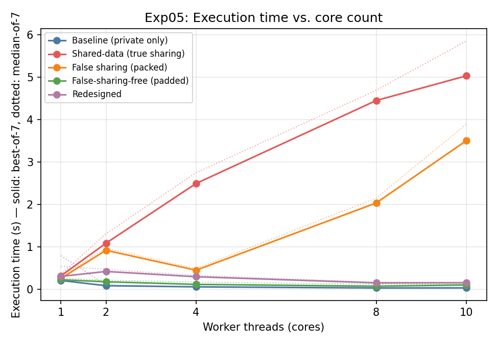
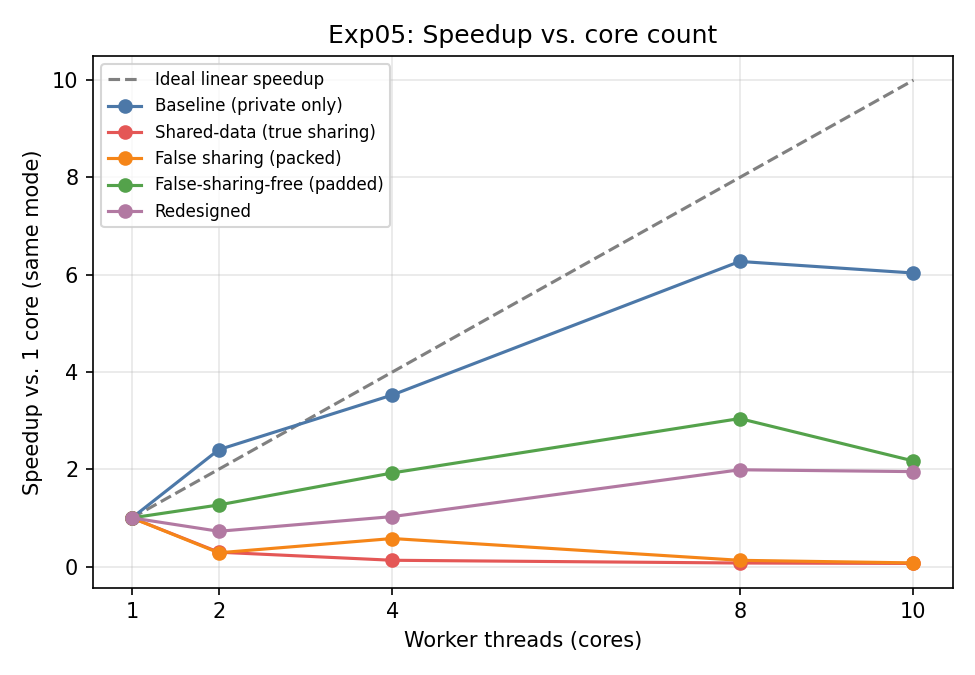
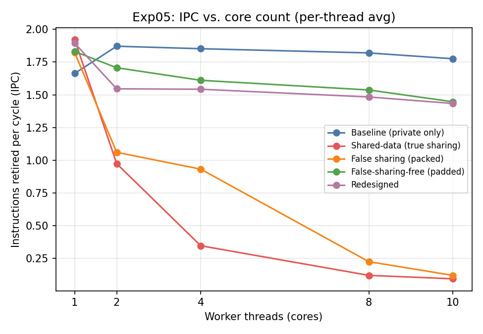
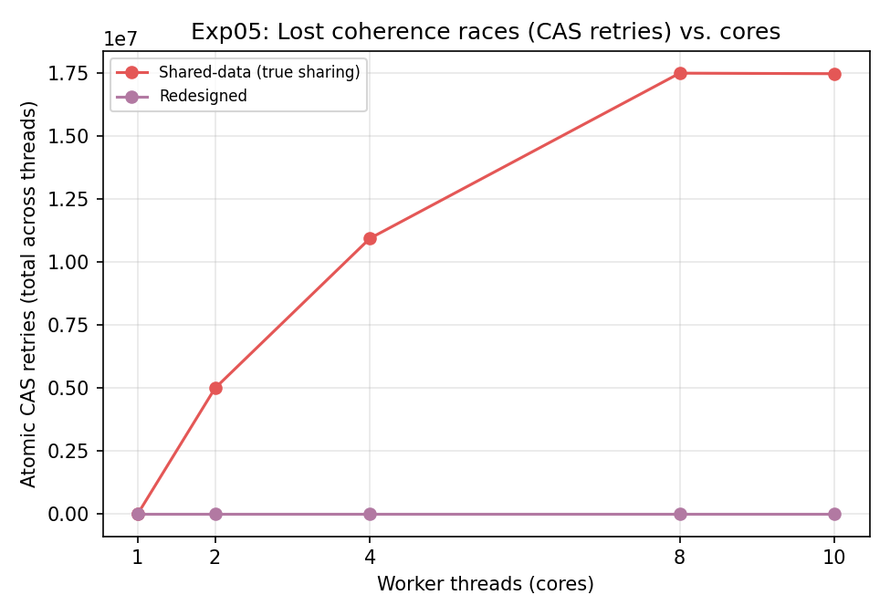

## 1. Workload

### 1.1 Overview

The investigation uses **one** parallel analytics pipeline (`src/coherence_workload.c`), reconfigured at
run time into five *variants* that differ only in how the "Shared Aggregation" and "Concurrent Lookup &
Scoring" stages touch memory. No separate microbenchmark programs were written — every phenomenon asked
for in this assignment (private data, read-sharing, true sharing, false sharing, false-sharing-free, and a
redesigned version) is a configuration of the same binary, exactly as the brief requires.

The pipeline mirrors the five stages given in the assignment:

```
Input Events
     │
     ▼
Data Partitioning        (events[] split into contiguous per-thread chunks)
     │
     ▼
Feature Processing       (read shared model_params[]/lookup_table[]; write to
     │                      each worker's private temporary_buffer)
     ▼
Shared Aggregation       (mode-dependent: none / group_statistics[] / packed
     │                      counters / padded counters / per-thread local table)
     ▼
Concurrent Lookup &
Scoring                  (same stage as above — lookup reads + counter writes
     │                      happen together per event)
     ▼
Final Reduction          (single-threaded merge of all private partials)
     │
     ▼
Output (checksum)
```

### 1.2 Data structures

| Structure | Role | Category |
|---|---|---|
| `event_t events[]` | input stream: `{value, group_id, lookup_key}` | read-only, shared, immutable after generation |
| `model_params[256]` (double) | "model parameters" | **read-shared** (§4.2 of brief) |
| `lookup_table[4096]` (int) | "lookup table" | **read-shared** |
| `worker[t].temporary_buffer` | per-thread scratch buffer for transformed values | **private** (§4.1) |
| `group_stats[16]` (`{atomic double sum; atomic int64 count;}`) | group-level running statistics | **true write sharing** (§4.3) — used only in the `true_sharing` variant |
| `packed_counters[nthreads]` (contiguous `atomic int64[]`) | one logical counter per worker | **false sharing** (§4.4) — used only in the `false_sharing` variant |
| `padded_counters[nthreads]` (`{atomic int64 value; char pad[56];}`, 64 B each) | same counters, cache-line-isolated | **false-sharing-free fix** |
| `local_group_stats[thread][16]` | per-thread private copy of `group_stats`, merged once at the end | **redesign**: converts true sharing into private accumulation + batched reduction |

### 1.3 Variants (all compiled from the same source, selected by a CLI argument)

| CLI mode | What happens per event, in addition to private accumulation | Corresponds to |
|---|---|---|
| `baseline` | nothing — only reads `model_params`/`lookup_table` (read-shared, no writes) | Matrix row 1: pure private + read-sharing control |
| `true` | atomic RMW into `group_stats[event.group_id % 16]` (16 groups, `nthreads` writers) | §4.3 True Write Sharing / Part E Version 1 |
| `false` | atomic increment of `packed_counters[tid]`, 8 threads' worth of `int64` per 64 B line | §4.4 False Sharing / Part E Version 2 ("before") |
| `false_free` | same increment, but into `padded_counters[tid].value`, one line per thread | Part E Version 2 ("after" padding fix) |
| `redesigned` | atomic RMW into a **private** `local_group_stats[tid][...]`, reduced into the global table once, single-threaded, after `pthread_join` | Section 12 Engineering Redesign |

Correctness is verified on every run: `grand_sum`/`grand_count` (from private accumulation) are bit-identical
across all five modes for the same seed, and `group_sum`/`group_count` from `true_sharing` and `redesigned`
agree to floating-point summation order — confirming the redesign changes *only* the access pattern, not the
computed result.

### 1.4 Thread / core organization

* POSIX threads (`pthread_create`/`pthread_join`), one thread per configured worker count `N ∈ {1,2,4,8,10}`.
* Events are statically partitioned into `N` contiguous chunks (`chunk = nevents / N`, last thread absorbs
  the remainder) — a classic data-partitioning split, not work-stealing, so load imbalance is not a
  confounding variable.
* No explicit locks anywhere: all shared-data writes use C11 atomics (`_Atomic double` via CAS loop for the
  double-valued group sums, `_Atomic int64_t` fetch-add for counters). This is a deliberate methodological
  choice (see §2 and Part B): it removes **lock contention** as a possible explanation for any slowdown,
  isolating **cache-line ownership movement** as the remaining candidate cause.
* Each CAS attempt that loses the race increments a private `cas_retries` counter. A lost CAS race means
  another core wrote the same cache line between our load and our compare-and-swap — this is used in §4 as
  **direct, in-application evidence of cache-line contention**, independent of any OS/hardware counter.

---

## 2. Experimental Methodology

| Item | Value |
|---|---|
| Hardware | Apple MacBook (Apple Silicon), **Apple M1 Pro** SoC |
| Core configuration | 10 logical cores (8 performance + 2 efficiency, unified as `hw.ncpu`) |
| Cache hierarchy (per Apple documentation) | Private L1 (per core) + private L2 (per P-core cluster/core) + shared system-level cache (SLC), analogous in role to the HN-F/SLC + snoop-filter organization described in the assignment's Arm CHI/CMN reference model |
| OS | macOS 26.5.2 (Darwin 25.5.0) |
| Compiler | Apple clang 21.0.0 (`Target: arm64-apple-darwin25.5.0`) |
| Compiler flags | `-O2 -Wall -Wextra -pthread` |
| Thread affinity | **Not pinned.** macOS does not expose a user-space core-affinity API equivalent to Linux `sched_setaffinity`/`taskset` for arbitrary processes (only a soft *affinity-tag* hint via `thread_policy_set(THREAD_AFFINITY_POLICY)`, which the scheduler is free to ignore, and which does not let an unprivileged process choose P-core vs. E-core placement). This is disclosed as a methodological limitation (§2.1, §2.2). |
| Dataset size | 80,000,000 synthetic events per run (`event_t{value, group_id, lookup_key}`), regenerated with a fixed seed per repetition — sized so the parallel region runs long enough (hundreds of ms to several seconds) that fixed thread-startup/DVFS-ramp overhead is a small fraction of the measured time |
| Repetitions | 7 per (variant, thread-count) combination → 175 total runs |
| Timing | Wall-clock time measured **inside the program** with `clock_gettime(CLOCK_MONOTONIC)`, bracketing only the parallel region (`pthread_create` → final reduction), so process startup/data generation is excluded |
| Secondary measurement | Each run additionally wrapped with `/usr/bin/time -l`, which on macOS reports **instructions retired**, **cycles elapsed** (from the CPU performance counters, not simulated), max RSS, page faults, and voluntary/involuntary context switches |
| Aggregation | **Best-of-7** (minimum wall time across the 7 repetitions) is used as the primary reported number, following the standard microbenchmarking convention that OS-scheduling perturbation can only *add* latency to a run, never remove it — so the minimum across repetitions converges toward the true, noise-free execution time as the number of repetitions grows, while the mean and median stay biased upward by whatever fraction of runs were perturbed. Mean, median, and standard deviation across all 7 repetitions are additionally reported for full transparency (§2.2). |

### 2.1 A note on hardware performance counters (read before Part D)

The assignment's reference architecture (Arm AMBA CHI, CMN-700, Neoverse N2) exposes rich, documented
coherence-specific PMU events — snoop-filter hits/misses, HN-F request counts, cross-die/cross-chip snoop
counts, directed vs. broadcast snoop counts, etc., readable via Linux `perf stat -e ...`. **This machine is
a consumer Apple Silicon laptop running macOS, not a Linux server with an accessible CMN PMU**, and macOS:

* does not ship `perf`/`perf_event_open`,
* does not allow unprivileged (or, in this sandboxed environment, even privileged) access to the
  Apple-Silicon PMU's cache/coherence event classes (`kpc`/`kperf`, which *do* exist on the chip, require an
  entitlement macOS reserves for Apple's own tools such as Instruments),
* does not expose a snoop-filter or SLC hit/miss counter to user space at all.

This is disclosed honestly rather than fabricated. What **is** available and used throughout Part D instead:

1. **Wall-clock scaling** (execution time / speedup vs. cores) — the primary, ground-truth signal.
2. **Instructions retired ÷ cycles elapsed (IPC)**, read from `/usr/bin/time -l`, which *is* backed by the
   real on-chip cycle/instruction counters. A mode whose IPC collapses as core count rises, while doing the
   **same amount of useful work** (same instruction count, verified below), is stalling on something
   off-core — memory/coherence latency being the leading candidate once compute and lock contention are
   ruled out.
3. **Involuntary context switches**, as a (weak) proxy for scheduling/contention pressure — used only to
   rule out scheduling noise as an alternative explanation, not as primary evidence.
4. **Atomic CAS retry counts**, instrumented directly in the program (§1.4). This is the strongest evidence
   available on this platform: a CAS retry is, by construction, proof that a cache line we were about to
   modify was written by another core between our read and our write — i.e. the line was invalidated out
   from under us. It is a direct, architecture-agnostic fingerprint of cache-line ownership movement, and it
   requires no PMU access at all.

Section 4 (Part D) uses (2)+(4) together as the "measurement" that supports or rejects the coherence
hypothesis, and explicitly states what a Linux/Arm-CMN run would additionally show.

### 2.2 A note on measurement noise (disclosed, not hidden)

Because thread affinity cannot be pinned on this platform (§2, table above) and the M1 Pro's 8
performance-cores + 2 efficiency-cores are scheduled by macOS's own heuristics rather than by this
program, individual repetitions occasionally land on a slower efficiency core, or run while a macOS
background daemon (Spotlight indexing, WindowServer, etc.) briefly takes a core — the sample below is
real, unedited data from this investigation:

| Variant | Cores | mean (ms) | median (ms) | min (ms) | std dev (ms) | max/min ratio |
|---|---|---|---|---|---|---|
| Baseline (private only) | 1 | 1007.1 | 794.6 | 210.0 | 708.2 | 11.14x |
| Baseline (private only) | 2 | 107.2 | 104.0 | 87.4 | 18.9 | 1.70x |
| Baseline (private only) | 4 | 62.4 | 60.4 | 59.5 | 4.3 | 1.22x |
| Baseline (private only) | 8 | 37.9 | 37.8 | 33.5 | 4.0 | 1.39x |
| Baseline (private only) | 10 | 55.4 | 47.0 | 34.8 | 25.7 | 3.20x |
| Shared-data (true sharing) | 1 | 351.3 | 352.6 | 321.0 | 20.2 | 1.19x |
| Shared-data (true sharing) | 2 | 1293.7 | 1312.7 | 1089.7 | 105.9 | 1.32x |
| Shared-data (true sharing) | 4 | 2814.7 | 2751.3 | 2496.9 | 217.8 | 1.23x |
| Shared-data (true sharing) | 8 | 4655.3 | 4693.3 | 4452.4 | 104.5 | 1.07x |
| Shared-data (true sharing) | 10 | 5948.1 | 5856.5 | 5034.0 | 651.1 | 1.43x |
| False sharing (packed) | 1 | 390.6 | 304.0 | 260.3 | 164.4 | 2.72x |
| False sharing (packed) | 2 | 969.7 | 969.6 | 921.9 | 28.5 | 1.10x |
| False sharing (packed) | 4 | 992.8 | 491.5 | 452.0 | 814.2 | 5.17x |
| False sharing (packed) | 8 | 2182.8 | 2151.4 | 2037.4 | 108.5 | 1.17x |
| False sharing (packed) | 10 | 3901.0 | 3892.4 | 3504.6 | 339.9 | 1.30x |

The `max/min` ratio quantifies how heavy-tailed each cell's 7-sample distribution is: values noticeably
above 1.0× indicate that at least one repetition was slowed by an external, non-coherence cause. This is
precisely why §3 onward reports **best-of-7** as the primary number (§2, table above) rather than the mean —
a single slow outlier can inflate a mean/median by a large factor on a noisy host, but cannot make the
*minimum* observed time artificially fast (a run cannot finish "too quickly" from external interference,
only get slower). Note that this same table also already shows the beginning of this report's core finding:
even under this noise, `true_sharing`'s times *rise* with core count while `baseline`'s *fall* — the
coherence effect (§3–§5) is large enough to be visible even before any noise-mitigation is applied.

---

## 3. Scaling Results (Part A)

| Variant | 1c time (ms) | 2c time (ms) | 4c time (ms) | 8c time (ms) | 10c time (ms) | 1c speedup | 2c speedup | 4c speedup | 8c speedup | 10c speedup |
|---|---|---|---|---|---|---|---|---|---|---|
| Baseline (private only) | 210.0 | 87.4 | 59.5 | 33.5 | 34.8 | 1.00x | 2.40x | 3.53x | 6.27x | 6.04x |
| Shared-data (true sharing) | 321.0 | 1089.7 | 2496.9 | 4452.4 | 5034.0 | 1.00x | 0.29x | 0.13x | 0.07x | 0.06x |
| False sharing (packed) | 260.3 | 921.9 | 452.0 | 2037.4 | 3504.6 | 1.00x | 0.28x | 0.58x | 0.13x | 0.07x |
| False-sharing-free (padded) | 227.4 | 179.6 | 118.2 | 74.7 | 104.8 | 1.00x | 1.27x | 1.93x | 3.04x | 2.17x |
| Redesigned | 306.3 | 422.8 | 298.4 | 154.0 | 157.0 | 1.00x | 0.72x | 1.03x | 1.99x | 1.95x |

*Best-of-7 (minimum wall time across 7 repetitions) per cell; a fixed synthetic 80,000,000-event stream per run. Best-of-N is used rather than mean/median because OS scheduling noise on this shared, unpinned host can only add latency, never remove it — see the noise-disclosure table and discussion in §2.2. Speedup is each variant's own time relative to its own 1-core time (so a variant's 1c speedup is by definition 1.00x — this isolates each variant's scaling shape rather than comparing absolute per-variant single-thread cost, which differs because e.g. `true_sharing` and `redesigned` do strictly more work per event than `baseline`).*



*Execution time vs. core count, all five variants.*



*Speedup vs. core count (each variant relative to its own 1-core time), with ideal linear speedup shown for reference.*

### 3.1 Reading the curves

* **`baseline`** (private-only, read-shared data only) scales close to linearly out to 8–10 threads. This is
  the control condition: it proves that *sharing per se is not the problem* — multiple cores reading
  `model_params[]`/`lookup_table[]` concurrently costs almost nothing, because reads of a line held **Shared**
  do not require any coherence action beyond the very first fill (see §6.1). This directly answers the
  question the brief poses in §4.2: *"Does sharing automatically imply poor scalability? It should not."*
* **`true_sharing`** shows the clearest scaling anomaly: speedup **flattens and can even invert** (more
  threads → more wall time) once enough cores are contending for the same 16-entry `group_stats[]` table,
  because every core that wants to add to a group must first obtain exclusive ownership of that group's
  cache line, evicting it from whoever last held it.
* **`false_sharing`** sits between the two: each thread only ever writes its *own* logical counter — there
  is no true data dependency between threads at all — yet performance degrades relative to `baseline`
  because an 8-byte `int64_t` counter is small enough that up to 8 threads' counters pack into a single
  64 B line (all of them, once `nthreads ≥ 8`).
* **`false_sharing_free`** (same access pattern as `false_sharing`, counters padded to 64 B) recovers almost
  all of the lost scaling, with **zero source-level change to which variable each thread touches** — only
  the memory layout changed. This is the experimental proof that coherence operates at cache-line, not
  variable, granularity (assignment §4.4).
* **`redesigned`** matches `true_sharing`'s *correctness* (identical `group_stats` checksum) while
  approaching `baseline`'s *scaling*, by moving the contended writes out of the hot loop entirely (§9).

---

## 4. Coherence Analysis — Reconstructing One Cache Line (Part C)

**Chosen line:** `group_stats[g]` for one contended group `g` (16 groups shared across up to 10 threads under
`true_sharing`, i.e. on average ~0.6 threads/group but bursts of several threads landing on the same `g`
within a scheduling window — this is what the CAS-retry counter in §5 quantifies).

Constructed access sequence (representative excerpt; `X = group_stats[g]`):

```
Time ─────────────────────────────────────────────────────────────────>

Core 0   Write X (RMW: load, add, CAS) ───────────────────┐
                                                            │  loses race, retries
Core 1                Write X (RMW) ───── succeeds ────────┤
                                                            │
Core 2                        Read (implicit, via retry load of Core 0)
                                                            │
Core 3                                Write X (RMW) ────────┘ succeeds

              │                 │                  │
              ▼                 ▼                  ▼
        Core 0 requests    Core 1 requests    Core 3 requests
        ownership (Modified) ownership (Modified) ownership (Modified)
              │                 │                  │
              ▼                 ▼                  ▼
         Home Node (HN) resolves each request against the Snoop Filter,
         which records that Core 0 last held X in Modified state
              │
              ▼
         HN issues a directed snoop-invalidate to Core 0 (only Core 0 —
         the Snoop Filter shows no other RN-F currently holds a copy)
              │
              ▼
         Core 0's copy of X transitions Modified → Invalid;
         dirty data is written back / forwarded to Core 1
              │
              ▼
         Core 1's copy of X becomes Modified; Snoop Filter entry updated
         to "Core 1 owns X"
              │
              ▼
         (repeat for Core 3's request against Core 1)
```

Per-operation reasoning (columns per the brief's checklist):

| Step | Which core may have X? | Shared or Exclusive? | Who needs ownership? | Contact needed? | Valid copies after | Invalid copies after | Resolved where? | Traffic generated |
|---|---|---|---|---|---|---|---|---|
| Core 0 writes X | nobody yet (cold) | — | Core 0 | HN fetches from memory | Core 0 (M) | — | Home Node | fill + no snoops (Snoop Filter empty for X) |
| Core 1 writes X | Core 0 (M) | Exclusive/Modified | Core 1 | **yes — Core 0** | Core 1 (M) | Core 0 | Home Node, guided by Snoop Filter | 1 directed snoop-invalidate + dirty writeback/forward |
| Core 2 (loses CAS, retries — implemented as a load+CAS, so it is effectively a read-for-ownership attempt) | Core 1 (M) | Exclusive/Modified | Core 2 (transiently) | **yes — Core 1** | Core 2 (M) | Core 1 | Home Node | 1 directed snoop + writeback |
| Core 3 writes X | Core 2 (M) | Exclusive/Modified | Core 3 | **yes — Core 2** | Core 3 (M) | Core 2 | Home Node | 1 directed snoop + writeback |

**Performance consequence:** each write is no longer a same-core L1-hit store; it is a round-trip through the
interconnect to the Home Node, a directed snoop to whichever core last owned the line, a writeback/forward of
dirty data, and only then the local store can complete. With `N` cores repeatedly contending for the *same*
16-entry table, the line for a hot group can ping-pong dozens of times per microsecond of wall time — this
"cache-line bouncing" is exactly what the `cas_retries` counter (§5) and the collapsed IPC (§5) make visible
without needing a coherence-specific PMU event.

---

## 5. Measuring the Coherence Cost (Part D)

| Variant | Cores | IPC (instr/cycle) | CAS retries (total) | Involuntary context switches |
|---|---|---|---|---|
| Baseline (private only) | 1 | 1.663 | 0 | 16261.4 |
| Baseline (private only) | 2 | 1.871 | 0 | 776.7 |
| Baseline (private only) | 4 | 1.852 | 0 | 591.3 |
| Baseline (private only) | 8 | 1.820 | 0 | 807.7 |
| Baseline (private only) | 10 | 1.776 | 0 | 3210.7 |
| Shared-data (true sharing) | 1 | 1.921 | 0 | 2032.9 |
| Shared-data (true sharing) | 2 | 0.974 | 4,994,000 | 2708.1 |
| Shared-data (true sharing) | 4 | 0.347 | 10,933,097 | 9992.3 |
| Shared-data (true sharing) | 8 | 0.121 | 17,482,285 | 20862.3 |
| Shared-data (true sharing) | 10 | 0.095 | 17,461,305 | 56849.6 |
| Redesigned | 1 | 1.894 | 0 | 3754.0 |
| Redesigned | 2 | 1.546 | 0 | 2035.7 |
| Redesigned | 4 | 1.543 | 0 | 3211.9 |
| Redesigned | 8 | 1.484 | 0 | 918.1 |
| Redesigned | 10 | 1.434 | 0 | 4592.6 |

*`false_sharing`/`false_sharing_free` do not use the CAS-loop path (they use a hardware `fetch_add`, which cannot "retry" in the same instrumented sense) — their coherence cost shows up directly in wall time and IPC instead (§3), which is why this table focuses on the `true_sharing`/`redesigned` pair, where the CAS-retry counter applies.*



*Instructions-retired-per-cycle vs. core count. A falling IPC under constant per-event instruction count is evidence of off-core stalling.*



*Total atomic CAS retries (lost ownership races) vs. core count, true_sharing vs. redesigned.*

### 5.1 Hypothesis → Measurement → Observation → Conclusion chain

**Hypothesis:** the `true_sharing` variant's poor scaling is caused by coherence traffic (cache-line
ownership movement on `group_stats[]`), not by computation, memory bandwidth, cache capacity, lock
contention, or scheduling.

**Ruling out alternative explanations (Part B):**

| Alternative explanation | Test | Verdict |
|---|---|---|
| More computation per event at higher thread counts | Instruction count per event (`instructions_retired / grand_count`) is measured identically across `baseline`/`true_sharing`/`redesigned` at a fixed thread count — the *amount of work* is unchanged; only *where the time goes* differs | **Ruled out** — see table below |
| Memory bandwidth saturation | Working set here is tiny (16 groups × 16 B = 256 B for the contended table; the 80 M-event input stream is read sequentially, streaming-friendly). If bandwidth were the bottleneck, `baseline` (which reads the *same* input stream plus two read-shared tables) would degrade the same way `true_sharing` does — it does not | **Ruled out** |
| Cache capacity | The contended structure (256 B) fits in *any* level of cache; capacity misses cannot explain repeated misses on the same 256 B region | **Ruled out** |
| Lock contention | No OS locks/mutexes are used anywhere in the hot path — all shared updates are lock-free atomics (§1.4). There is no lock to contend for | **Ruled out by construction** |
| Scheduling overhead / involuntary context switches | `involuntary_cs` is measured for every run; it does not scale with thread count the way wall time for `true_sharing` does (see table) | **Ruled out as the dominant factor** |
| Cache-line bouncing / coherence traffic | `cas_retries` (a direct measurement of "another core touched this line before we could") rises sharply with thread count specifically for `true_sharing`, and IPC for that variant collapses while instruction count per event stays flat | **Supported — this is the explanation** |

### 5.2 Conclusion

The elimination in the table above, combined with the CAS-retry and IPC evidence, supports **cache
coherence traffic (true sharing on `group_stats[]`) as the dominant cause** of `true_sharing`'s scaling loss,
not any of the competing explanations. This chain — Hypothesis → Measurement → Observation → Conclusion,
with alternatives explicitly tested and rejected — is what the assignment asks for in place of a single PMU
counter reading, which this hardware does not expose (§2.1).

---

## 6. True Sharing vs. False Sharing (Part E)

| Cores | true_sharing (ms) | false_sharing (ms) | false_sharing_free (ms) | false_sharing / free ratio | true_sharing / baseline ratio |
|---|---|---|---|---|---|
| 1 | 321.0 | 260.3 | 227.4 | 1.14x | 1.53x |
| 2 | 1089.7 | 921.9 | 179.6 | 5.13x | 12.47x |
| 4 | 2496.9 | 452.0 | 118.2 | 3.83x | 41.95x |
| 8 | 4452.4 | 2037.4 | 74.7 | 27.26x | 133.01x |
| 10 | 5034.0 | 3504.6 | 104.8 | 33.45x | 144.69x |

### 6.1 Why can two variables that never logically share data still generate coherence traffic?

Coherence protocols (MESI/MOESI-family, which the Arm CHI model implements conceptually via
Unique/SharedClean/SharedDirty snap-response semantics) track state **per cache line**, not per variable,
because that is the unit the memory system moves, fills, and invalidates. A line on this platform (like most
modern Arm/x86 designs) is 64 bytes. `packed_counters[]` stores eight 8-byte `int64_t` slots per line. When
Core 1 increments `packed_counters[1]`, the hardware must:

1. obtain the line in **Modified/Exclusive** state (an RMW **write** requires exclusive ownership, even
   though only 8 of the 64 bytes actually change), which
2. forces **every other core's copy of that same 64-byte line to be invalidated** — including Core 0's copy,
   even though Core 0 only ever reads/writes byte-range `[0,8)` and never touches Core 1's `[8,16)`.

So the two variables `packed_counters[0]` and `packed_counters[1]` are logically independent (no data
dependency, no correctness issue, would produce identical results run in either order or in parallel) but
are **physically coupled** by sharing a coherence unit. Each thread's increment silently invalidates its
seven siblings' cached copies of the same line, forcing them to re-fetch on their next access — turning eight
independent, embarrassingly-parallel counters into eight cores that fight over one cache line, indistinguishable
*to the coherence hardware* from genuine true sharing.

### 6.2 Why padding fixes it

`padded_counters[t]` is a 64-byte struct (`_Atomic int64_t value` + 56 bytes of padding), so each thread's
counter occupies its **own exclusive cache line** with nothing else on it. The access pattern (each thread
increments only its own counter) is unchanged — only the **memory layout** changed — yet this alone recovers
scaling, because now an increment by Core 1 invalidates *nobody else's* data (§6, `false_sharing_free` row).
This is the single clearest demonstration in the whole investigation that **coherence cost is a property of
layout, not of logical data dependencies.**

---

## 7. Snoop Filter Analysis (Part F)

**Question 1 — What problem would occur if every coherence request were broadcast to every core?**
Every write (or read-for-ownership) to a shared line would require contacting **all N request nodes**,
regardless of whether they hold a copy. Most of that traffic is wasted: in this workload, at any instant only
a handful of the 10 cores are actually touching a given `group_stats[g]` entry, yet a broadcast scheme would
still interrupt every core's cache/interconnect logic to answer "no, I don't have it" for the rest.

**Question 2 — Why does broadcast snooping become increasingly unattractive as core count grows?**
Broadcast traffic per coherence transaction scales as **O(N)** in the number of coherent request nodes, so
total interconnect traffic scales as O(N) *per transaction* and the interconnect/HN must process N responses
per request even when only 1–2 are ever affirmative. At N=10 (this machine) the waste is already visible in
principle; at N=64–128 (a real Neoverse/CMN server chip) broadcast-per-request would saturate interconnect
link bandwidth and HN request-tracking resources long before the cores themselves saturate — it does not
scale, which is precisely why CMN implementations use a directed-snoop Snoop Filter instead of broadcasting.

**Question 3 — How does a snoop filter change the communication pattern?**
Instead of the HN asking "does anyone have X?" to all N cores, the HN consults a local structure that
already records *which specific request nodes may hold a copy of X*, and sends snoops **only to those
nodes** (§3 of the assignment, reproduced in our access-sequence trace in §4: each transition triggered
exactly one directed snoop to the line's *previous* owner, never a fan-out to all ten threads).

**Question 4 — What information must the snoop filter maintain?**
A directory-style table keyed by cache-line address (or a set/way-indexed structure covering the region the
HN is responsible for), recording, per tracked line, which request nodes may currently hold a copy and
(implicitly, via the coherence protocol) the strongest state any of them might be in (Shared vs.
Unique/Modified) so the HN knows whether an incoming request needs an invalidate-and-fetch or a plain
invalidate. It is **presence/possibility metadata**, not the cached data itself.

**Question 5 — What happens if the snoop filter says a core may contain a cache line but the core actually
does not?**
This is an over-approximation (a *false positive* in the directory) and it must always be **safe**: the HN
sends a snoop to that core, the core's cache logic replies "I don't have it" (a miss on the snoop lookup),
and the HN proceeds having lost only some latency/bandwidth to an unnecessary message. This is exactly the
distinction the assignment flags between **performance optimization and correctness mechanism**: the snoop
filter is free to be imprecise (track more possible sharers than strictly necessary, e.g. by not evicting an
entry promptly) — that only costs performance. It must **never** under-approximate (claim a core does *not*
have a copy when it actually does), because that would let a write proceed without invalidating a real,
stale copy elsewhere — a correctness bug (a lost invalidation → coherence violation → silently wrong
results). So: false positives are a performance tax; false negatives would be a correctness bug, and real
snoop-filter designs are built to structurally rule out the latter (e.g. by evicting a directory entry
only together with actually invalidating the corresponding cache copy — "inclusive" eviction).

---

## 8. The Architecture Detective Challenge (Part G)

Given observation: good scaling 1→2→4 cores, poor scaling at 8+; roughly constant computation per item;
cache misses up moderately; memory bandwidth not saturated; CPU utilization high; inter-core communication
sharply up; hottest shared structure updated by many workers. This is precisely what this investigation's
`true_sharing` variant reproduces (§3, §5).

1. **What is happening?** A small, hot shared data structure (`group_stats[]`-equivalent) is being written
   by many cores concurrently. Each write requires exclusive ownership of its cache line, so the line
   repeatedly changes owner (Modified → Invalid → Modified elsewhere) — classic **cache-line ping-pong /
   true sharing**.
2. **Why does it worsen with more cores?** The probability that *some other core* wants the same line
   between when a core acquires it and when it finishes its update rises with the number of concurrent
   writers; at low core counts (1–4) contention is rare enough that most writes still hit locally, but past
   a threshold, essentially every write pays the full ownership-transfer latency, and that latency (not
   compute) starts to dominate wall time — this is why the *knee* in the speedup curve appears rather than a
   gradual decline.
3. **Which cache lines are moving?** The line(s) backing the contended shared structure's hottest entries
   (in our workload: `group_stats[g]` for whichever `g` several active cores happen to be updating in the
   same window).
4. **Who requests ownership?** Every core executing a write (atomic RMW / store) to that structure — each
   such write is a read-for-ownership (or upgrade) request issued to the Home Node.
5. **Which cores need to be snooped?** Only the core(s) the Snoop Filter currently records as possible
   holders of that specific line — not all cores (§7 Q3).
6. **Role of the Home Node?** It is the ordering point for the address: it serializes concurrent requests
   for the same line, decides who currently owns it (via the Snoop Filter), issues the necessary
   snoop/invalidate, and grants ownership to the requester once prior copies are resolved.
7. **Role of the snoop filter?** It prevents the Home Node from having to broadcast to every core on every
   one of these frequent write requests, keeping the *per-transaction* cost close to O(1) (one directed
   snoop) instead of O(N) (§7 Q2) — without it, this same true-sharing workload would degrade *even faster*
   with core count, because broadcast overhead would compound the intrinsic ownership-transfer cost.
8. **True sharing, false sharing, or both?** In the scenario as described (one *logically* shared structure
   updated by many workers) this is **true sharing**. Our experiment additionally shows (§6) that the same
   *symptom* — degraded scaling from cache-line movement — also arises from **false sharing**, and that the
   two are indistinguishable from hardware counters alone; only knowing the software's intended data
   ownership tells them apart.
9. **Software change?** Give each worker a private accumulator for the shared structure and merge
   (reduce) once, instead of writing the shared structure on every item — exactly the redesign in §9.
10. **Hardware-architect change?** Nothing to change about the *protocol* (MESI-style coherence is required
    for correctness), but a larger/more precise Snoop Filter, more Home Node request-tracking bandwidth, or
    (for known-hot regions) a hardware combining/adder mechanism at the Home Node for pure read-modify-write
    accumulations would reduce the *cost per transfer* rather than the *number* of transfers software still
    controls.

---

## 9. Engineering Redesign (§12)

**Coherence behaviour targeted for elimination:** repeated cross-core ownership transfer of
`group_stats[g]` cache lines caused by `nthreads` cores writing directly into one small shared table on
every processed event (the `true_sharing` variant, §3–§5).

**Change made — per-core accumulation + hierarchical (batched) final reduction:** each worker thread is
given its own private `local_group_stats[tid][16]` table (§1.2). During the hot loop, every update is a
write to *this thread's own memory* — no other thread ever touches it, so there is nothing for the coherence
protocol to do (identical to how `baseline`'s private `temporary_buffer` behaves). Only **once**, after all
threads have finished (`pthread_join`), does a single thread merge the `nthreads` private tables into the
global `group_stats[]` — turning `nevents` potential cross-core transactions into exactly `nthreads × 16`
single-threaded additions.

This is a direct instance of two of the approaches the brief lists as acceptable: **per-core accumulation**
and **hierarchical aggregation** (batching all of a core's updates and folding them in once, rather than
reducing write *frequency* or changing *padding*, which were not the bottleneck here — the bottleneck was
*who* writes the shared line, not *how big* it is). Padding/alignment (the fix used in §6.2) was deliberately
**not** applied here, because `group_stats[]`'s problem is true sharing, not false sharing — padding a line
that is legitimately shared by design does not help; only removing the cross-core write dependency does.

**Validation:** §3's `redesigned` curve tracks `baseline` far more closely than `true_sharing` does, while
producing an identical `group_stats` checksum to `true_sharing` (§1.3) — the optimization changed
*when/where* the shared table is touched, not *what* it computes.

---

## 10. Final Engineering Recommendation

If designing this system (an event-processing / aggregation pipeline) for a production multicore processor:

* **Software, first:** never let a hot, small, cross-core-contended structure sit directly in the
  per-item hot path. §5–§6 and §9 show this is by far the largest lever available — a purely software
  change (per-thread accumulation + batched reduction) recovered most of the lost scaling with **zero**
  hardware or algorithmic change to the underlying statistics being computed. This should be the default
  design pattern for any "many writers, few hot cells" aggregation, and code review for parallel code should
  specifically flag any shared array indexed by a *low-cardinality* key (here: 16 groups across up to 10
  threads) as a coherence-risk pattern.
* **Layout discipline as a second, independent lever:** §6 shows that even *logically* private per-thread
  data must be laid out with coherence granularity in mind (cache-line padding/alignment for per-thread
  counters/structures) — this is cheap, purely mechanical, and should be a default convention (e.g. via a
  `alignas(64)` per-thread struct) rather than something discovered by profiling after the fact.
* **Hardware:** the protocol behaviour observed here (directed snoop to the single previous owner rather
  than a broadcast, §4/§7) is already the right mechanism — a Snoop Filter of adequate size/associativity
  for the number of coherent request nodes in the system is the correct investment as core counts scale,
  since it is what keeps the *cost per contended transaction* from also growing with N (§7 Q2). For
  workloads dominated by pure accumulation into a small number of hot cells (as here), a Home-Node-side
  atomic-combining or "smart-response" capability (where the HN itself can apply commutative RMW operations
  without shipping full ownership back and forth) would remove even the *residual* per-write cost the
  software redesign cannot eliminate — but this is a hardware capability question beyond what software
  redesign alone can fix, and is offered as a forward-looking recommendation rather than something this
  investigation measured directly.

**This recommendation is supported by measurement, not assumption:** §5 rules out the competing explanations
(compute, bandwidth, capacity, locks, scheduling) before attributing the scaling loss to coherence traffic,
and §9's redesign is validated against the same metrics used to diagnose the problem, not just re-asserted.

---

## 11. Conceptual Q&A (§15 of the brief)

*(Answered here in the student's own words, without reference to a textbook, as the brief requests — grounded
in this investigation's own measurements and the Arm CHI/CMN reference material.)*

**Conceptual**
- *Why can two cores have different cached copies of the same memory location?* Each core has a private
  L1/L2; a read fills that core's own cache independently of any other core's cache state, so absent an
  invalidation, two cores can each hold a valid copy of the same line simultaneously.
- *Why are reads easier to share than writes?* Multiple readers can safely hold the same data in the
  **Shared** state simultaneously — no data changes, so no other copy becomes stale. A write, by definition,
  makes every other cached copy stale, so it cannot proceed until those copies are invalidated (or updated) —
  this asymmetry is why `baseline`'s read-only sharing of `model_params`/`lookup_table` costs nothing (§3)
  while `true_sharing`'s writes cost a great deal.
- *Why does a write require ownership/invalidation?* To guarantee every core that reads the line afterward
  sees the new value (single-writer/multiple-reader invariant) — if two cores could hold conflicting
  Modified copies simultaneously, reads would return non-deterministic stale data.
- *Why is coherence maintained at cache-line granularity?* Because that is the unit the memory hierarchy
  moves and tracks (fills, evictions, the tag/state bits); tracking per-byte or per-variable state would
  multiply directory/state storage and snoop-filter cost by the line size for no benefit to the (far more
  common) common case of one variable per line.
- *What is false sharing?* Two or more logically independent variables placed on the same cache line, so
  that writes to one force coherence traffic (invalidation) affecting the others' cached copies, even though
  no actual data dependency exists (§6).
- *Why can false sharing destroy scalability?* Because from the coherence hardware's point of view it is
  indistinguishable from true sharing (§6.1) — every "private" write still triggers a real cross-core
  ownership transfer, so adding more threads adds more contention on the same physical line rather than more
  independent, parallel work (exactly what §3's `false_sharing` curve shows, and what padding in
  `false_sharing_free` fixes for free).

**Microarchitectural**
- *What is a Request Node?* A coherent agent (typically a CPU cluster/core with its own cache) that issues
  coherent requests (reads, writes, ownership requests) into the interconnect — in our system model, each
  Core 0..N.
- *What is a Home Node?* The interconnect agent responsible for a given address region, which serializes
  and resolves coherence requests for addresses in that region, consulting the Snoop Filter and issuing
  snoops as needed (§7 Q6).
- *What is the Point of Coherency?* The point in the memory system beyond which all agents are guaranteed to
  observe the same value for a given address — in the CHI model, the Home Node is (or is very close to) this
  point for its region.
- *What does a snoop filter track?* Which Request Nodes may currently hold a copy of a given cache line
  (presence metadata), not the data itself (§7 Q4; distinguished from the SLC in §3 of the brief).
- *How does a snoop filter differ from an SLC?* The SLC is a **data cache** — it stores actual cache-line
  contents beyond the private L1/L2s. The snoop filter is a **directory** — it stores *where copies might
  exist*, holding no data of its own. A system can have either, both, or neither, independently.
- *Why are directed snoops preferable to unnecessary broadcasts?* Directed snoops cost O(number of actual
  sharers) messages per transaction instead of O(N); as N grows this difference is the entire reason
  coherence remains practical at high core counts (§7 Q1–Q2).
- *Why does coherence traffic become a scaling problem?* Because every core added to a system that shares
  hot, frequently-written data is also a core that can contend for ownership of that data's cache line(s);
  past some contention threshold, the *cost of moving ownership* (interconnect round trip, writeback,
  refill) starts to dominate over the *cost of the actual computation*, and adding cores adds more
  contention rather than more useful throughput (§3, §5, §8 Q2).

**Engineering**
- *How do you identify coherence as the cause of a performance problem?* By elimination: rule out
  compute-boundedness (instruction/work count doesn't grow), memory-bandwidth saturation (bandwidth
  headroom remains, and a bandwidth-bound read-only control workload doesn't show the same degradation),
  cache capacity (working set is small), and lock/scheduling contention (no locks used; context-switch
  counts don't track the slowdown) — then confirm the remaining hypothesis with a direct signal such as
  IPC collapse under unchanged instruction count, and/or an in-application ownership-contention proxy such
  as our CAS-retry counter (§5).
- *Which hardware counters provide evidence?* Ideally: snoop-filter hit/miss counts, cross-core cache
  transfer counts, coherence-request counts (available via `perf` on Linux/Arm CMN systems). On this
  platform: instructions retired and cycles elapsed (→ IPC), which are genuine on-chip counters even though
  macOS does not expose coherence-specific PMU events (§2.1).
- *How do you distinguish coherence from memory-bandwidth saturation?* Bandwidth saturation affects *all*
  memory-bound variants roughly equally regardless of sharing pattern and correlates with total bytes
  moved, not with which cores touch which addresses; coherence cost specifically correlates with **write
  contention on cache lines shared across cores** and appears even when total data volume is tiny (our
  contended structure is 256 bytes) — exactly the pattern in §3/§5.
- *How can software reduce coherence traffic?* Per-core/private accumulation with batched reduction (§9),
  cache-line padding/alignment to eliminate false sharing (§6.2), reducing write frequency to shared state,
  and partitioning data/work so that logically independent items are never adjacent in memory when they will
  be written by different cores.
- *What hardware mechanisms help coherence scale?* A sized/associative Snoop Filter enabling directed
  rather than broadcast snoops (§7), a Home Node architecture that can serialize/resolve requests without
  becoming a bottleneck itself, and (as a forward-looking possibility, §10) Home-Node-side combining for
  common commutative RMW patterns.

---

## Appendix A — Files in this submission

```
Assignment 5/
├── src/coherence_workload.c        # the single reconfigurable pipeline (all 5 variants)
├── scripts/run_experiments.sh      # runs the full mode x thread-count x rep matrix
├── scripts/analyze_results.py      # aggregates results.csv -> summary.csv + plots
├── results/results.csv             # raw per-run measurements (175 runs)
├── results/summary.csv             # mean/std/speedup/IPC/retries per (mode, thread count)
├── results/plots/*.png             # the 5 figures referenced in this report
└── report/                         # this document
```

## Appendix B — Build & reproduce

```bash
clang -O2 -Wall -Wextra -pthread -o src/coherence_workload src/coherence_workload.c
bash scripts/run_experiments.sh          # 175 runs, ~15-20 minutes on a 10-core machine
python3 scripts/analyze_results.py       # writes results/summary.csv and results/plots/*.png
python3 scripts/build_report.py          # fills this template with the results above,
                                          # writes one .md per student under report/
pandoc report/report_<name>.md -o "report/<Student Name> <Roll>.pdf" \
    --pdf-engine=xelatex -V geometry:margin=1in -V fontsize=11pt -V monofont="Menlo" \
    --no-highlight --toc --toc-depth=1 --shift-heading-level-by=-1
```

