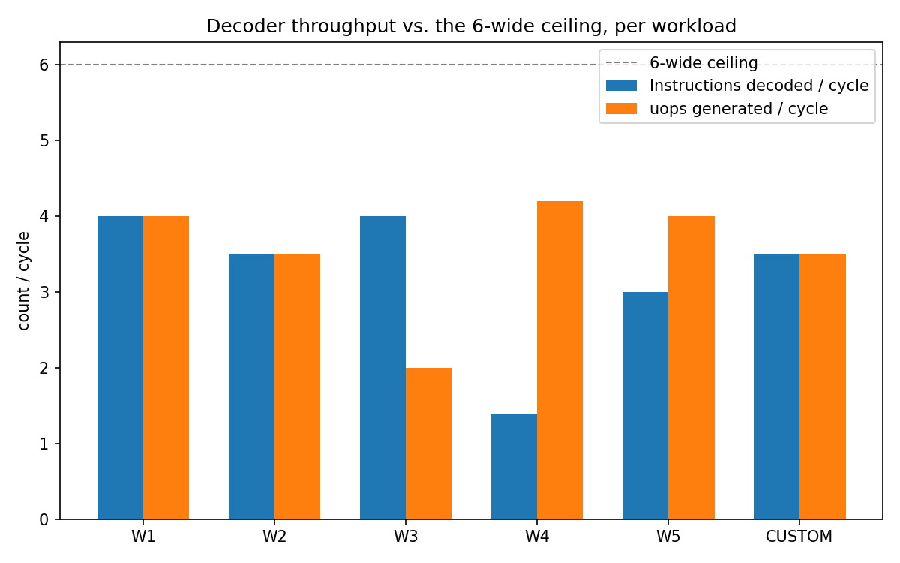
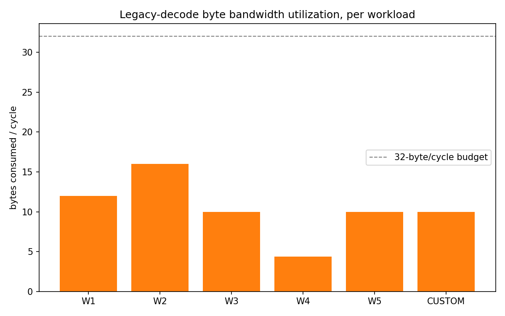
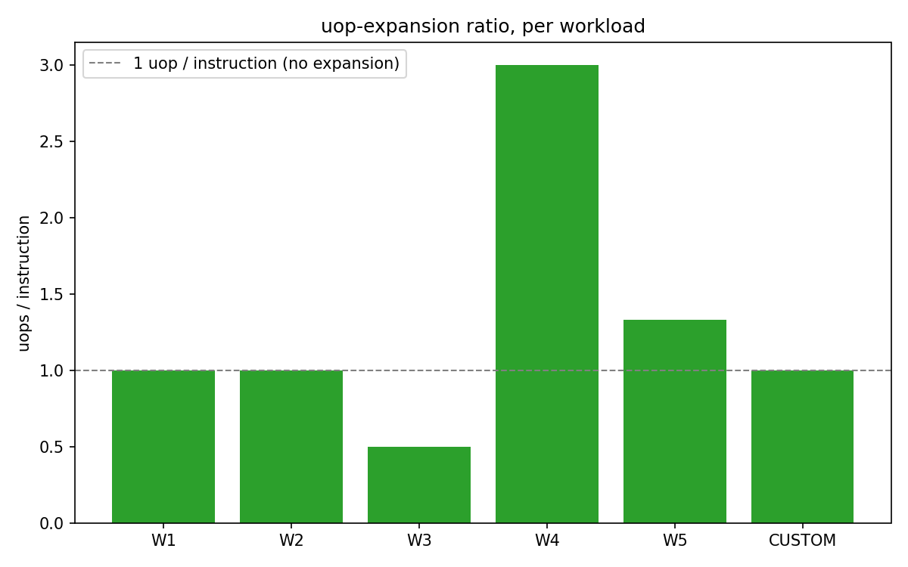
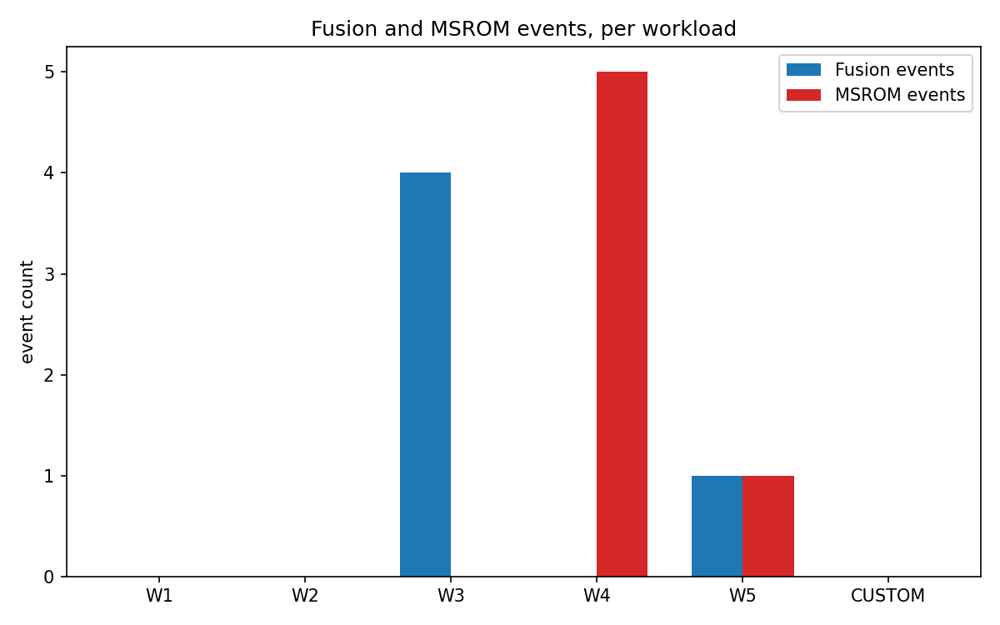

## 1. Objective

Before an out-of-order core can execute anything, its front end has to answer a deceptively hard
question: *where does the next instruction start, and what does it actually mean?* Golden Cove answers
this with a 32-byte/cycle legacy-decode fetch window and six decoder lanes (D0-D5) that turn raw
instruction bytes into uops. This report documents a software model of that path -- built from scratch in
Python, with no disassembler library used at simulation time -- and uses it to study five prescribed
instruction workloads plus one workload of my own design, in order to answer a single question: **what
actually limits decode throughput, and when?**

The simulator source lives under `src/`, is organised as six explicit pipeline stages (never a single
`decode()` black box), and every workload byte string used below was independently cross-checked against
Capstone before being run through my own decoder, so any behaviour reported here reflects the simulator's
own logic rather than an encoding mistake in the input.

## 2. Simulator Architecture

### 2.1 Pipeline stages

```
RAW BYTES
   |
   v  (length_decode.py: prefix + REX processing)
PREFIXES / REX
   |
   v  (length_decode.py: opcode table lookup)
OPCODE
   |
   v  (length_decode.py: ModRM / SIB / displacement / immediate)
OPERAND / ADDRESS FIELDS
   |
   v  (uop_rules.py: classify())
INSTRUCTION CLASS
   |
   v  (uop_rules.py: classify(); simulator.py: fusion/MSROM resolution)
uOPS
```

Each stage is a separate function/module (`decoder/length_decode.py` for boundary-through-operand
decoding, `decoder/uop_rules.py` for classification and uop counting, `decoder/simulator.py` for lane
packing, fusion resolution and MSROM handling), matching the assignment's explicit requirement that the
transformation be observable stage by stage rather than hidden behind one call.

### 2.2 Six-lane, 32-byte-window packing loop

For each cycle, the simulator starts from the current stream position and repeatedly decodes the next
instruction, placing it into the next open lane (D0, D1, ... D5) as long as **both**:

1. fewer than 6 instructions have been placed in the current cycle, and
2. the instruction's own byte length still fits inside the 32-byte-per-cycle budget for that cycle.

The moment either limit is hit, the cycle closes and any remaining bytes are picked up at the start of the
next cycle (no bytes are discarded — the stream pointer simply carries over).

### 2.3 uop rules (the "rules provided in this assignment")

Since Intel does not publish decoder-internal uop counts, I defined an explicit, documented rule set
(`decoder/uop_rules.py`) and used it consistently across every workload:

| Instruction shape | uops | Notes |
|---|---|---|
| Register-register ALU (ADD/SUB/XOR reg,reg) | 1 | simple path, any of D0-D5 |
| Register-immediate ALU (ADD/SUB reg,imm8) | 1 | GRP1 opcode 0x83 |
| Load (MOV reg, [mem]) | 1 | address computed by AGU, single uop |
| Store (MOV [mem], reg) | 1 | |
| LEA reg, [complex addr] | 1 | AGU-only; address complexity never adds uops |
| Memory read-modify-write (ADD [mem], reg) | 2 | micro-fused load+op, plus a store |
| CMP / TEST (register-register) | 1 | also a **fusion candidate** for a following Jcc |
| Jcc | 1, or 0 if fused | fused Jcc merges into the CMP/TEST's single uop |
| CPUID | 4 | MSROM |
| RDTSC | 2 | MSROM |
| ENTER imm16, imm8 | 3 | MSROM |
| REP MOVSB | 4 (symbolic) | MSROM; real count is RCX-dependent at runtime, not decode time |
| LOCK XADD [mem], reg | 5 | MSROM; locked atomic RMW |

### 2.4 Fusion resolution rule

A CMP/TEST that is immediately followed **in program order** by a Jcc is only fused if that Jcc lands in
the very next decoder lane of the *same cycle*. If the CMP/TEST happened to be packed into D5 (the last
lane), the following Jcc necessarily spills into D0 of the next cycle — and fusion is lost, even though the
two instructions are still directly adjacent in the byte stream. This single rule turns out to be the most
interesting result of the whole lab (Section 8).

### 2.5 MSROM resolution rule

An MSROM-class instruction is allowed to occupy the lane it lands in, but it immediately closes the cycle:
no further lane is used that cycle, regardless of remaining byte or lane budget. This models the real
front end's hand-off from the 6-wide legacy decoders to the single-issue MSROM sequencer.

## 3. Results

All five workloads were run end-to-end; full per-cycle decoder traces are in `results/traces/*.txt`,
per-instruction and per-cycle CSVs in `results/per_instruction.csv` and `results/per_cycle.csv`, and the
aggregated table below in `results/summary.csv`.

| Workload | Instr/cycle | Bytes/cycle | uops/cycle | Fusion | MSROM |
|---|---|---|---|---|---|
| W1 | 4.0 | 12.0 | 4.0 | 0 | 0 |
| W2 | 3.5 | 16.0 | 3.5 | 0 | 0 |
| W3 | 4.0 | 10.0 | 2.0 | 4 | 0 |
| W4 | 1.4 | 4.4 | 4.2 | 0 | 5 |
| W5 | 3.0 | 10.0 | 4.0 | 1 | 1 |

**Observations (one per workload):**

- **W1** — the 6-lane ceiling is hit at only 18/32 bytes: lane count, not byte bandwidth, is the limiter.
- **W2** — even with an 8-byte instruction present, 6 still pack into 27/32 bytes: the lane cap keeps binding first regardless of length variety.
- **W3** — 8 instructions, only 4 uops: all four CMP/TEST;Jcc pairs land on adjacent lanes in the same cycle and fuse.
- **W4** — instr/cycle craters to 1.4, but uops/cycle (4.2) stays healthy: MSROM residency, not lane or byte availability, is the limiter here.
- **W5** — a full 6-lane cycle (fusion and RMW expansion happening together) is immediately followed by a lone MSROM cycle: two different bottleneck shapes inside one workload.

*(A detailed, per-question discussion of these results follows in Section 3.1.)*

Figures (`results/plots/`):



*W1 and W3 both reach the 4.0 instructions/cycle average, yet W3 generates half as many uops per cycle — direct evidence that instruction count and uop count are independent quantities (see Q5 below).*



*No workload here gets close to the 32-byte ceiling; across W1-W3 and W5, the 6-instruction lane cap binds first. This is a property of these particular streams' average instruction length, not a general law — see Section 5.*



*W3's ratio (0.5) shows fusion reducing effective uop count below 1-per-instruction; W4's ratio (3.0) shows the opposite: MSROM instructions inflating it well above 1.*



### 3.1 Addressing the assignment's specific questions

- **When are all six decoder lanes useful?** Only when the stream supplies at least six short,
  independently-decodable instructions before any byte/lane/MSROM limit intervenes — W1 cycle 0, W2 cycle
  0, W3 cycle 0, and W5 cycle 0 all achieve this; W4 never does, because after just 2 ordinary instructions
  it hits an MSROM instruction and every subsequent cycle is single-issue.
- **Can six decoders decode six instructions every cycle for every stream?** No. W4 shows the clearest
  counter-example: 7 instructions require 5 separate cycles because MSROM residency forces single-issue
  cycles regardless of what other decodable bytes remain.
- **What happens with very different instruction lengths?** W2 shows that length variability by itself is
  not disruptive as long as total bytes stay under budget — the 6-lane cap, not the byte cap, was still the
  binding constraint even with an 8-byte instruction mixed in.
- **How do ModRM/SIB/disp/imm fields affect decoding?** They change instruction *length* and address
  the payload) but, in this model, only change uop *count* when they imply a memory write that must be
  computed separately from a memory read (the RMW case in W4, and the SIB+disp8 store in W2's last
  instruction) — LEA is the counter-example: however elaborate its SIB+disp addressing gets, it stays 1
  uop because it never performs an actual memory access.
- **Can two equal-instruction-count streams produce different uop counts?** Yes, directly: W1 and W3 both
  contain exactly 8 architectural instructions, but W1 emits 8 uops (no fusion opportunities) while W3
  emits only 4 (all four CMP/TEST;Jcc pairs fuse).
- **What changes when fusion occurs?** The Jcc stops being counted as an independent uop-producing
  instruction; it is still decoded (occupies a lane, contributes to "instructions decoded" and to bytes
  consumed) but contributes 0 uops of its own, since its semantics fold into the CMP/TEST's single
  comparison-and-branch uop.
- **What happens on the MSROM path?** The decoding lane that hits the MSROM instruction still reports a
  single "instruction decoded", but the uop count for that lane jumps (2-5, per Section 2.3) and — critically
  — every other lane in that cycle is forced idle even if bytes and lane slots were still available.
- **Is instruction count alone sufficient to understand decoder behaviour?** No — W4 is the whole
  argument: 7 instructions, only 1.4 instr/cycle, yet 4.2 uops/cycle. Reading "instructions/cycle" alone
  would suggest a badly underutilized decoder; reading uops/cycle alongside it shows the front end is
  actually delivering a comparable amount of work per cycle to W1/W3/W5, just concentrated into fewer,
  heavier instructions.
- **What was the limiting factor in each workload?** W1/W3: the 6-lane cap (byte budget never came close).
  W2: still the 6-lane cap, despite longer instructions. W4: MSROM residency (single-issue by construction).
  W5: alternates between lane-cap-bound (cycle 0) and MSROM-bound (cycle 1) cycles within the *same*
  workload — the limiting factor is not a fixed property of the workload but of each individual cycle's
  content.

## 4. My Own Investigation: Fusion Lost at a Cycle Boundary

**Predicted behaviour.** Workload W3 established that a CMP;Jcc pair fuses reliably. I wanted to know
whether that holds regardless of *where in the decode group* the CMP lands, or whether lane position
matters. My prediction going in: since the two instructions are still directly adjacent in the byte stream
(no bytes in between), fusion should still occur — program-order adjacency is what usually gets
described informally as "the fusion rule."

**Stream constructed** (`CUSTOM_fusion_across_cycle` in `src/workloads.py`):

```
48 01 D8   ADD RAX, RBX   -> D0
48 01 C8   ADD RAX, RCX   -> D1
48 01 F0   ADD RAX, RSI   -> D2
48 01 C1   ADD RCX, RAX   -> D3
48 01 CA   ADD RDX, RCX   -> D4
48 39 D8   CMP RAX, RBX   -> lands in D5 (last lane of cycle 0)
75 05      JNE +5         -> the very next instruction in program order
```

Five 3-byte ADDs (15 bytes) are placed first, deliberately consuming exactly D0-D4, so the following CMP is
forced into D5 — the last lane available in that cycle.

**Simulator result:**

```
Cycle 0: D0-D4 = ADD x5 (1 uop each), D5 = CMP RAX,RBX -> 1 uop.  Fusion events: 0.
Cycle 1: D0 = JNE +5 -> 1 uop (NOT fused).  Fusion events: 0.
```

**Observed phenomenon.** Fusion did *not* occur, even though this is the exact same CMP;Jcc byte pair (`48
39 D8 75 05`) that fused successfully four times over in W3. My prediction was wrong.

**Explanation.** The simulator's fusion check only looks at the immediately preceding *lane* within the
*same cycle's lane list* (`simulator.py`, the `lanes[-1].uop.is_fusion_source and uop.is_jcc` check inside
the packing loop). Because D5 was the last lane opened in cycle 0, the packing loop's `while len(lanes) < 6`
condition ends the cycle right after the CMP is placed — there is no D6. The JNE, still perfectly adjacent
in the byte stream, is therefore decoded at the start of cycle 1, where the "previous lane" is empty, so the
fusion condition can never trigger. This is not a bug in the byte-adjacency logic; it is a direct, correct
consequence of modelling fusion as a *same-decode-group* phenomenon rather than a pure *byte-adjacency*
phenomenon — and it matches how real fusion is documented to behave: the compare and the branch must be
decoded together by the front end in the same cycle, not merely be neighbours in the instruction stream.
The practical lesson is that instruction *scheduling relative to the 6-wide decode boundary* (which, in
real code, is a function of surrounding instruction lengths, alignment, and even compiler behaviour) can
silently take away a fusion opportunity that looks guaranteed from the source code alone.

## 5. Final Question

**Golden Cove provides six decoder lanes and 32 bytes/cycle of legacy decode bandwidth. Based on this
simulator, what actually determines whether those resources are fully utilized by a given instruction
stream?**

Four independent factors, in the order they actually bound in these workloads:

1. **Lane count vs. instruction density.** For every workload here except W4, the 6-instruction lane cap
   bound before the 32-byte budget did — W1's cycle 0 used only 18/32 bytes, W2's only 27/32, both while
   already full on lanes. Byte bandwidth only becomes the binding constraint once average instruction
   length exceeds 32/6 ~= 5.33 bytes; none of W1-W3/W5's ordinary segments reach that average, so lane count
   dominated throughout.
2. **Fusion is possible, but conditional on cycle alignment, not just program order.** W3 shows fusion
   working every time it's tried; Section 4's custom stream shows the identical instruction pair failing to
   fuse purely because of where it landed relative to the 6-lane boundary. Utilization of the *fusion*
   mechanism specifically, then, depends on how the surrounding instructions happen to fill out the decode
   group — a property of the whole stream's layout, not of the fusable pair in isolation.
3. **MSROM residency overrides everything else.** The instant an MSROM-class instruction is decoded, both
   the lane budget and the byte budget become irrelevant for the rest of that cycle — W4 never uses more
   than 1 lane per cycle from its second instruction onward, and W5's cycle 1 does the same, despite both
   streams having easily enough decodable bytes and instructions to keep going.
4. **Instruction count and uop count are genuinely decoupled**, and only uop count directly reflects
   how much execution-ready work the front end produced. A workload can show poor "instructions/cycle"
   (W4: 1.4) while still delivering a comparable uops/cycle to workloads with a healthy-looking
   instructions/cycle (W1: 4.0 instr/cycle but also 4.0 uops/cycle, vs. W4's 1.4 instr/cycle but 4.2
   uops/cycle) — so utilization has to be read from uop throughput, not instruction throughput, to mean
   anything about actual back-end feed rate.

In short: for compact, register-form code the 6-instruction ceiling is the practical limiter almost every
cycle, not the advertised 32 bytes/cycle; fusion recovers some of that lost headroom but only when decode-group
alignment cooperates; and any MSROM-class instruction unconditionally erases all six-wide/32-byte
advantages for its entire cycle, which is exactly why W4 (all "special path" instructions) and the MSROM
cycles inside W5 are the true worst-case front-end behaviour observed in this lab, not the long or
memory-heavy instructions of W2.

## Appendix A — Reproduce

```bash
python3 src/run_all.py
# writes results/traces/*.txt, results/*.csv, results/plots/*.png
```

## Appendix B — Verification note

Every hex byte string in `src/workloads.py` was decoded once with Capstone (`CS_ARCH_X86`, `CS_MODE_64`)
in a standalone script before being run through this project's own hand-written decoder, confirming
instruction boundaries, mnemonics and operand text matched exactly. Capstone was used only for this
one-time verification step and is not a dependency of the simulator itself.
