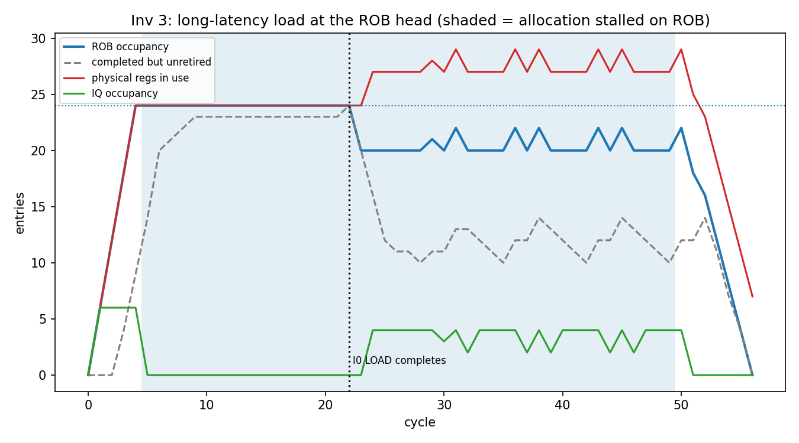
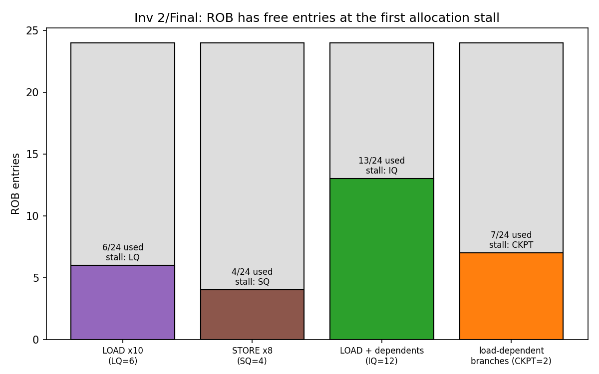
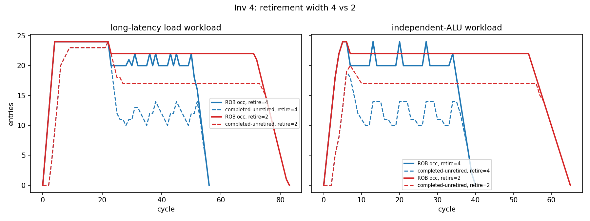
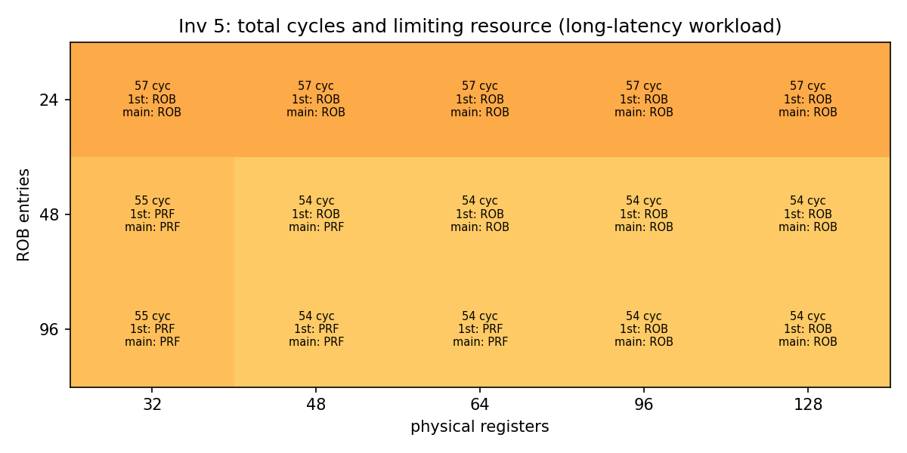
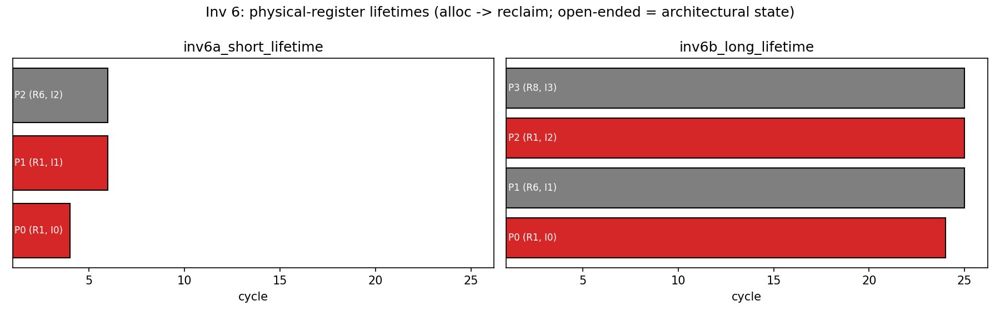
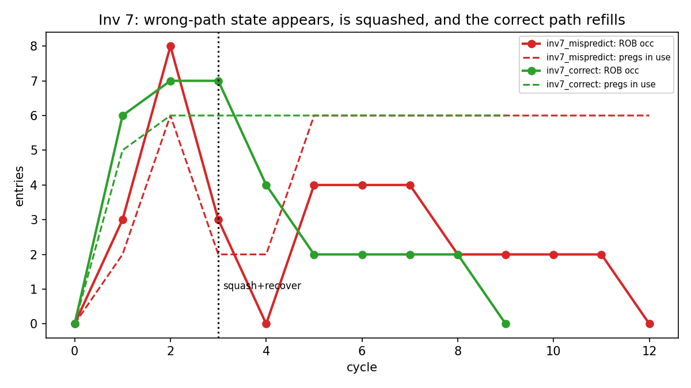
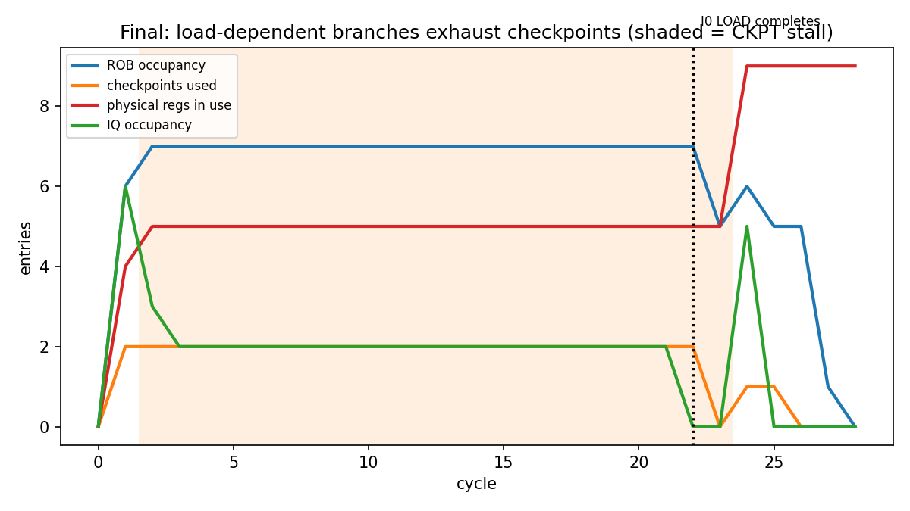
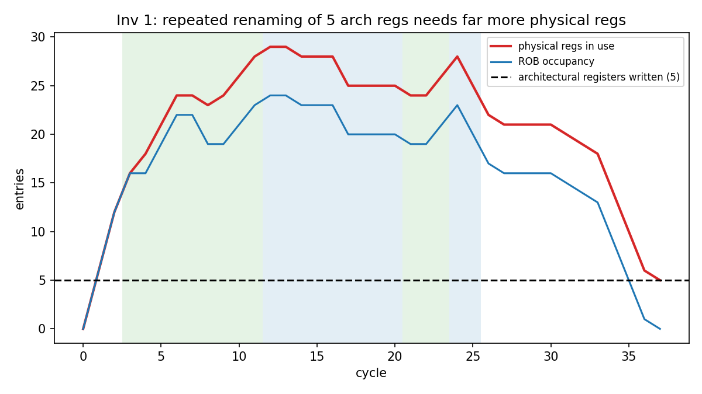

## 1. Objective and Machine

Decoding is only the first step: before a uop can execute it needs a ROB entry, a physical register (PRF), an
issue-queue (IQ) slot and, depending on its type, a load-queue (LQ) slot, a store-queue (SQ) slot or a branch
checkpoint (CKPT). All of these stay occupied until the uop retires or is squashed. This report uses a
cycle-level Python model (`src/ooo/`) to answer one question: **when allocation stops, which resource caused it,
and how far back can the cause be traced?** Every claim below is read from the simulator's own output in
`results/` (per-cycle traces, CSVs, plots).

Baseline: decode 6, rename/allocate 6, retire 4, ROB 24, PRF 32, IQ 12, LQ 6, SQ 4, 2 branch checkpoints;
latencies ADD 1, MUL 4, LOAD 20 (STORE and BRANCH 1).

## 2. Simulator

**Lifecycle modelled:** Decode -> Rename -> Allocate -> Execute -> Complete -> Retire -> Reclaim, and
Mispredict -> Squash -> Recovery -> Redirect -> Decode. Execute, Complete, Retire and Reclaim are four *separate
events* with separate cycle stamps in the per-instruction table.

**Per-cycle stage order:** (1) allocate, (2) complete/branch-resolve/recovery, (3) retire+reclaim, (4) issue,
(5) decode. Allocation runs before retirement, so *a resource freed in cycle t is first usable in t+1*. An
instruction issued at cycle s completes at s+latency; its consumers may issue at that cycle; it may retire from
complete+1.

**Allocation rule.** In-order, up to 6/cycle. The head of the decode queue needs ROB + IQ always, PRF if it has a
destination, LQ for loads, SQ for stores, CKPT for branches (the table in Section 4 of the assignment). If any
is missing the whole group stops: **the model records every missing resource, a primary one (priority
ROB, PRF, IQ, LQ, SQ, CKPT), why it is unavailable, and an earlier root event** found by walking from the
holder of the resource back to the oldest unfinished instruction (`stall_chains.csv`).

**Resource lifetimes.** PRF: new preg at allocation, the *previous* mapping of the destination is reclaimed when
the *overwriting* instruction retires. IQ: freed at issue. LQ/SQ: freed at retirement. CKPT: freed when the
branch resolves. ROB: freed at retirement.

**Assumptions not in the brief** (set once, never tuned per experiment): decode queue of 12 uops between decode
and rename (this is where frontend backpressure becomes visible); issue width 6; initial architectural register
values live in a separate always-ready ARF, so a register only costs a preg once it has been written in-flight
(shown as "ARF" in tables); a predicted-taken branch ends its decode group; after a misprediction decode
resumes the cycle after recovery; no store-to-load forwarding or memory dependences.

**Tracked per instruction** (`per_instruction.csv`, bottom of every trace): architectural/physical sources and
destination, previous mapping, ROB entry, decode/alloc/issue/complete/retire/squash/reclaim cycles. **Tracked per
cycle** (`per_cycle.csv`): ROB, free pregs, IQ, LQ, SQ, CKPT, decode-queue occupancy, allocated/retired/squashed,
stalled flag and cause. Inputs are in `inputs/*.asm`.

## 3. Investigations

### 3.1 Rename and allocation (Inv 1)

Workload `inv1_rename`: the assignment's stream extended to 12 instructions. Evolution of R1 (from
`inv1_register_evolution.txt`):

| writer | R1 -> | read by (issue cycle) | reclaimed |
|---|---|---|---|
| I0 | P0 | I2 @3 | cycle 8, at retire of **I3** |
| I3 | P3 | I4 @3 | cycle 10, at retire of I7 |
| I7 | P7 | I8 @9, I9 @13 | cycle 17, at retire of I11 |
| I11 | P11 | -- | still the architectural mapping |

1. *When is a new preg allocated?* For every instruction with a destination, in its allocation cycle: I0..I5 get
   P0..P5 in cycle 1, including I3 (R1 again -> P3) and I5 (R2 again -> P5).
2. *Which preg does a consumer read?* The RAT value at its own rename: I2 (older than I3) reads R1 -> **P0**; I4
   (younger, allocated in the same cycle as I3) reads R1 -> **P3**. The same architectural name resolved to two
   different registers in one cycle.
3. *When can the old preg be reclaimed?* Not when its last reader issues (I2 issues at 3, P0's value is
   consumed by cycle 7) but when the **overwriting instruction I3 retires** (cycle 8; the per-instruction table
   shows `reclaim_c = 8` on I3). P1 (old R2) is reclaimed in the same cycle by I5.
4. *Pressure.* `inv1b_rename_x5` repeats the stream 5x (60 instructions, only **5 architectural registers**
   written: R1, R2, R3, R4, R8). Peak physical registers in use: **29**, with 3 free at the minimum
   (`08_inv1_rename_pressure.png`). Every write takes a fresh preg and old ones linger until retirement. In
   this run PRF never ran out: the first stall was the **IQ** (cycle 3, 12/12, ROB 16/24) because dependent
   chains wait in it, then the ROB.

### 3.2 Different uops, different resources (Inv 2)

Each run stalls with ROB entries free (`02_rob_headroom_at_stall.png`):

| run | first stall | blocked uop | ROB at stall | what was exhausted | stall length |
|---|---|---|---|---|---|
| 10 independent LOADs | cycle 2 | I6 | **6/24** | LQ 6/6 (PRF free 26, IQ 6/12) | cycles 2-23 |
| 8 STOREs | cycle 1 | I4 | **4/24** | SQ 4/4 (PRF free 32/32) | cycles 1-4 |
| LOAD + 20 dependent ADDs | cycle 3 | I13 | **13/24** | IQ 12/12 | cycles 3-22 |

*Why "the ROB has space" does not mean "the processor can accept another uop":* the ROB is only one of several
structures an uop needs simultaneously. The 7th load has 18 free ROB entries and 26 free pregs but nowhere to
put its load-queue record. Because allocation is in order, **one blocked uop blocks everything behind it**,
including independent ALU instructions. The chains: LQ stall -> LQ entries are held until *retirement* ->
oldest load I0 completes at cycle 22 and retires at 23 -> stall clears. IQ stall -> 12 dependents sit in the IQ
waiting for R1 -> I0 LOAD completes at cycle 22.

### 3.3 The long-latency instruction (Inv 3)

Workload `inv3_longlat`: I0 `LOAD R1,[A]` followed by 120 independent ADD/MUL instructions
(`01_inv3_longlat_timeline.png`, `traces/inv3_longlat.txt`).

* Cycles 1-4: 6 uops/cycle allocate; I0 issues at cycle 2 (completes **22**). Younger ADDs/MUL execute at once:
  23 of 24 ROB entries are complete by cycle 21. IQ is **empty**, 6 issue slots/cycle idle.
* **Cycle 5, first stall: ROB 24/24.** PRF still has 8 free, IQ 0/12, LQ 1/6.
* Cycle 6: decode queue 12/12 -> frontend stalls.
* Retirement is 0 for cycles 0-22, then resumes at cycle 23 (I0 retires).

**Causal chain from the simulation:**

```
Frontend stall            cycle 6   decode queue 12/12
   | allocation not draining it
Allocation stall          cycle 5   I24 blocked, ROB 24/24 (PRF 8 free, IQ 0/12)
   | ROB entries cannot be reclaimed
23 younger uops COMPLETE but cannot RETIRE (retire is in order)
   | retirement blocked
Oldest instruction I0 LOAD  issued cycle 2, completes cycle 22
```

*Execution completion, retirement, and reclamation are different events:* I1 (`ADD R2`) issues at 2, completes
at **3**, retires at **23**, and only its *overwriter* I7 (retires 24) reclaims the old R2 register (P1) at
**24**. 20 cycles separate "result ready" from "ROB entry usable", 21 from "old register reusable". The
stall does not end when the load returns: after cycle 23 allocation is throttled to 4/cycle (= retire width),
so the stall flag stays on until cycle 49. Of 45 stall cycles, **18 are caused by the load (5-22) and 27 by
retirement bandwidth (23-49)**.

### 3.4 Retirement as a bottleneck (Inv 4)

Two workloads, retire width 4 vs 2 (`03_inv4_retire_width.png`). `longlat` is Inv 3; `independent` is the same 120
ALU/MUL uops with *no* load.

| run | cycles | alloc-stall cycles | frontend-stall cycles | peak completed-unretired | avg idle issue slots (of 6) in stall cycles |
|---|---|---|---|---|---|
| longlat, retire 4 | 57 | 45 | 41 | 24 | 3.9 |
| longlat, retire 2 | **84** | 67 | 60 | 24 | 4.5 |
| independent, retire 4 | 41 | 29 | 25 | 19 | 2.7 |
| independent, retire 2 | **66** | 49 | 42 | 20 | 4.0 |

1. *How many completed instructions accumulate?* 23 younger uops (the whole ROB minus the load) before I0
   completes; 19-20 in the no-load workload.
2. *Effect of narrower retirement:* the ROB sits at 22/24 for the entire drain (vs 20 at width 4), the
   completed-unretired plateau rises from ~10-14 to 17, runtime grows 47% (57 -> 84) and 61% (41 -> 66).
3. *Can retirement alone stall allocation and the frontend?* Yes: the independent workload has **no long-latency
   instruction**. Allocation (6/cycle) outruns retirement (4 or 2/cycle), the ROB fills at cycle 5, the
   decode queue fills, and 25-42 frontend-stall cycles follow. The allocation rate converges to the retire width.
4. *Why can execution units be free while the machine cannot accept more?* In stall cycles the IQ is empty and
   4 of 6 issue slots are idle (retire 2): the units have nothing to do because they only see uops that already
   have a ROB entry. Execute -> Complete -> **Retire** -> Reclaim: the execute stage is done long before the
   resources it holds are given back, and the give-back path (retire) is narrower than the take path (allocate).

### 3.5 Changing the resource (Inv 5)

Long-latency workload, one resource changed at a time (`inv5_grid.csv`, `04_inv5_bottleneck_grid.png`).

**Prediction (from counting, before the sweep):** while I0 blocks retirement *nothing is reclaimed*, so every
in-flight destination holds a fresh preg: in-flight capacity = min(ROB, PRF). Hence ROB 24: ROB limits; ROB 48
and 96: **PRF at 32** limits (PRF 32 -> only 32 uops can be in flight); with ROB 24, raising PRF should change
nothing.

| config | cycles | first stall | ROB occ. at first stall | stall cycles ROB / PRF |
|---|---|---|---|---|
| ROB 24, PRF 32 | 57 | ROB @5 | 24 | 45 / 0 |
| ROB 48, PRF 32 | 55 | **PRF @6** | 32/48 | 0 / 43 |
| ROB 96, PRF 32 | 55 | **PRF @6** | 32/96 | 0 / 43 |
| ROB 24, PRF 48 | 57 | ROB @5 | 24 | 45 / 0 |
| ROB 24, PRF 64 | 57 | ROB @5 | 24 | 45 / 0 |

Predictions held. Quadrupling the ROB (24 -> 96) did **not** move the limit to something bigger, it moved it to
the PRF at 32 in-flight uops: 25 older versions were un-reclaimable because their overwriters could not
retire. Raising only the PRF did nothing because the ROB was already the tighter limit. The extended grid shows
the *crossovers*: ROB 48 + PRF 48 stalls on ROB first (cycle 9) but loses 19 cycles to PRF and 15 to ROB
(co-limited); ROB 96 + PRF 96 hits ROB at cycle 17 (still 7 PRF stall cycles). The best case is 54 cycles
vs 57: the remaining time is **load latency (22) + 121 uops / 4 retire per cycle = ~53**. Past about 48 entries
there is nothing left in the ROB/PRF to expose: *retirement bandwidth* is the wall, a resource that was never
in the sweep.

### 3.6 Physical-register lifetime (Inv 6)

Case A (`inv6a`): `I0 ADD R1; I1 ADD R1; I2 ADD R6,R1,R7`. I0 -> R1 -> **P0**, I1 -> R1 -> **P1**, I2 reads
R1 -> **P1**. P0 had *no* readers, yet it is reclaimed only at cycle **4** when I1 retires (life 3 cycles).

Case B (`inv6b`): `I0 ADD R1; I1 LOAD R6,[R1]; I2 ADD R1; I3 ADD R8,R1,R9`. P0 (R1) is read by the 20-cycle
load. I2 renames R1 -> P2 and completes at cycle 3, but cannot retire before the load, so P0 is reclaimed at
cycle **24** (life **23 cycles**, vs 3 in case A) even though I2 had finished at cycle 3
(`05_inv6_preg_lifetimes.png`). The *same architectural register R1* held two physical registers for 3 cycles
in A and for 23 cycles in B.

Case C (`inv6c`, ROB 64): `LOAD R9` then 40 x `ADD R1,R2,R3`: **one** architectural destination (R1), yet the PRF
empties at 32 in-flight versions, PRF stall from cycle 6, 20 stall cycles (30 superseded versions unreclaimable).
So *the architectural register count does not set the physical requirement; the number of speculative versions
alive, and how long retirement keeps them alive, does.*

### 3.7 Branch misprediction recovery (Inv 7)

The listed stream has I3-I6 *after* the branch in program order, and the actual outcome is Not-Taken; so the
correct path is the fall-through I3-I6, and the **predicted (Taken) path is the wrong path**, W0-W4:
`ADD R7`, `MUL R9`, `LOAD R12`, `STORE [C]`, `ADD R13`. (Wrong-path text is in `inv7_mispredict.asm`.)

Branch I2 is allocated at cycle 1 and completes at cycle 3; wrong-path uops were allocated at cycle 2 and
are **detected and squashed in cycle 3** (`traces/inv7_mispredict.txt`, full dumps under "Machine-state snapshots"):

| state | before recovery | after recovery |
|---|---|---|
| RAT | R1->P0, R4->P1, **R7->P2, R9->P3, R12->P4, R13->P5** | R1->P0, R4->P1 |
| ROB | 8/24 (3 correct + 5 wrong-path) | 3/24 |
| free pregs | 26 | 30 (P2-P5 returned) |
| IQ / LQ / SQ / CKPT | 5 / 1 / 1 / 1 | 0 / 0 / 0 / 0 |

The simulator (1) identifies W0-W4 as younger than the branch, (2) removes them from ROB, IQ, LQ, SQ,
(3) restores the RAT from the branch's checkpoint, (4) returns P2-P5 to the free list (youngest first), (5)
flushes the decode queue, (6) redirects: the correct path decodes at cycle 4, allocates at 5, and I3 re-uses
ROB entry #3 and gets **R7 -> P6**, not the squashed P2. The old mappings of the wrong-path writers were never
touched (`pold` is only reclaimed at retire), so nothing needed un-freeing. Total: **13 cycles vs 10** when the
same stream is predicted correctly (`inv7_correct`).

*Late-detection variant* (`inv7b_late_resolve`, branch depends on a 20-cycle LOAD): the wrong path runs for 20
cycles. At the squash (cycle 23) 7 wrong-path uops occupy the ROB (10/24 with the 3 correct-path entries); **W0, W1, W3-W6 have already
executed and completed** (they were never going to retire), **W2 (LOAD) is still in flight**, LQ 2/6 and SQ 1/4. After
recovery: ROB 3, LQ 1, SQ 0, free pregs 24 -> 30.

**Normal:** Allocate -> Execute -> Complete -> **Retire -> Reclaim** (I0: alloc 1, issue 2, complete 3, retire 4).
**Wrong path:** Allocate -> Execute/Wait -> **Mispredict -> Squash -> Reclaim**: no retire, the registers are
returned *immediately* at squash (cycle 3 / 23) rather than at a later retirement, and their results are never
architecturally visible.

### 3.8 Final investigation: checkpoint starvation

**Prediction (written before the run).** (1) Limiting resource: **branch checkpoints (CKPT=2)**. (2) Why: three
`BRANCH ... src=R1` instructions depend on `LOAD R1`, which takes 20 cycles, so none can resolve and each holds a
checkpoint; the third branch cannot allocate even though only ~7 uops are in flight, i.e. a speculation-depth
limit unrelated to the ROB, PRF or IQ. (3) *Prediction fails if:* the first stall is anything other than CKPT, or
it happens with ROB occupancy near 24, or it clears before the load returns.

**Result (`final_ckpt`).** First stall cycle 2: **I7 (third branch) blocked on CKPT** with ROB **7/24**, PRF free 27,
IQ 7/12, LQ 1/6. The stall persists cycles 2-23 (22 cycles) and **all 22 stall cycles are CKPT**; the prediction held.
Chain from `stall_chains.csv`:

```
Immediate resource : CKPT 2/2                        (I7 cannot allocate)
Why unavailable    : B1 (I2), B2 (I5) are unresolved; a checkpoint is held until the branch resolves
Earlier event      : both branches wait in the IQ for R1 <- I0 LOAD, issued cycle 2, completes cycle 22
```

I2 completes at cycle 23, releases a checkpoint, and I7 allocates at 24 (a one-cycle reclaim-to-use lag by
construction). Note the *collateral damage*: independent ADDs I8-I11 behind the blocked branch also wait because
allocation is in-order; peak ROB occupancy for the whole run was just **7**, and 17 free ROB entries and at least 23 free
pregs sat unused (`07_final_ckpt.png`).

## 4. Analysis Questions

**A. Allocation.** The uop must be given storage for everything it will leave behind *before* it can run: a ROB
slot (ordering), a preg (its result version), an IQ slot (wakeup), and LQ/SQ/CKPT where relevant. The 7th load
in Inv 2 had ROB and PRF but no LQ slot; I7 in the final run had everything except a checkpoint.

**B. Rename.** R1 in Inv 1: I0->P0 (read by I2, reclaimable at I3's retire, cycle 8), I3->P3 (cycle 10), I7->P7
(cycle 17), I11->P11 (live). A preg is reclaimable when the **next writer of the same architectural register
retires**, since by then every older reader has retired and no checkpoint can return to it.

**C. ROB.** I1 (`ADD R2`) completed at cycle 3 but stays in the ROB until 23. Its entry cannot be released
because retirement is in order: I0 older and unfinished could still fault or be squashed, in which case the
state of I1 must be undone, and the ROB entry is what lets that happen.

**D. Retirement.** Inv 3 and 4: up to 23 completed uops accumulate behind an older load, and with retire width 2
the plateau persists even with an idle IQ (4 of 6 issue slots idle during stalls).

**E. Resource pressure.** Inv 2, cycle 2 of `inv2a_loads_LQ`: ROB 6/24 and PRF 26 free, but I6 (a load) is
blocked on **LQ 6/6**. Another: cycle 3 of `inv2c`, ROB 13/24, **IQ 12/12**.

**F. Bottleneck migration.** The bottleneck did **not** stay the same: ROB 24 -> 48/96 moved it to the PRF
(stall at 32 in-flight uops), PRF 32 -> 48/64 with ROB 24 changed nothing, ROB 48+PRF 48 was co-limited, and
beyond that retirement bandwidth set the floor (54 cycles vs 57 baseline).

**G. Backpressure.** Section 3.3: I0 LOAD (completes 22) -> retire blocked -> 23 completed uops stuck in ROB
-> ROB 24/24 at cycle 5 -> decode queue 12/12 at cycle 6 -> frontend stall.

**H. Recovery.** Discard: all younger ROB entries, their IQ/LQ/SQ entries, in-flight execution, their
destination pregs (returned to the free list), younger checkpoints, and the decode queue. Restore: the RAT from
the branch's checkpoint, and fetch/decode PC. Preserve: everything at or older than the branch, and old
mappings of wrong-path destinations.

**I. Design reasoning.** Larger structures cost area, power and cycle time (IQ wakeup/select and PRF ports scale
badly with size), and the experiments show they stop paying off: ROB 24 -> 96 saved 2-3 cycles because PRF
and then retire width took over. Each structure is sized against the *others*; the machine is balanced when the
limits are approximately simultaneous, not when any one is large. Window depth is also limited by branch
accuracy (7b: 20 cycles of wrong-path work, 6 wasted pregs plus ROB/LQ/SQ entries) and by true dependences
(Inv 2c: a 20-cycle load plus a dependent chain fills the IQ at ROB 13/24), which no amount of capacity fixes.

## Appendix A -- Reproduce

```
cd "Assignment 7/src" && python3 run_all.py
```

writes `results/traces/*.txt` (per-cycle trace + causal-chain summary + per-instruction table + register-version
table), `summary.csv`, `per_cycle.csv`, `per_instruction.csv`, `stall_chains.csv`, `preg_lifetimes.csv`,
`inv5_grid.csv`, `inv1_register_evolution.txt`, `inv6_r1_evolution.txt` and `results/plots/*.png`. All 23
runs (including the extra ones) are logged in `summary.csv`; nothing is dropped.

## Appendix B -- Limitations

LQ/SQ entries are released at retirement (real stores keep their SQ entry until they drain to cache); there is no
memory disambiguation, no port-level execution model, no move elimination, and branch checkpoints are a plain
counter. The decode-queue size (12) and issue width (6) are my assumptions; they affect *when* the frontend
stall is visible (cycle 6 here), not *which* resource is first exhausted in any experiment.

\newpage

## Appendix C -- Plots

{width=85%}

{width=85%}

{width=85%}

{width=85%}

{width=85%}

{width=85%}

{width=85%}

{width=85%}
