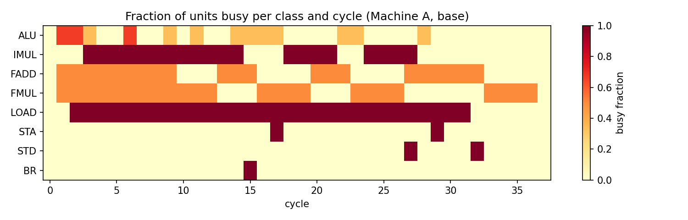
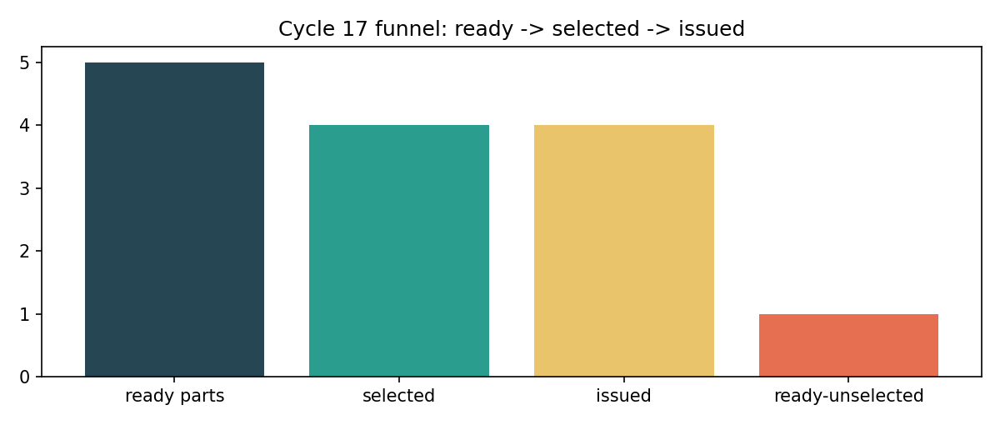
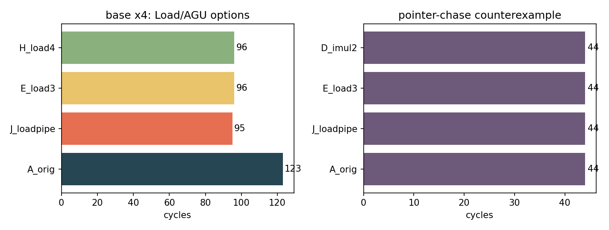
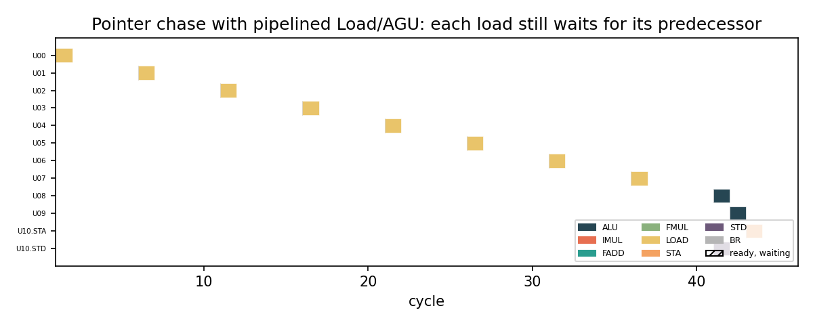

## At a glance

I wrote a cycle-level model of a Golden-Cove-style backend (dispatch 6, scheduler 24, issue 6, wakeup 6, ALU 3, IMUL 1,
FADD 2, FMUL 2, LOAD/AGU 2, STA 1, STD 1, BR 1) and used its trace to ask, for every ready uop that did not run, *which
condition stopped it*. The short answers, each tied to a cycle and uop:

| Question | Answer from the trace |
|---|---|
| What sets the run time of the given kernel? | The FP chain U04 -> U10 -> U17 -> U23 -> U25 -> U28 -> U36 -> U37 -> U41 -> U44: 10 links, zero queueing, **T = 37** |
| Does the scheduler help? | It holds up to 24 uops but only **2.82** are ready on average; 12 vs 24 vs 48 entries gives 39 / 37 / 37 cycles |
| Why do ready uops wait? | A *unit of their class* is occupied: 41 of 45 lost-arbitration uop-cycles are **loads** (both LOAD/AGUs busy, e.g. cycle 16: U35, U40, U43 vs U16, U34) |
| Is idle hardware the same as usable hardware? | No: at cycle 18 three ALUs, two FADDs and a FMUL are idle while U20, U43 wait for LOAD |
| Does wider issue/wakeup help? | 3/3 vs 6/6: **37 vs 37**. Only 6 of 34 issue cycles use more than 2 slots |
| Where does the bottleneck go? | 4-copy stream: LOAD (123) -> after fixing loads, the in-order window and the single multiplier (95--96) |
| What would I change? | **Pipeline the Load/AGU** (accept a load per cycle): 123 -> 95 cycles on 4 copies |
| When does that fail? | A pointer chase: 8 dependent loads, **44 cycles with or without pipelining** |

## 1. The model in one page

**Per cycle:** (1) dispatch up to 6 uops in order while the 24-entry scheduler has room; (2) *select*: ready parts compete
for free units of their own class, lowest uop ID first; (3) *issue*: winners are trimmed to the issue width; (4) *wakeup*:
due tag broadcasts wake consumer operands, at most `wakeup_width` per cycle; (5) bookkeeping. A uop dispatched in cycle
*t* is selectable from *t+1*; a producer issued at *s* with latency *L* broadcasts at *s+L-1*, so a 1-cycle ALU result
can be used in *s+1*.

**Four distinct events per uop** (`results/per_uop.csv`): operand-ready, first-selected, issued, completed -- plus
dispatch. The per-cycle counts for *ready*, *selected* and *issued* are separate (`results/per_cycle.csv`), and a uop that
wins selection but loses on issue width is logged as `selected-not-issued`.

**Decisions I made where the brief is silent**

* A unit is *busy from issue until completion*, so a load holds its LOAD/AGU 5 cycles and an IMUL holds the multiplier
  for 4. (If every unit were pipelined the 49-uop kernel would still take 37 cycles; see Section 8.1.)
* A STORE is one scheduler entry with two parts (STA on its address register, STD on its data register).
* Register renaming is assumed, so only true (RAW) dependences exist; live-in registers are ready at dispatch.
* I appended **I48 `BR R55`** so the branch unit has something to do. `I<n>` and `U<n>` denote the same uop.
* Besides the 49-uop kernel (`base`) I also run **four copies back to back** (`base_x4`, 196 uops) because a kernel this
  short is latency-bound and hides resource effects. Every table gives both.

All streams are in `inputs/`, every run's full cycle-by-cycle trace is in `results/traces/`, and the summary tables are in
`results/*.csv`.

## 2. Parallelism: in flight versus executable now (Investigation 1)

The full per-cycle state of Machine A (`occ` entries in the scheduler after dispatch; `wait` = occ - ready; `sel` =
won class arbitration; `iss` = issued after the width limit; `lost` = ready but not selected; `busy` = units busy after issue, ALU/IMUL/FADD/FMUL/LOAD):

| cyc | occ | wait | rdy | sel | iss | lost | issued | busy |
|---|---|---|---|---|---|---|---|---|
| 0 | 6 | 6 | 0 | 0 | 0 | 0 | - | 0/0/0/0/0 |
| 1 | 12 | 8 | 4 | 4 | 4 | 0 | U00 U01 U04 U05 | 2/0/1/1/0 |
| 2 | 14 | 10 | 4 | 4 | 4 | 0 | U02 U03 U06 U08 | 2/0/1/1/2 |
| 3 | 16 | 13 | 3 | 2 | 2 | 1 | U07 U12 | 1/1/1/1/2 |
| 4 | 20 | 16 | 4 | 1 | 1 | 3 | U11 | 0/1/1/1/2 |
| 5 | 24 | 20 | 4 | 1 | 1 | 3 | U10 | 0/1/1/1/2 |
| 6 | 24 | 19 | 5 | 2 | 2 | 3 | U32 U33 | 2/1/1/1/2 |
| 7 | 24 | 18 | 6 | 4 | 4 | 2 | U09 U13 U14 U18 | 0/1/1/1/2 |
| 8 | 24 | 22 | 2 | 0 | 0 | 2 | - | 0/1/1/1/2 |
| 9 | 24 | 20 | 4 | 2 | 2 | 2 | U17 U38 | 1/1/1/1/2 |
| 10 | 24 | 21 | 3 | 0 | 0 | 3 | - | 0/1/0/1/2 |
| 11 | 24 | 20 | 4 | 2 | 2 | 2 | U15 U39 | 1/1/0/1/2 |
| 12 | 24 | 21 | 3 | 2 | 2 | 1 | U16 U34 | 0/1/0/1/2 |
| 13 | 24 | 22 | 2 | 1 | 1 | 1 | U23 | 0/1/1/0/2 |
| 14 | 24 | 22 | 2 | 1 | 1 | 1 | U47 | 1/1/1/0/2 |
| 15 | 23 | 19 | 4 | 2 | 2 | 2 | U42 U48 | 1/0/1/0/2 |
| 16 | 21 | 16 | 5 | 2 | 2 | 3 | U25 U45 | 1/0/0/1/2 |
| 17 | 19 | 14 | 5 | 4 | 4 | 1 | U19 U35 U40 U46.STA | 1/0/0/1/2 |
| 18 | 16 | 13 | 3 | 1 | 1 | 2 | U21 | 0/1/0/1/2 |
| 19 | 15 | 13 | 2 | 0 | 0 | 2 | - | 0/1/0/1/2 |
| 20 | 15 | 12 | 3 | 1 | 1 | 2 | U28 | 0/1/1/0/2 |
| 21 | 14 | 12 | 2 | 0 | 0 | 2 | - | 0/1/1/0/2 |
| 22 | 14 | 11 | 3 | 3 | 3 | 0 | U20 U22 U43 | 1/0/1/0/2 |
| 23 | 11 | 8 | 3 | 2 | 2 | 1 | U26 U36 | 1/0/0/1/2 |
| 24 | 9 | 6 | 3 | 1 | 1 | 2 | U29 | 0/1/0/1/2 |
| 25 | 8 | 6 | 2 | 0 | 0 | 2 | - | 0/1/0/1/2 |
| 26 | 8 | 6 | 2 | 0 | 0 | 2 | - | 0/1/0/1/2 |
| 27 | 8 | 4 | 4 | 4 | 4 | 0 | U24 U27 U37 U46.STD | 0/1/1/0/2 |
| 28 | 4 | 3 | 1 | 1 | 1 | 0 | U30 | 1/0/1/0/2 |
| 29 | 3 | 2 | 1 | 1 | 1 | 0 | U31.STA | 0/0/1/0/2 |
| 30 | 3 | 2 | 1 | 1 | 1 | 0 | U41 | 0/0/1/0/2 |
| 31 | 2 | 2 | 0 | 0 | 0 | 0 | - | 0/0/1/0/2 |
| 32 | 2 | 1 | 1 | 1 | 1 | 0 | U31.STD | 0/0/1/0/0 |
| 33 | 1 | 0 | 1 | 1 | 1 | 0 | U44 | 0/0/0/1/0 |
| 34 | 0 | 0 | 0 | 0 | 0 | 0 | - | 0/0/0/1/0 |
| 35 | 0 | 0 | 0 | 0 | 0 | 0 | - | 0/0/0/1/0 |
| 36 | 0 | 0 | 0 | 0 | 0 | 0 | - | 0/0/0/1/0 |
| 37 | 0 | 0 | 0 | 0 | 0 | 0 | - | 0/0/0/0/0 |


Three numbers summarise it. **Occupancy** hits 24/24 at cycle 5 and dispatch is blocked until cycle 14 (9 blocked cycles).
**Ready** averages 2.82 uops against 12.0 waiting. **Issue** averages 1.5 per active cycle (histogram over cycles
0--33: 8 cycles issue 0, 12 issue 1, 8 issue 2, 1 issues 3, 5 issue 4). In cycles 8, 10, 19, 21, 25 and 26 there are two
or three ready uops and *none* issues. The scheduler is a waiting room, not an execution engine.

{width=90%}

### Three chains, with their slack

I measured each chain's finish time; the difference to T = 37 is its slack.

**Chain 1: FP chain (slack 0).** U44 completes at 37.

| uop | instruction | eligible (operand-ready) c | because | issue c | complete c | wait | why it waited |
|---|---|---|---|---|---|---|---|
| U04 | FMUL F10, F2, F3 | 1 | live-in/dispatch | 1 | 5 | 0 | - |
| U10 | FMUL F12, F10, F6 | 5 | U04->F10 | 5 | 9 | 0 | - |
| U17 | FMUL F14, F12, F8 | 9 | U10->F12 | 9 | 13 | 0 | - |
| U23 | FADD F16, F14, F15 | 13 | U17->F14 | 13 | 16 | 0 | - |
| U25 | FMUL F17, F16, F10 | 16 | U23->F16 | 16 | 20 | 0 | - |
| U28 | FADD F18, F17, F11 | 20 | U25->F17 | 20 | 23 | 0 | - |
| U36 | FMUL F19, F18, F12 | 23 | U28->F18 | 23 | 27 | 0 | - |
| U37 | FADD F20, F19, F16 | 27 | U36->F19 | 27 | 30 | 0 | - |
| U41 | FADD F21, F20, F17 | 30 | U37->F20 | 30 | 33 | 0 | - |
| U44 | FMUL F22, F21, F19 | 33 | U41->F21 | 33 | 37 | 0 | - |


U10 is eligible at cycle 5 because U04's FMUL (4 cycles) completes at 5; it cannot run earlier because that is the
producer's latency, and no unit is ever the reason (all waits are 0). Meanwhile, while U17 runs (9--13) the machine
issues U38 (9), U15, U39 (11), U16, U34 (12): independent work from the other chains.

**Chain 2: address -> IMUL -> load chain, finishing at U31 = 33 (slack 4).**

| uop | instruction | eligible (operand-ready) c | because | issue c | complete c | wait | why it waited |
|---|---|---|---|---|---|---|---|
| U00 | ADD R20, R1, R2 | 1 | live-in/dispatch | 1 | 2 | 0 | - |
| U06 | ADD R22, R20, R6 | 2 | U00->R20 | 2 | 3 | 0 | - |
| U12 | ADD R25, R22, R26 | 3 | U06->R22 | 3 | 4 | 0 | - |
| U14 | IMUL R27, R25, R28 | 4 | U12->R25 | 7 | 11 | 3 | IMUL unit(s) occupied by U07 |
| U15 | ADD R29, R27, R30 | 11 | U14->R27 | 11 | 12 | 0 | - |
| U16 | LOAD R15, [R29 + 0] | 12 | U15->R29 | 12 | 17 | 0 | - |
| U19 | ADD R31, R15, R32 | 17 | U16->R15 | 17 | 18 | 0 | - |
| U21 | IMUL R33, R31, R34 | 18 | U19->R31 | 18 | 22 | 0 | - |
| U22 | ADD R35, R33, R36 | 22 | U21->R33 | 22 | 23 | 0 | - |
| U26 | ADD R37, R35, R38 | 23 | U22->R35 | 23 | 24 | 0 | - |
| U29 | IMUL R39, R37, R40 | 24 | U26->R37 | 24 | 28 | 0 | - |
| U30 | ADD R41, R39, R42 | 28 | U29->R39 | 28 | 29 | 0 | - |
| U31 | STORE [R41 + 0], R18 | 32 | U27->R18 | 32 | 33 | 0 | - |


U14 is eligible at 4 but issues at 7: the lone multiplier is busy with U07 (3..7). This 3-cycle resource delay moves U15,
U16, U19 each later, but the chain still ends before the FP chain.

**Chain 3: second address chain, finishing at U46 = 28 (slack 9).**

| uop | instruction | eligible (operand-ready) c | because | issue c | complete c | wait | why it waited |
|---|---|---|---|---|---|---|---|
| U00 | ADD R20, R1, R2 | 1 | live-in/dispatch | 1 | 2 | 0 | - |
| U32 | ADD R43, R20, R44 | 6 | U00->R20 | 6 | 7 | 0 | - |
| U38 | ADD R47, R43, R48 | 9 | U32->R43 | 9 | 10 | 0 | - |
| U39 | IMUL R49, R47, R50 | 10 | U38->R47 | 11 | 15 | 1 | IMUL unit(s) occupied by U14 |
| U40 | LOAD R21, [R49 + 0] | 15 | U39->R49 | 17 | 22 | 2 | LOAD unit(s) occupied by U16, U34 |
| U42 | ADD R51, R49, R52 | 15 | U39->R49 | 15 | 16 | 0 | - |
| U43 | LOAD R22, [R51 + 0] | 16 | U42->R51 | 22 | 27 | 6 | LOAD unit(s) occupied by U16, U34 |
| U45 | ADD R53, R51, R54 | 16 | U42->R51 | 16 | 17 | 0 | - |
| U46 | STORE [R53 + 0], R22 | 27 | U43->R22 | 27 | 28 | 0 | - |


U39 waits one cycle for the multiplier (held by U14, 7..11); U40 waits two cycles and U43 six cycles for a LOAD unit. This
chain has the most slack, so its 9 cycles of queueing cost nothing here. They *would* matter if something shifted the
chain right: with a 12-entry scheduler U32 dispatches at cycle 17 instead of 5, U43 issues at 33 instead of 22, U46
completes at 39, and this slack chain becomes the longest path (see Section 6).

## 3. Three cycles where several uops are ready (Investigation 2)

The full list (27 cycles) is `results/inv2_multi_ready_cycles.csv`. I picked three that fail for *different* reasons.

### Cycle 16 -- three loads, two units, both still executing

```
Cycle: 16                          Scheduler: 21/24 occupied
Ready uops:           U25 FMUL, U35 LOAD, U40 LOAD, U43 LOAD, U45 ADD
Selected uops:        U25, U45
Ready but unselected: U35, U40, U43
Required resource:    LOAD x3  (+ FMUL, ALU for the winners)
Available resource:   LOAD 0 free (LOAD0=U16, LOAD1=U34, both issued c12, free at c17); FMUL 2 free; ALU 3 free
Issue slots:          2 used, 4 remaining
Wakeup availability:  6/cycle, 2 used
```

U35, U40, U43 stayed because **both load units were mid-execution**: U16 and U34 issued at cycle 12 and keep their units
until 17. Nothing was "chosen over" them. Note that U35 had already been ready for 9 cycles (since cycle 7).

### Cycle 18 -- two loads, a multiplier that is free, an ALU that is useless to them

```
Cycle: 18                          Scheduler: 16/24 occupied
Ready uops:           U20 LOAD, U21 IMUL, U43 LOAD
Selected uops:        U21
Ready but unselected: U20, U43
Required resource:    LOAD x2, IMUL x1
Available resource:   LOAD 0 free (U35, U40 issued c17, free c22); IMUL 1 free; ALU 3, FADD 2, FMUL 1 idle
Issue slots:          1 used, 5 remaining
Wakeup availability:  6/cycle, 0 used (nothing waking this cycle)
```

U20 and U43 wait because the LOAD pair is again occupied (c17--22). Five of six issue slots and the whole ALU/FADD
pool sit unused; they are useless to a load.

### Cycle 23 -- one load loses because the units are occupied, not because of age

```
Cycle: 23                          Scheduler: 11/24 occupied
Ready uops:           U24 LOAD, U26 ADD, U36 FMUL
Selected uops:        U26, U36
Ready but unselected: U24
Required resource:    LOAD x1, ALU x1, FMUL x1
Available resource:   LOAD 0 free (U20, U43 issued c22, free c27); ALU 3 free; FMUL 2 free
Issue slots:          2 used, 4 remaining
Wakeup availability:  6/cycle, 2 used
```

U24 is the *only* LOAD candidate and still loses: the pair granted at cycle 22 (U20, U43) holds the units until 27. U24
then waits 4 cycles (ready 23, issue 27). The underlying condition in all three cases is **unit occupancy**; "age" only
chooses among simultaneous winners (it decided U35/U40 over U43 at cycle 17, see Section 9).

## 4. Execution-resource contention (Investigation 3)

| resource | uops | units | lat | unit-cycles demanded | cycles if perfectly spread |
|---|---|---|---|---|---|
| ALU | 16 | 3 | 1 | 16 | 5.3 |
| IMUL | 5 | 1 | 4 | 20 | 20.0 |
| FADD | 7 | 2 | 3 | 21 | 10.5 |
| FMUL | 6 | 2 | 4 | 24 | 12.0 |
| LOAD | 12 | 2 | 5 | 60 | 30.0 |
| STA | 2 | 1 | 1 | 2 | 2.0 |
| STD | 2 | 1 | 1 | 2 | 2.0 |
| BR | 1 | 1 | 1 | 1 | 1.0 |


Classification of the 51 issue parts (49 uops; each store splits into STA + STD): 16 ALU, 5 IMUL, 7 FADD, 6 FMUL, 12 LOAD,
2 STA, 2 STD, 1 BR. **LOAD is the most demanded class**: 60 unit-cycles on 2 units = 30 cycles of load-unit time, and
**41 of 45** lost-arbitration uop-cycles belong to loads (4 to IMUL). Measured utilisation: LOAD 78.9%, IMUL 52.6%,
FMUL 31.6%, FADD 27.6%, ALU 14.0%.

{width=95%}

**Case A (many ready, one resource):** cycle 16 above, plus cycle 7 where four loads (U09, U13, U34, U35) want two units.

**Case B (idle units while ready work waits):** cycle 18 above. Across the run **23 of 38 cycles** have a ready uop
waiting while units of *another class* idle (192 idle unit-slots in those cycles). The heat map shows it: the ALU row is
pale throughout while the LOAD row is saturated cycle after cycle. Total capacity (13 units, 6 slots) predicts nothing
about throughput; what matters is whether the unit *that can execute this uop* is free. An idle ALU cannot execute a
LOAD or IMUL, and "an execution unit is available" is not "an execution unit capable of executing this particular uop
is available".

## 5. Dependency structure (Investigation 4)

A 22-uop kernel (6 ADD, 5 LOAD, 2 IMUL, 4 FMUL, 4 FADD, 1 STORE). **Version A** has two long chains: a pointer-walk chain
`ADD -> LOAD -> ADD -> LOAD -> IMUL -> ADD -> LOAD -> IMUL -> ADD -> LOAD` and an FP accumulate chain `FMUL -> FADD -> FMUL
-> FADD -> FMUL -> FADD -> FMUL -> FADD`, joined by a final load/store tail (`inputs/d_inv4_A.asm`). **Version B**
(`d_inv4_B.asm`) uses identical opcodes and destinations but fresh live-in source registers, so nothing depends on
anything.

| metric | Version A (dependent) | Version B (independent) |
|---|---|---|
| execution time (cycles) | 40 | 16 |
| avg scheduler occupancy | 9.6 | 5.83 |
| peak scheduler occupancy | 19 | 12 |
| avg ready uops / cycle | 0.57 | 4.0 |
| peak ready uops | 2 | 11 |
| issue rate (uops/cycle, active) | 0.575 | 1.917 |
| IPC (uops / T) | 0.55 | 1.375 |
| cycles with entries but 0 ready | 20 | 1 |
| ready-but-unselected uop-cycles | 0 | 26 |
| ALU util | 0.049 | 0.118 |
| IMUL util | 0.195 | 0.471 |
| FADD util | 0.146 | 0.353 |
| FMUL util | 0.195 | 0.471 |
| LOAD util | 0.305 | 0.735 |


**What changed in the backend.** In A the ready pool never exceeds 2 and there are **20 cycles** in which uops sit in the
scheduler with none ready; every issue is one link of a chain (cycles 1, 2, 5, 7, 8, 12, 13 ...). No uop ever loses
arbitration (0) because there is never more than one candidate per class. Total time is the sum of chain latencies:
**40 cycles**. In B six uops issue at cycle 1, the ready pool reaches **11** and the scheduler empties quickly (average
occupancy 5.8 vs 9.6). Contention now appears: **26** lost-arbitration uop-cycles, and the tail is purely a LOAD queue --
cycles 7--10 each have one ready load (U19) that cannot start because the units hold earlier loads. Time falls to **16
cycles**. Dependence structure decides whether the machine is *latency-limited* (A: idle units, short ready list) or
*resource-limited* (B: full ready list, queueing).

{width=85%}

## 6. Scheduler capacity (Investigation 5)

**What I expected.** The kernel is dataflow-bound (37-cycle FP chain), so growing the scheduler should not help it; a
12-entry scheduler might cost a little because dispatch is in order. On the 4-copy stream I expected LOAD capacity, not
the window, to be the limit, so 48 entries should add waiting work but no speed.

| wl | sched | T | avg occ | peak occ | disp-blocked | avg rdy | peak rdy | lost | issue rate | LOAD util | IMUL util | limiter |
|---|---|---|---|---|---|---|---|---|---|---|---|---|
| 1x | 6 | 42 | 5.52 | 6 | 35 | 1.45 | 4 | 11 | 1.214 | 0.698 | 0.465 | window |
| 1x | 12 | 39 | 9.62 | 12 | 26 | 2.08 | 5 | 30 | 1.308 | 0.75 | 0.5 | window |
| 1x | 24 | 37 | 14.82 | 24 | 9 | 2.82 | 6 | 45 | 1.5 | 0.789 | 0.526 | dataflow |
| 1x | 48 | 37 | 15.74 | 34 | 0 | 2.88 | 7 | 47 | 1.5 | 0.789 | 0.526 | dataflow |
| 1x | 96 | 37 | 15.74 | 34 | 0 | 2.88 | 7 | 47 | 1.5 | 0.789 | 0.526 | dataflow |
| x4 | 6 | 156 | 5.87 | 6 | 149 | 1.6 | 5 | 50 | 1.308 | 0.764 | 0.51 | mix: window, IMUL, LOAD |
| x4 | 12 | 136 | 11.2 | 12 | 122 | 2.96 | 8 | 199 | 1.5 | 0.876 | 0.584 | mix: LOAD, window, IMUL |
| x4 | 24 | 123 | 20.59 | 24 | 90 | 6.1 | 10 | 546 | 1.659 | 0.968 | 0.645 | LOAD |
| x4 | 48 | 123 | 33.15 | 48 | 49 | 10.39 | 19 | 1073 | 1.659 | 0.968 | 0.645 | LOAD |
| x4 | 96 | 123 | 42.54 | 96 | 4 | 12.83 | 29 | 1372 | 1.659 | 0.968 | 0.645 | LOAD |


(`1x` = the 49-uop kernel, `x4` = four copies; `lost` = ready-but-unselected uop-cycles; `window` = scheduler capacity; `mix:` = several constraints jointly limit.)

* *More useful work enters?* On `base`, 48 entries removes all 9 dispatch-blocked cycles (U48 dispatches at 8 instead of 14;
  peak occupancy reaches only 34). On `base_x4` average occupancy rises 20.6 -> 33.2.
* *More uops ready?* Yes: average ready 6.1 -> 10.4 and peak 10 -> 19.
* *More issue opportunities?* No: issue rate is 1.659 for 24, 48 and 96 entries.
* *Better utilisation / new bottleneck?* LOAD stays at 96.8% busy; ready-but-unselected work *doubles* (546 -> 1073).
  The bigger window just exposes more loads to the same two units.

**The no-improvement case:** `base_x4`, 24 -> 48 -> 96 entries -> **123 / 123 / 123 cycles**. **The shrinking case is the
interesting one:** with 12 entries `base` takes 39 cycles, not 37. In-order dispatch lets the early loads (dead ones
included) fill the window, so the second address chain is dispatched late (U32 at 17, not 5), U43 issues at 33 (not 22),
U46 completes at 39. A smaller scheduler converted a 9-cycle-slack chain into the critical path.

## 7. Issue and wakeup limits (Investigation 6)

| wl | issue/wake | T | issue rate | avg rdy | sel-not-issued | wakes deferred | lost | LOAD util | limiter |
|---|---|---|---|---|---|---|---|---|---|
| 1x | I2/W2 | 41 | 1.342 | 2.03 | 12 | 23 | 14 | 0.714 | mix: issue, wake, LOAD |
| 1x | I3/W3 | 37 | 1.457 | 2.31 | 4 | 4 | 27 | 0.789 | dataflow |
| 1x | I3/W6 | 37 | 1.457 | 2.34 | 4 | 0 | 28 | 0.789 | dataflow |
| 1x | I6/W3 | 37 | 1.5 | 2.82 | 0 | 1 | 45 | 0.789 | dataflow |
| 1x | I4/W4 | 37 | 1.5 | 2.82 | 0 | 0 | 45 | 0.789 | dataflow |
| 1x | I6/W6 | 37 | 1.5 | 2.82 | 0 | 0 | 45 | 0.789 | dataflow |
| x4 | I2/W2 | 128 | 1.594 | 4.8 | 88 | 105 | 323 | 0.93 | mix: LOAD, issue, wake |
| x4 | I3/W3 | 124 | 1.645 | 5.7 | 16 | 6 | 489 | 0.96 | mix: LOAD, issue |
| x4 | I3/W6 | 124 | 1.645 | 5.72 | 19 | 0 | 488 | 0.96 | mix: LOAD, issue |
| x4 | I6/W3 | 123 | 1.659 | 5.85 | 0 | 12 | 515 | 0.968 | LOAD |
| x4 | I4/W4 | 123 | 1.659 | 5.96 | 8 | 2 | 522 | 0.968 | LOAD |
| x4 | I6/W6 | 123 | 1.659 | 6.1 | 0 | 0 | 546 | 0.968 | LOAD |


**3/3 vs 6/6 on the base kernel: 37 and 37 cycles.** Width 3 costs issue slots only in cycles 1, 2 and 12 (U05; U06 and
U08; U39 were selected but could not issue), and wakeup width 3 defers 3 of 6 operand wakeups at cycle 4 and 1 at cycle
26. Each event delays a few uops by one cycle (e.g. U07, the multiplier op, issues at cycle 4 instead of 3 because U06 was
pushed back), but none touches the FP critical path. On `base_x4` the 3/3 machine takes 124 vs 123. The bandwidth is
real but unused: only 6 of 34 issue cycles use more than 2 slots, and the peak is 4.

Only **2/2** hurts (41 and 128 cycles, 12 selected-not-issued, 23 deferred wakeups). Separating the two knobs shows that
only issue width moves anything (I3/W6: 37 and 124; I6/W3: 37 and 123); wakeup width 3 alone costs nothing. **Next limiting resource:** the
FP chain on `base`, and the LOAD/AGU pair (96.8% busy) on `base_x4`. The kernel does not contain enough
*independent, executable* work for 6-wide issue to matter.

{width=70%}

## 8. The bottleneck moves (Investigation 7)

**How I predicted.** `src/predict.py` reads only the program text: dataflow critical path and, per class, `ceil(unit-
occupancy / units)`; the larger is the predicted time and the term attaining it is the predicted limiter
(`results/predictions.csv`, written before the runs). The *actual* limiter comes from relaxing one constraint at a time
and measuring the gain (`results/bottleneck_attribution.csv`).

| wl | machine | crit. path | LOAD | IMUL | FMUL | FADD | ALU | pred. T | pred. limiter | sim. T |
|---|---|---|---|---|---|---|---|---|---|---|
| 1x | A orig | 37 | 30 | 20 | 12 | 11 | 6 | 37 | dataflow | 37 |
| 1x | E load3 | 37 | 20 | 20 | 12 | 11 | 6 | 37 | dataflow | 37 |
| x4 | A orig | 37 | 120 | 80 | 48 | 42 | 22 | 120 | LOAD | 123 |
| x4 | E load3 | 37 | 80 | 80 | 48 | 42 | 22 | 80 | IMUL | 96 |


| machine | T 1x | T x4 | pred. T x4 | pred. limiter | actual limiter | gain if relaxed (x4) |
|---|---|---|---|---|---|---|
| A orig | 37 | 123 | 120 | LOAD | LOAD | LOAD -28 |
| B sched48 | 37 | 123 | 120 | LOAD | LOAD | LOAD -36 |
| C alu4 | 37 | 123 | 120 | LOAD | LOAD | LOAD -28 |
| D imul2 | 37 | 123 | 120 | LOAD | LOAD | LOAD -36 |
| E load3 | 37 | 96 | 80 | IMUL | mix: window, IMUL, LOAD | window -9, IMUL -6, LOAD -1 |
| F issue8 | 37 | 123 | 120 | LOAD | LOAD | LOAD -28 |
| G load3 imul2 | 37 | 90 | 80 | LOAD | mix: window, LOAD | window -5, LOAD -3 |
| H load4 | 37 | 96 | 80 | IMUL | mix: IMUL, window, LOAD | window -6, IMUL -9, LOAD -1 |
| I load3 imul2 fmul3 | 37 | 90 | 80 | LOAD | mix: window, LOAD | window -5, LOAD -5 |
| J loadpipe | 37 | 95 | 80 | IMUL | mix: window, IMUL | window -8, IMUL -8 |
| K allpipe | 37 | 85 | 37 | dataflow | mix: window, IMUL | window -22, IMUL -1 |


| Machine | Prediction | Outcome | Moved? |
|---|---|---|---|
| **B** 48 entries | nothing changes | 37 / 123 | no |
| **C** 4 ALUs | nothing (ALU 14% busy) | 37 / 123 | no |
| **D** 2 IMUL | nothing while LOAD limits | 37 / 123 | no (until loads fixed) |
| **E** 3 LOAD | x4: 80 cycles, limiter IMUL | 37 / **96**; limiter window + IMUL + LOAD | yes, but not where predicted |
| **F** issue 8 | nothing (1.66 issues/cycle) | 37 / 123 | no |
| **H** 4 LOAD | like E, IMUL | 37 / **96**; IMUL -9, window -6 | yes |
| **J** pipelined LOAD | x4: 80, IMUL | 37 / **95**; IMUL (-8) + window (-8) | yes -> IMUL |
| **K** everything pipelined | x4: 37 (dataflow) | 37 / **85**; window -22 | yes -> scheduler |

**Interesting failures of my prediction.** For E, H and J the static bound said 80 (IMUL-bound) but the machines run 95--96.
For E, relaxing the scheduler would give -9, the multiplier -6, the loads only -1: **once loads stop being the limit, the
bottleneck is a combination**. Making everything pipelined (K) leaves *only* the window: 85 vs a 37-cycle dataflow bound,
because 24 entries cannot hold enough independent iterations behind the load/FP latencies. 4 loads (H) equals 3 loads (E):
the fourth unit is wasted once the multiplier and window cap throughput.

{width=95%}

### 8.1 What the pipelining sensitivity says about my model

| machine | T 1x | T x4 | lost (x4) |
|---|---|---|---|
| A orig | 37 | 123 | 546 |
| J loadpipe | 37 | 95 | 60 |
| K allpipe | 37 | 85 | 2 |


If all units were pipelined the 49-uop kernel would still take 37 cycles and `base_x4` would fall 123 -> 85. So my
"unit busy for the whole latency" choice is what makes load/IMUL contention visible; it is also what makes Section 10
meaningful.

## 9. The crime scene -- cycle 17

```
Cycle: 17
Scheduler:  Occupied 19/24   Ready 5   Waiting 14
Ready uops:      U19 ADD R31      U35 LOAD R20     U40 LOAD R21     U43 LOAD R22     U46.STA STORE addr
Selected uops:   U19, U35, U40, U46.STA
Execution resources:
  Available at select: ALU 3, IMUL 1, FADD 2, FMUL 1, LOAD 2, STA 1, STD 1, BR 1
  Busy after issue:    ALU 1/3 (U19), FMUL 1/2 (U25 till c20), LOAD 2/2 (U35, U40), STA 1/1 (U46.STA)
  Idle:                ALU 2, IMUL 1, FADD 2, FMUL 1, STD 1, BR 1
Issue slots: Used 4   Remaining 2
Wakeup:      Available 6   Used 2   (deferred 0)
Waiting (14): U20, U21 (on R31 from U19), U22, U24, U26 .. U31, U36, U37, U41, U44 (on FP chain / address chain)
```

**Why did U43 not execute?**

```
U43 did not execute (cycle 17)
  v  U43 needs LOAD/AGU
  v  both free LOAD units were taken in this very cycle by U35 and U40 (lower IDs)
  v  those units had just been released at c17 when U16 and U34 (issued c12) completed
  v  U16 and U34 got them at c12 when U09, U13 (issued c7) released the pair
  v  U40 became ready at c15 when U39 (IMUL R49) completed
  v  U39 issued at c11, a cycle after it was ready (c10), because the multiplier was busy with U14 (c7..11)
  v  U14 was ready at c4 but issued at c7: the multiplier was busy with U07 (c3..7)
  v  U07 was ready at c3 when U06 completed; U06 <- U00 (live-in operands, c1)
```

and why U35 beat U43: U35 had been ready since cycle 7 and lost the arbitration at c7 (to U09, U13) and c12 (to U16,
U34) -- program order decides among simultaneous candidates, and at c17 U35 (35) and U40 (40) are older than U43 (43).
U43 became ready only at c16 (when U42 completed). Tracing backward also shows what did *not* cause the loss: the multiplier slips (U14 +3, U39 +1, caused by U07, whose result nothing reads)
made U40 ready at 15 instead of 14, but the load pair was held until 17 anyway, so those slips were **absorbed** and U40's issue time did not change.
U43's 6-cycle wait is a pure load-queue effect: the pair was occupied by U16/U34 (c12--17) and then by the older U35/U40 (c17--22).

{width=55%}

## 10. One change I would make: pipeline the Load/AGU

**Parameter poorly matched:** the Load/AGU holds a unit for the whole 5-cycle load. Two units are busy for 5 cycles per
load, while the work that needs the unit is only the address generation. **Workload characteristic:** 12 of 49 uops are
loads that become ready at cycles 3, 4, 7, 7, 12, 15, 16, 18, 23, 24 and each hold a unit for 5 cycles, so the *queue length*
at the units is long even though the average rate is low.

**Trace evidence.** (1) Lost arbitration: 41 of 45 uop-cycles are loads; U35 waits 10 cycles (c7 -> c17), U43 six (c16 ->
c22), U09 four. (2) Utilisation of the LOAD class is 78.9% on `base` and **96.8%** on `base_x4`, versus ALU 14%. (3) At
cycles 16, 18 and 23 the *only* reason three different sets of loads wait is occupancy by loads issued 4--5 cycles earlier.

**Effect (Machine J).** `base_x4`: **123 -> 95 cycles** (-23%); ready-but-unselected uop-cycles **546 -> 60**; the LOAD class
drops from 96.8% to 25% occupied; IPC 1.59 -> 2.06. It matches a 4th load unit (H, 96 cycles) and beats the 3rd (E, 96).
The next limiter becomes the multiplier (29 of the remaining 60 lost arbitrations are IMUL). The 49-uop kernel
stays at **37**: the benefit is real only when several iterations of independent loads are in flight.

{width=95%}

## 11. Counterexample: a pointer chase

`inputs/d_counterexample.asm`: 8 loads where each address is the previous load's result, then two ADDs and a store.

| machine | T | LOAD util | IMUL util | lost | avg rdy | limiter |
|---|---|---|---|---|---|---|
| A orig | 44 | 0.444 | 0.0 | 0 | 0.27 | dataflow |
| E load3 | 44 | 0.296 | 0.0 | 0 | 0.27 | dataflow |
| J loadpipe | 44 | 0.089 | 0.0 | 0 | 0.27 | dataflow |
| D imul2 | 44 | 0.444 | 0.0 | 0 | 0.27 | dataflow |
| G load3 imul2 | 44 | 0.296 | 0.0 | 0 | 0.27 | dataflow |


**44 cycles on every machine**: with 3 LOAD units, with pipelined LOAD/AGU, with a second IMUL, and with all three. The
dataflow critical path of this stream is 44: 8 x 5 cycles of load latency + 2 ADDs + the STA, plus the first issue cycle. In the trace each load
is eligible only the cycle its predecessor completes (U01 at 6, U02 at 11, ... U07 at 36); at every cycle at most one
load exists in the scheduler, so there is never a second load to overlap. Pipelining only lowers LOAD unit occupancy (44%
-> 9%), i.e. it frees a resource nobody is waiting for. Average ready uops: 0.27.

{width=85%}

Pipelining the load port is a **throughput** fix for independent loads; it does nothing for a **latency** chain.

## 12. Takeaways

1. **Ready is a necessary condition, not a sufficient one.** In `base`, 27 of 38 cycles have at least two ready uops but the
   machine issues 1.5 uops/cycle on average, and 45 uop-cycles of ready work lose to a busy unit of their class.
2. **Time is the longest chain until a unit class saturates.** `base`: 37 = FP chain U04..U44 under every machine change
   A--K. `base_x4`: 123 = LOAD pair at 96.8%.
3. **Bigger structures buy nothing at the wrong place** (48 entries, 8-wide issue, 4 ALUs: all 123), and a too-small one
   can promote a slack chain to the critical path (12 entries: 39).
4. **Fixing one limit exposes another**: LOAD fixed -> window + IMUL (predicted 80, observed 95--96); everything pipelined -> window only (85).
5. **The scheduler cannot see criticality.** Only 3 of the 12 loads (U16, U27, U43) have a consumer; dead loads held the units
   that delayed live ones (U43 +6).

*Limitations:* simplified latencies; units occupied for the full latency; no memory dependences, cache misses or
branch recovery; oldest-first select; the static prediction rule ignores window refill.

## Appendix -- reproducing

`python3 src/predict.py` (predictions), `python3 src/run_all.py` (all runs, traces, CSVs, plots),
`python3 src/report_tables.py`, `python3 src/build_reports.py`. Trace of the crime-scene cycle:
`results/traces/base__A_orig.txt`, "=== cycle 17 ===".
