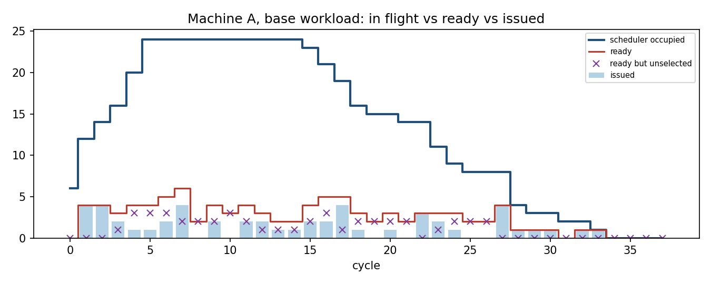
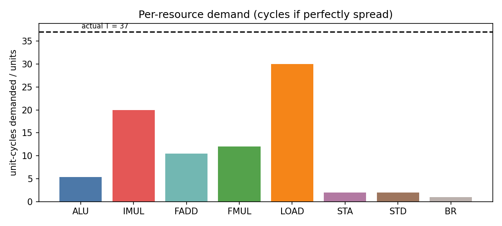
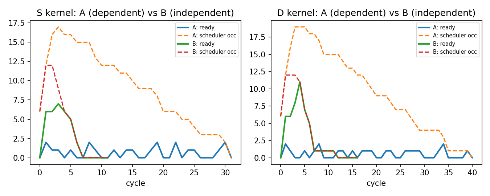
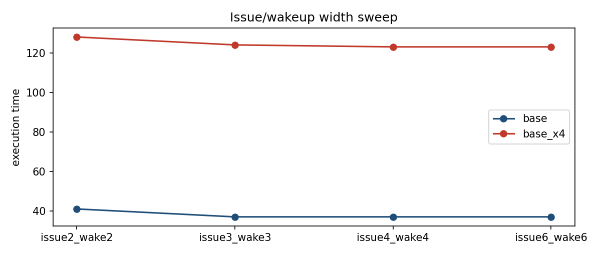
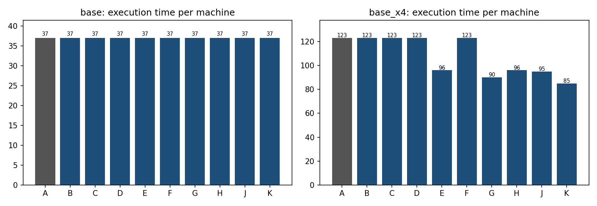
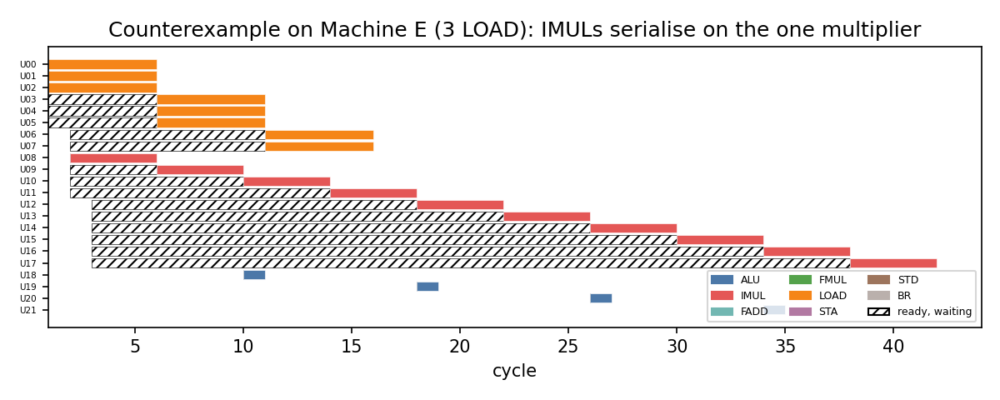

## 1. Objective and Machine

A uop that is *in the scheduler* is not a uop that *executes*. Between "all operands arrived" and "starts on a unit" there
are three more gates: **select** (a unit of the right class must be free), **issue** (an issue slot must be free) and,
earlier, **wakeup** (a tag broadcast must be delivered). This report uses a cycle-level Python model (`src/sched/`) to
answer: *a uop is ready, units exist, so why did it not execute?* Every number below is read from the simulator output in
`results/` (traces, CSVs, plots); the cycle and uop IDs are the ones in `results/traces/`.

| Parameter | Machine A (baseline) |
|---|---|
| Dispatch / issue / wakeup width | 6 uops / 6 uops / 6 source operands per cycle |
| Scheduler | 24 entries |
| Units | 3 ALU, 1 IMUL, 2 FADD, 2 FMUL, 2 LOAD/AGU, 1 STA, 1 STD, 1 BR |
| Latency | ALU 1, IMUL 4, FADD 3, FMUL 4, LOAD 5, STORE 1, BRANCH 1 |

## 2. The Simulator

**Per-cycle order:** (1) *dispatch* in order, up to 6, while a scheduler entry is free; a uop dispatched in cycle *t*
can first be selected in *t+1*. (2) *select*: every ready uop competes for the free units of **its own class**, oldest
(lowest ID) first. (3) *issue*: the selected set is trimmed to the issue width, oldest first; issue frees the scheduler
entry (usable by dispatch from *t+1*). (4) *wakeup*: producers whose tag broadcast is due wake consumer source operands,
at most `wakeup_width` per cycle. (5) *complete* bookkeeping.
A producer that issues at *s* with latency *L* broadcasts at *s+L-1*; the woken operand is usable one cycle later, so a
1-cycle ALU result feeds a consumer in *s+1*. If the wakeup budget is exhausted the operand is woken a cycle later and the
consumer is "data-available but not ready" -- this is how wakeup bandwidth becomes visible.

**Events kept separate** (`results/per_uop.csv`): dispatch, operand-ready (last source usable), *first selected*, issue,
complete. Ready, selected and issued are three different per-cycle counts (`results/per_cycle.csv`): "selected" = won the
class arbitration; "issued" = also fit in the issue width. A selected-but-not-issued uop is reported separately.

**Modelling choices not in the brief** (fixed before any experiment, never tuned):

* **A unit is occupied from issue until completion** (so a LOAD holds a LOAD/AGU for 5 cycles, an IMUL holds the multiplier
  for 4). This is the simplest reading of "the resource is occupied"; a fully pipelined sensitivity run is in Section 10.3.
* A STORE is one scheduler entry with two parts, STA (address operand) and STD (data operand), each issuing on its own
  unit; the store completes when both are done. Issue width counts parts.
* Registers are renamed, so only RAW dependences exist; initial register values are live-in and ready at dispatch.
* The workload is extended with **I48 `BR R55`** (a loop-closing branch on the last ADD) so that the Branch unit is
  exercised. The 48 given instructions are unchanged. `I<n>` and `U<n>` are the same thing (one uop per instruction).
* Because the 49-uop stream is short, some experiments also use `base_x4`: four back-to-back copies (196 uops; copies
  share only live-ins and the R55 chain). The brief allows extending the stream; both are reported everywhere.

Files: `inputs/base.asm`, `inputs/*.asm` (all streams), `results/traces/<run>.txt` (cycle-by-cycle), `results/*.csv`,
`results/plots/`, `results/plots_sudarshan/`, code in `src/`.

## 3. The Workload and Its Resource Mix

| resource | uops | units | lat | unit-cycles demanded | cycles if perfectly spread |
|---|---|---|---|---|---|
| ALU | 16 | 3 | 1 | 16 | 5.3 |
| IMUL | 5 | 1 | 4 | 20 | 20.0 |
| FADD | 7 | 2 | 3 | 21 | 10.5 |
| FMUL | 6 | 2 | 4 | 24 | 12.0 |
| LOAD | 12 | 2 | 5 | 60 | 30.0 |
| STA | 2 | 1 | 1 | 2 | 2.0 |
| STD | 2 | 1 | 1 | 2 | 2.0 |
| BR | 1 | 1 | 1 | 1 | 1.0 |


51 issue parts from 49 uops (the 2 stores split). `LOAD` is the most heavily demanded class: 60 unit-cycles on 2 units
means **at least 30 cycles of load-unit time**, against the 37-cycle run. IMUL (20 cycles on one unit) is second.

## 4. Investigation 1 -- Where Does the Parallelism Come From?

Complete per-cycle state of Machine A (`occ` = scheduler entries after dispatch, `wait` = occupied minus ready, `sel` =
winners of class arbitration, `iss` = issued, `lost` = ready parts that lost arbitration, `busy` = units busy after issue as ALU/IMUL/FADD/FMUL/LOAD):

| cyc | occ | wait | rdy | sel | iss | lost | issued | busy |
|---|---|---|---|---|---|---|---|---|
| 0 | 6 | 6 | 0 | 0 | 0 | 0 | - | 0/0/0/0/0 |
| 1 | 12 | 8 | 4 | 4 | 4 | 0 | U00 U01 U04 U05 | 2/0/1/1/0 |
| 2 | 14 | 10 | 4 | 4 | 4 | 0 | U02 U03 U06 U08 | 2/0/1/1/2 |
| 3 | 16 | 13 | 3 | 2 | 2 | 1 | U07 U12 | 1/1/1/1/2 |
| 4 | 20 | 16 | 4 | 1 | 1 | 3 | U11 | 0/1/1/1/2 |
| 5 | 24 | 20 | 4 | 1 | 1 | 3 | U10 | 0/1/1/1/2 |
| 6 | 24 | 19 | 5 | 2 | 2 | 3 | U32 U33 | 2/1/1/1/2 |
| 7 | 24 | 18 | 6 | 4 | 4 | 2 | U09 U13 U14 U18 | 0/1/1/1/2 |
| 8 | 24 | 22 | 2 | 0 | 0 | 2 | - | 0/1/1/1/2 |
| 9 | 24 | 20 | 4 | 2 | 2 | 2 | U17 U38 | 1/1/1/1/2 |
| 10 | 24 | 21 | 3 | 0 | 0 | 3 | - | 0/1/0/1/2 |
| 11 | 24 | 20 | 4 | 2 | 2 | 2 | U15 U39 | 1/1/0/1/2 |
| 12 | 24 | 21 | 3 | 2 | 2 | 1 | U16 U34 | 0/1/0/1/2 |
| 13 | 24 | 22 | 2 | 1 | 1 | 1 | U23 | 0/1/1/0/2 |
| 14 | 24 | 22 | 2 | 1 | 1 | 1 | U47 | 1/1/1/0/2 |
| 15 | 23 | 19 | 4 | 2 | 2 | 2 | U42 U48 | 1/0/1/0/2 |
| 16 | 21 | 16 | 5 | 2 | 2 | 3 | U25 U45 | 1/0/0/1/2 |
| 17 | 19 | 14 | 5 | 4 | 4 | 1 | U19 U35 U40 U46.STA | 1/0/0/1/2 |
| 18 | 16 | 13 | 3 | 1 | 1 | 2 | U21 | 0/1/0/1/2 |
| 19 | 15 | 13 | 2 | 0 | 0 | 2 | - | 0/1/0/1/2 |
| 20 | 15 | 12 | 3 | 1 | 1 | 2 | U28 | 0/1/1/0/2 |
| 21 | 14 | 12 | 2 | 0 | 0 | 2 | - | 0/1/1/0/2 |
| 22 | 14 | 11 | 3 | 3 | 3 | 0 | U20 U22 U43 | 1/0/1/0/2 |
| 23 | 11 | 8 | 3 | 2 | 2 | 1 | U26 U36 | 1/0/0/1/2 |
| 24 | 9 | 6 | 3 | 1 | 1 | 2 | U29 | 0/1/0/1/2 |
| 25 | 8 | 6 | 2 | 0 | 0 | 2 | - | 0/1/0/1/2 |
| 26 | 8 | 6 | 2 | 0 | 0 | 2 | - | 0/1/0/1/2 |
| 27 | 8 | 4 | 4 | 4 | 4 | 0 | U24 U27 U37 U46.STD | 0/1/1/0/2 |
| 28 | 4 | 3 | 1 | 1 | 1 | 0 | U30 | 1/0/1/0/2 |
| 29 | 3 | 2 | 1 | 1 | 1 | 0 | U31.STA | 0/0/1/0/2 |
| 30 | 3 | 2 | 1 | 1 | 1 | 0 | U41 | 0/0/1/0/2 |
| 31 | 2 | 2 | 0 | 0 | 0 | 0 | - | 0/0/1/0/2 |
| 32 | 2 | 1 | 1 | 1 | 1 | 0 | U31.STD | 0/0/1/0/0 |
| 33 | 1 | 0 | 1 | 1 | 1 | 0 | U44 | 0/0/0/1/0 |
| 34 | 0 | 0 | 0 | 0 | 0 | 0 | - | 0/0/0/1/0 |
| 35 | 0 | 0 | 0 | 0 | 0 | 0 | - | 0/0/0/1/0 |
| 36 | 0 | 0 | 0 | 0 | 0 | 0 | - | 0/0/0/1/0 |
| 37 | 0 | 0 | 0 | 0 | 0 | 0 | - | 0/0/0/0/0 |


*Reading it.* The scheduler fills to 24/24 at **cycle 5** and stays full to cycle 13 (dispatch blocked 9 cycles; the
last uop, U48, enters at cycle 14). The average number of *ready* uops is only **2.82** against **12.0 waiting** per
cycle, and the average issue rate is **1.5** per cycle (peak 4). 49 uops are "in flight" in the scheduler at once but at
most 6 (cycle 7) can execute. Six cycles (**8, 10, 19, 21, 25, 26**) have 2--3 ready uops and issue *nothing*: every ready uop needs
a unit class that is full (cycle 8: U34, U35 need LOAD; cycle 10: U34, U35 need LOAD, U39 needs IMUL; cycles 25--26: U24, U27 need LOAD).

{width=88%}

### Three dependency chains (from `results/inv1_chains.csv`)

**Chain 1 -- FP chain, the critical path.** `U04 FMUL -> U10 FMUL -> U17 FMUL -> U23 FADD -> U25 FMUL -> U28 FADD -> U36 FMUL -> U37 FADD -> U41 FADD -> U44 FMUL`

| uop | instruction | eligible (operand-ready) c | because | issue c | complete c | wait | why it waited |
|---|---|---|---|---|---|---|---|
| U04 | FMUL F10, F2, F3 | 1 | live-in/dispatch | 1 | 5 | 0 | - |
| U10 | FMUL F12, F10, F6 | 5 | U04->F10 | 5 | 9 | 0 | - |
| U17 | FMUL F14, F12, F8 | 9 | U10->F12 | 9 | 13 | 0 | - |
| U23 | FADD F16, F14, F15 | 13 | U17->F14 | 13 | 16 | 0 | - |
| U25 | FMUL F17, F16, F10 | 16 | U23->F16 | 16 | 20 | 0 | - |
| U28 | FADD F18, F17, F11 | 20 | U25->F17 | 20 | 23 | 0 | - |
| U36 | FMUL F19, F18, F12 | 23 | U28->F18 | 23 | 27 | 0 | - |
| U37 | FADD F20, F19, F16 | 27 | U36->F19 | 27 | 30 | 0 | - |
| U41 | FADD F21, F20, F17 | 30 | U37->F20 | 30 | 33 | 0 | - |
| U44 | FMUL F22, F21, F19 | 33 | U41->F21 | 33 | 37 | 0 | - |


Every link issues in the cycle it becomes eligible (wait 0): *nothing but the producer's latency* prevents an earlier
start. The chain's latencies 4+4+4+3+4+3+4+3+3+4 = 36 plus the first-issue cycle give the run length **T = 37**; U44
completes at cycle 37. This chain, not any resource, sets execution time on Machine A.

**Chain 2 -- integer address -> multiply -> load chain.** `U00 -> U06 -> U12 -> U14 (IMUL) -> U15 -> U16 (LOAD) -> U19 -> U21 (IMUL) -> U22 -> U26 -> U29 (IMUL) -> U30 -> U31 (STORE)`

| uop | instruction | eligible (operand-ready) c | because | issue c | complete c | wait | why it waited |
|---|---|---|---|---|---|---|---|
| U00 | ADD R20, R1, R2 | 1 | live-in/dispatch | 1 | 2 | 0 | - |
| U06 | ADD R22, R20, R6 | 2 | U00->R20 | 2 | 3 | 0 | - |
| U12 | ADD R25, R22, R26 | 3 | U06->R22 | 3 | 4 | 0 | - |
| U14 | IMUL R27, R25, R28 | 4 | U12->R25 | 7 | 11 | 3 | IMUL unit(s) occupied by U07 |
| U15 | ADD R29, R27, R30 | 11 | U14->R27 | 11 | 12 | 0 | - |
| U16 | LOAD R15, [R29 + 0] | 12 | U15->R29 | 12 | 17 | 0 | - |
| U19 | ADD R31, R15, R32 | 17 | U16->R15 | 17 | 18 | 0 | - |
| U21 | IMUL R33, R31, R34 | 18 | U19->R31 | 18 | 22 | 0 | - |
| U22 | ADD R35, R33, R36 | 22 | U21->R33 | 22 | 23 | 0 | - |
| U26 | ADD R37, R35, R38 | 23 | U22->R35 | 23 | 24 | 0 | - |
| U29 | IMUL R39, R37, R40 | 24 | U26->R37 | 24 | 28 | 0 | - |
| U30 | ADD R41, R39, R42 | 28 | U29->R39 | 28 | 29 | 0 | - |
| U31 | STORE [R41 + 0], R18 | 32 | U27->R18 | 32 | 33 | 0 | - |


Here U14 becomes eligible at **cycle 4** (U12 completes) but issues at **cycle 7**: the single IMUL is held by U07 (issued
cycle 3). This three-cycle resource delay pushes U15, U16 and U19 later; the chain still finishes (U31 completes cycle 33)
before the FP chain (37), so it does not set T.

**Chain 3 -- second address chain.** `U00 -> U32 -> U38 -> U39 (IMUL) -> {U40 LOAD, U42 -> U43 LOAD, U45} -> U46 (STORE)`

| uop | instruction | eligible (operand-ready) c | because | issue c | complete c | wait | why it waited |
|---|---|---|---|---|---|---|---|
| U00 | ADD R20, R1, R2 | 1 | live-in/dispatch | 1 | 2 | 0 | - |
| U32 | ADD R43, R20, R44 | 6 | U00->R20 | 6 | 7 | 0 | - |
| U38 | ADD R47, R43, R48 | 9 | U32->R43 | 9 | 10 | 0 | - |
| U39 | IMUL R49, R47, R50 | 10 | U38->R47 | 11 | 15 | 1 | IMUL unit(s) occupied by U14 |
| U40 | LOAD R21, [R49 + 0] | 15 | U39->R49 | 17 | 22 | 2 | LOAD unit(s) occupied by U16, U34 |
| U42 | ADD R51, R49, R52 | 15 | U39->R49 | 15 | 16 | 0 | - |
| U43 | LOAD R22, [R51 + 0] | 16 | U42->R51 | 22 | 27 | 6 | LOAD unit(s) occupied by U16, U34 |
| U45 | ADD R53, R51, R54 | 16 | U42->R51 | 16 | 17 | 0 | - |
| U46 | STORE [R53 + 0], R22 | 27 | U43->R22 | 27 | 28 | 0 | - |


U39 waits 1 cycle for the multiplier (held by U14, cycles 7--11); U40 waits 2 and U43 waits **6 cycles** for a LOAD unit.

**Independent work that executes while a chain waits.** While the FP chain sits in U17's 4-cycle latency (cycles 9--13),
the machine issues U38 (cycle 9), U15 and U39 (cycle 11), U16 and U34 (cycle 12): work from chains 2 and 3. While chain 2
waits for U14 (cycles 4--6), the machine issues U11 (cycle 4), U10 (cycle 5), and U32, U33 (cycle 6). *In flight* (49
entries over the run, up to 24 at once) is therefore very different from *can execute now* (2.82 on average).

## 5. Investigation 2 -- The Ready-uop Problem

All 27 cycles with >=2 ready uops are in `results/inv2_multi_ready_cycles.csv`. Three are analysed in full.

**Case 1 -- Cycle 4** (scheduler 20/24)

| Field | Value |
|---|---|
| Ready uops | U09 LOAD, U11 FADD, U13 LOAD, U14 IMUL |
| Selected | U11 |
| Ready but unselected | U09, U13, U14 |
| Required / available resource | LOAD x2 needed, **0 free** (both held by U02, U03 until cycle 7). IMUL needed, **0 free** (held by U07 until cycle 7). FADD needed, 2 free |
| Issue slots | 1 of 6 used (5 free) |
| Wakeup availability | 6 per cycle, 2 used (no pressure) |

Why each stayed: **U09** -- LOAD0/LOAD1 are occupied by U02 and U03, issued cycle 2, each holding a unit 5 cycles, free at
cycle 7. **U13** -- same two units, same reason. **U14** -- IMUL0 is occupied by U07 (issued cycle 3, 4-cycle latency,
free at cycle 7). None of these was beaten by a priority decision: no unit of their class existed to give. Meanwhile ALU
had 3 idle units and 5 issue slots were unused.

**Case 2 -- Cycle 7** (scheduler 24/24, dispatch blocked)

| Field | Value |
|---|---|
| Ready uops | U09, U13, U34, U35 (all LOAD); U14 IMUL; U18 FADD |
| Selected | U09, U13, U14, U18 |
| Ready but unselected | U34, U35 |
| Required / available resource | LOAD needed by 4, **2 free** (U02/U03 complete at 7). IMUL 1 free (U07 completes at 7), FADD 2 free (U11 completes at 7), ALU 3 free |
| Issue slots | 4 used, 2 remaining |
| Wakeup availability | 6 available, 0 used |

U34 and U35 became ready at cycle 7 together with U09 and U13, but only two LOAD units came free. The tie-break (oldest
first) gave them to U09 and U13; the *condition* behind the loss is that **four loads wanted a two-unit class in the same
cycle**. Because a load then holds its unit for 5 cycles, U34 and U35 are blocked again at cycles 8--11. Two issue slots
were left unused -- slots were not the constraint.

**Case 3 -- Cycle 12** (scheduler 24/24)

| Field | Value |
|---|---|
| Ready uops | U16, U34, U35 (all LOAD) |
| Selected | U16, U34 |
| Ready but unselected | U35 |
| Required / available resource | LOAD x3, **2 free** (U09/U13 complete at 12). ALU 3, FADD 2, FMUL 1 free but unrequested |
| Issue slots | 2 used, 4 remaining |
| Wakeup availability | 6 available, 1 used |

U35 had been ready since cycle 7 yet loses to **U16, which became ready only this cycle**: select orders by program
order, not by waiting time. U35 then waits until cycle 17 (10 cycles ready-to-issue) because U16 and U34 occupy both units
from 12 to 17.

## 6. Investigation 3 -- Execution-Resource Contention

Classification is the table in Section 3. **LOAD is the most demanded resource**: 41 of the 45 ready-but-unselected
uop-cycles in the whole run are loads (the other 4 are U14 waiting for the multiplier). Utilization over 38 cycles: LOAD
78.9%, IMUL 52.6%, FMUL 31.6%, FADD 27.6%, ALU 14.0%, STA/STD 5.3%, BR 2.6%.

**Case A -- many ready uops, one resource.** Cycle 7 above: four loads for two units; also cycle 16 (U35, U40, U43 vs the
two units held by U16/U34 until 17).

**Case B -- units idle while ready work waits.** **Cycle 4**: U09/U13/U14 wait while **3 ALUs, 1 FADD, 1 FMUL, STA, STD,
BR are free**. Across the run, in **23 of 38 cycles** some other class had idle units while a ready uop waited, with 192
idle unit-slots in those cycles (`results/tables/stranded.md`). Total execution capacity is therefore a poor predictor: the
machine has 13 units and 6 issue slots, but the work that is *ready* is made of loads, and "a unit is available" (an ALU is
idle) is not "a unit **capable of executing this uop** is available" (a LOAD/AGU is). Integer ALUs cannot execute IMUL
or LOAD; FP units cannot execute address arithmetic.

{width=70%}

## 7. Investigation 4 -- Dependency Structure

Kernel (20 uops: 7 ADD, 3 LOAD, 2 IMUL, 3 FMUL, 4 FADD, 1 STORE). **Version A** keeps long producer-consumer chains
(`inputs/s_inv4_A.asm`); **Version B** (`s_inv4_B.asm`) keeps the *same opcodes and destinations* but every source is a
fresh live-in, so no uop depends on another.

```
A:  ADD R20,R1,R2 ; ADD R21,R20,R3 ; LOAD R10,[R21] ; ADD R22,R10,R4 ; LOAD R11,[R22] ; FMUL F10,F2,F3 ;
    FADD F11,F10,F4 ; FMUL F12,F11,F5 ; FADD F13,F12,F6 ; IMUL R23,R11,R7 ; ADD R24,R23,R8 ; LOAD R12,[R24] ;
    FMUL F14,F13,F7 ; FADD F15,F14,F8 ; ADD R25,R12,R9 ; IMUL R26,R25,R13 ; ADD R27,R26,R14 ;
    STORE [R27],F15 ; FADD F16,F15,F9 ; ADD R28,R27,R15
```

| metric | Version A (dependent) | Version B (independent) |
|---|---|---|
| execution time (cycles) | 31 | 11 |
| avg scheduler occupancy | 9.35 | 7.43 |
| peak scheduler occupancy | 17 | 12 |
| avg ready uops / cycle | 0.68 | 4.57 |
| peak ready uops | 2 | 7 |
| issue rate (uops/cycle, active) | 0.677 | 3.0 |
| IPC (uops / T) | 0.645 | 1.818 |
| cycles with entries but 0 ready | 15 | 1 |
| ready-but-unselected uop-cycles | 0 | 12 |
| ALU util | 0.073 | 0.194 |
| IMUL util | 0.25 | 0.667 |
| FADD util | 0.188 | 0.5 |
| FMUL util | 0.188 | 0.5 |
| LOAD util | 0.234 | 0.625 |


*What changed.* In A the ready pool never exceeds **2 uops** and **15 of 31 cycles** have waiting uops but none ready;
every issue is a single link of a chain (e.g. cycles 2, 3, 5: U01, U02, U06 issue one per cycle). Nothing ever competes
(0 ready-but-unselected), so units sit idle and execution time is the sum of chain latencies, **31 cycles**. In B, 6
uops issue at cycle 1 and the ready pool reaches **7**: now the units matter. Contention appears (12 ready-unselected
uop-cycles, e.g. cycle 3: U14, U16, U17.STA, U17.STD issue but others queue; cycle 4: six ready, only U19 issues, the
other five need busy LOAD/IMUL units) and time falls to **11 cycles**. Scheduler occupancy *dropped* (9.35 -> 7.43) because B
drains its entries instead of holding them: a fuller scheduler (A) is *worse*, not better. Independence turned latency-bound
execution into resource-bound execution.

{width=88%}

## 8. Investigation 5 -- Scheduler Capacity

**Predictions (static analysis, Section 10.1).** *Base:* the run is bound by the 37-cycle FP chain; a 12-entry scheduler
will delay dispatch of later (in-order) uops a little, 48 entries will not help. *Base x4:* the window is not the limit;
LOAD capacity is (120-cycle bound), so 48 entries should help little, while 12 will hurt.

| wl | sched | T | avg occ | peak occ | disp-blocked | avg rdy | peak rdy | lost | issue rate | LOAD util | IMUL util | limiter |
|---|---|---|---|---|---|---|---|---|---|---|---|---|
| 1x | 6 | 42 | 5.52 | 6 | 35 | 1.45 | 4 | 11 | 1.214 | 0.698 | 0.465 | window |
| 1x | 12 | 39 | 9.62 | 12 | 26 | 2.08 | 5 | 30 | 1.308 | 0.75 | 0.5 | window |
| 1x | 24 | 37 | 14.82 | 24 | 9 | 2.82 | 6 | 45 | 1.5 | 0.789 | 0.526 | dataflow |
| 1x | 48 | 37 | 15.74 | 34 | 0 | 2.88 | 7 | 47 | 1.5 | 0.789 | 0.526 | dataflow |
| 1x | 96 | 37 | 15.74 | 34 | 0 | 2.88 | 7 | 47 | 1.5 | 0.789 | 0.526 | dataflow |
| x4 | 6 | 156 | 5.87 | 6 | 149 | 1.6 | 5 | 50 | 1.308 | 0.764 | 0.51 | mix: window, IMUL, LOAD |
| x4 | 12 | 136 | 11.2 | 12 | 122 | 2.96 | 8 | 199 | 1.5 | 0.876 | 0.584 | mix: LOAD, window, IMUL |
| x4 | 24 | 123 | 20.59 | 24 | 90 | 6.1 | 10 | 546 | 1.659 | 0.968 | 0.645 | LOAD |
| x4 | 48 | 123 | 33.15 | 48 | 49 | 10.39 | 19 | 1073 | 1.659 | 0.968 | 0.645 | LOAD |
| x4 | 96 | 123 | 42.54 | 96 | 4 | 12.83 | 29 | 1372 | 1.659 | 0.968 | 0.645 | LOAD |


(`1x` = the 49-uop kernel, `x4` = four copies; `lost` = ready-but-unselected uop-cycles; `window` = scheduler capacity; `mix:` = no single constraint buys more than half of the gap to the dataflow bound.)

* **More useful work enters the scheduler?** Only because dispatch finishes sooner: on base, 48 entries gives 0 dispatch-blocked
  cycles (vs 9) and peak occupancy 34. On base_x4 average occupancy goes 20.6 -> 33.2.
* **More uops become ready?** Yes: base_x4 average ready 6.1 -> 10.4, peak 10 -> 19.
* **More issue opportunities?** No: issue rate stays **1.659** at 24, 48 and 96 entries.
* **Better utilisation?** No: LOAD utilisation is **96.8% at every size** from 24 up: already saturated.
* **Another bottleneck?** The bottleneck was already LOAD/AGU: 1073 uop-cycles of ready-unselected waiting at 48 entries
  vs 546 at 24, but the same 123 cycles.

**Little-improvement case:** base_x4, 24 -> 48 -> 96 entries: **123, 123, 123 cycles**. The extra entries hold *more ready
loads* (ready-unselected doubles) but there are still only 2 LOAD units, each busy 5 cycles per load. **The only
improvements are on the downside**: 12 entries cost +2 cycles (base) and +13 (x4); 6 entries cost +5 and +33. The 12-entry
base run slows because dispatch is in order: the second address chain U32...U46 is dispatched at cycles 17--28 instead of 5--14, U43 issues at
33 instead of 22 and U46 completes at **39**, overtaking the FP chain (37) as the longest path. The window turned a non-critical chain critical.

## 9. Investigation 6 -- Issue and Wakeup Limits

**Prediction:** the workload averages 1.5 issues/cycle with a peak of 4, so 3-wide issue/wakeup should cost 0--1 cycles.

| wl | issue/wake | T | issue rate | avg rdy | sel-not-issued | wakes deferred | lost | LOAD util | limiter |
|---|---|---|---|---|---|---|---|---|---|
| 1x | I2/W2 | 41 | 1.342 | 2.03 | 12 | 23 | 14 | 0.714 | mix: issue, wake, LOAD |
| 1x | I3/W3 | 37 | 1.457 | 2.31 | 4 | 4 | 27 | 0.789 | dataflow |
| 1x | I3/W6 | 37 | 1.457 | 2.34 | 4 | 0 | 28 | 0.789 | dataflow |
| 1x | I6/W3 | 37 | 1.5 | 2.82 | 0 | 1 | 45 | 0.789 | dataflow |
| 1x | I4/W4 | 37 | 1.5 | 2.82 | 0 | 0 | 45 | 0.789 | dataflow |
| 1x | I6/W6 | 37 | 1.5 | 2.82 | 0 | 0 | 45 | 0.789 | dataflow |
| x4 | I2/W2 | 128 | 1.594 | 4.8 | 88 | 105 | 323 | 0.93 | mix: LOAD, issue, wake |
| x4 | I3/W3 | 124 | 1.645 | 5.7 | 16 | 6 | 489 | 0.96 | mix: LOAD, issue |
| x4 | I3/W6 | 124 | 1.645 | 5.72 | 19 | 0 | 488 | 0.96 | mix: LOAD, issue |
| x4 | I6/W3 | 123 | 1.659 | 5.85 | 0 | 12 | 515 | 0.968 | LOAD |
| x4 | I4/W4 | 123 | 1.659 | 5.96 | 8 | 2 | 522 | 0.968 | LOAD |
| x4 | I6/W6 | 123 | 1.659 | 6.1 | 0 | 0 | 546 | 0.968 | LOAD |


Configuration A (3/3) vs B (6/6): **37 vs 37 cycles** on base, **124 vs 123** on x4. The extra bandwidth is used in only a
handful of cycles. With width 3, `selected-not-issued` fires 4 times: cycle 1 (U05 loses to U00, U01, U04), cycle 2 (U06 and
U08 lose to U02, U03, U05) and cycle 12 (U39). With wakeup 3, cycle 4 has 6 operands to wake and only 3 are granted (3
deferred) and cycle 26 defers 1. They delay a few uops by one cycle (U06, U08 issue at cycle 3 instead of 2, so U07 starts
at 4 instead of 3), but none of them is on the FP critical path. Only at **2/2** does the machine slow (41 / 128 cycles,
12 selected-not-issued, 23 deferred wakeups). **Next limiting resource:** on base the FP chain (critical path); on x4 the
two LOAD/AGU units (96.8% busy). The workload does not contain enough *executable* work to use 6 issue slots: only 6 cycles
issue more than 2 uops.

{width=70%}

## 10. Investigation 7 -- The Bottleneck Moves

### 10.1 How predictions were made

`src/predict.py` computes, from the program text alone, the dataflow critical path and for each class
`ceil(sum of unit-occupancy / units)`; predicted time = the larger, predicted limiter = whichever attains it.
`results/predictions.csv` was produced before `run_all.py`. The actual limiter is found by *relaxing each constraint
one at a time* (infinite scheduler, issue width, wakeup, each unit class) and seeing which relaxation buys cycles
(`results/bottleneck_attribution.csv`). If no relaxation helps, execution is dataflow-bound.

| wl | machine | crit. path | LOAD | IMUL | FMUL | FADD | ALU | pred. T | pred. limiter | sim. T |
|---|---|---|---|---|---|---|---|---|---|---|
| 1x | A orig | 37 | 30 | 20 | 12 | 11 | 6 | 37 | dataflow | 37 |
| 1x | E load3 | 37 | 20 | 20 | 12 | 11 | 6 | 37 | dataflow | 37 |
| x4 | A orig | 37 | 120 | 80 | 48 | 42 | 22 | 120 | LOAD | 123 |
| x4 | E load3 | 37 | 80 | 80 | 48 | 42 | 22 | 80 | IMUL | 96 |


### 10.2 The machines (A--F required, plus follow-ups G--K)

| machine | T 1x | T x4 | pred. T x4 | pred. limiter | actual limiter | gain if relaxed (x4) |
|---|---|---|---|---|---|---|
| A orig | 37 | 123 | 120 | LOAD | LOAD | LOAD -28 |
| B sched48 | 37 | 123 | 120 | LOAD | LOAD | LOAD -36 |
| C alu4 | 37 | 123 | 120 | LOAD | LOAD | LOAD -28 |
| D imul2 | 37 | 123 | 120 | LOAD | LOAD | LOAD -36 |
| E load3 | 37 | 96 | 80 | IMUL | mix: window, IMUL, LOAD | window -9, IMUL -6, LOAD -1 |
| F issue8 | 37 | 123 | 120 | LOAD | LOAD | LOAD -28 |
| G load3 imul2 | 37 | 90 | 80 | LOAD | mix: window, LOAD | window -5, LOAD -3 |
| H load4 | 37 | 96 | 80 | IMUL | mix: IMUL, window, LOAD | window -6, IMUL -9, LOAD -1 |
| I load3 imul2 fmul3 | 37 | 90 | 80 | LOAD | mix: window, LOAD | window -5, LOAD -5 |
| J loadpipe | 37 | 95 | 80 | IMUL | mix: window, IMUL | window -8, IMUL -8 |
| K allpipe | 37 | 85 | 37 | dataflow | mix: window, IMUL | window -22, IMUL -1 |


| Machine | Prediction | Outcome | Bottleneck moved? |
|---|---|---|---|
| **B** sched 48 | no gain; scheduler not limiting | base 37, x4 123 | No: LOAD/AGU stays limiting |
| **C** 4 ALUs | no gain; ALU util is 14% | 37 / 123 | No: ALU was never contended |
| **D** 2 IMUL | base: no gain (dataflow); x4: no gain, LOAD limits | 37 / 123 | No. IMUL gain only appears once LOAD is fixed (G) |
| **E** 3 LOAD | x4 -> 80 cycles, limiter becomes IMUL | 37 / **96**, ready-unsel 546 -> 135 | **Yes**, but to scheduler window + IMUL, not IMUL alone |
| **F** issue 8 | no gain; 1.66 issues/cycle vs 6 | 37 / 123 | No |
| **G** 3 LOAD + 2 IMUL | x4 -> 80, limiter LOAD | 37 / **90** | **Yes**: scheduler window (-5) and LOAD (-3) |

**Result for E (the central one).** Prediction 80 cycles was **wrong** (actual 96). The static bound ignores that after
the third load unit the 24-entry in-order window and the single multiplier together keep the pipeline from refilling: relaxing the
scheduler would give -9, an unlimited IMUL -6, an unlimited LOAD only -1. The bottleneck moved from *LOAD/AGU* to a
*window + multiplier* limit. After G (add a second IMUL) the remaining gains come from scheduler capacity (-5) and LOAD (-3):
the limit is no longer one structure. Fully pipelined units (K, 85 cycles) leave the scheduler as the dominant limiter
(-22): once execution resources stop being the problem, window size is.

On the single-iteration workload **every machine A--K gives 37 cycles**: the FP chain is the only thing that matters, which
is why the bottleneck "moves" in secondary metrics only (E cuts ready-unselected uop-cycles 45 -> 9, utilisation of LOAD
78.9% -> 52.6%).

{width=95%}

### 10.3 Pipelining sensitivity

| machine | T 1x | T x4 | lost (x4) |
|---|---|---|---|
| A orig | 37 | 123 | 546 |
| J loadpipe | 37 | 95 | 60 |
| K allpipe | 37 | 85 | 2 |


If every unit accepted a new uop each cycle the single-iteration time would be unchanged (37) while x4 falls 123 -> 85:
the model's "occupied for the whole latency" assumption is what makes the base stream contend at all.

## 11. The OOO Crime Scene -- Cycle 4

```
Cycle: 4
Scheduler: occupied 20/24, ready 4, waiting 16
Ready uops:    U09 LOAD R12,[R24]   U11 FADD F13,F11,F7   U13 LOAD R14,[R25]   U14 IMUL R27,R25,R28
Selected uops: U11
Execution resources:
  Available (free at select): ALU 3/3, FADD 2/2, FMUL 1/2, STA 1, STD 1, BR 1, IMUL 0/1, LOAD 0/2
  Busy: IMUL0 = U07 (issued c3, free c7)   LOAD0 = U02, LOAD1 = U03 (issued c2, free c7)
        FMUL0 = U04 (until c5)   FADD = U11 (selected now)
Issue slots: Used 1   Remaining 5
Wakeup: Available 6 operands/cycle   Used 2   (no deferral)
Waiting (16): U10, U15--U29 -- e.g. U15 waits on R27 from U14; U17 waits on F12 from U10 (ready c9)
```

**Why did U11 execute and not U09, U13, U14?**

```
U14 did not execute
  v  U14 requires the integer multiplier
  v  the only IMUL unit is occupied (IMUL0 busy until c7, 4-cycle non-pipelined)
  v  U07 was selected at cycle 3 and holds it
  v  U07 was the only IMUL-ready uop at cycle 3 (U14 became ready at cycle 4, one cycle later)
  v  U07 became ready at cycle 3 when U06 completed (U06: ADD R22, issued c2)
  v  U06 became ready at cycle 2 when U00 completed (U00: ADD R20, live-in sources, issued c1)
```

```
U09 and U13 did not execute
  v  both require LOAD/AGU;  v  both units occupied (U02, U03 issued c2, 5 cycles)
  v  U02/U03 were selected at cycle 2 when their address U00 completed
```

U11 won only because it needs FADD and two FADD units were free: **there was no priority decision at all**. The unsettling
part is that U07's result R23 and the loads' results R10, R11 (U02, U03), R12 (U09), R14 (U13) are *never read* by any later uop: in this
stream only 3 of the 12 loads (U16, U27, U43) feed anything. The oldest-ready work, much of it dead, occupied the units that the live
chain uop U14 needed, and later dead loads (U34, U35, U40) delayed the live load U43 by 6 cycles. The scheduler orders by
program order and readiness; it cannot see which result matters.

## 12. One Architecture I Would Change: LOAD/AGU 2 -> 3

**Poorly matched parameter:** the load/AGU count. **Workload characteristic:** a high density of loads (12 of 49 uops, 60
of 146 unit-cycles) that each hold a unit 5 cycles, many arriving at the same time. **Trace evidence**

* 41 of 45 ready-but-unselected uop-cycles are loads; U34 waits 5 cycles (ready c7, issue c12), U35 waits 10 (c7 -> c17),
  U43 waits 6 (c16 -> c22), U09 waits 4, U20 4, U24 4.
* LOAD utilisation is 78.9% on base and **96.8% on base_x4**; relaxing LOAD alone saves 28 of the 86 cycles above the
  critical path (x4).
* In cycles 4, 7, 12, 16, 18 the *other* units are idle (ALU 3/3 free at cycle 4).

**Result (Machine E):** base_x4 **123 -> 96 cycles (-22%)**, ready-but-unselected uop-cycles 546 -> 135, IPC 1.59 -> 2.04. On
base alone T stays **37** because the critical FP chain is untouched, but unselected load-cycles fall 41 -> 4 and the
integer chains finish earlier. I would not claim the benefit for latency-bound code.

## 13. Final Challenge -- A Workload Where the Third Load Unit Does Not Help

`inputs/s_counterexample.asm`: 8 independent loads, 10 independent IMULs, 4 ADDs that consume IMUL results.

| machine | T | LOAD util | IMUL util | lost | avg rdy | limiter |
|---|---|---|---|---|---|---|
| A orig | 42 | 0.465 | 0.93 | 232 | 6.51 | IMUL |
| E load3 | 42 | 0.31 | 0.93 | 207 | 5.87 | IMUL |
| J loadpipe | 42 | 0.093 | 0.93 | 184 | 5.28 | IMUL |
| D imul2 | 22 | 0.87 | 0.87 | 132 | 8.11 | mix: dispatch width, IMUL |
| G load3 imul2 | 22 | 0.58 | 0.87 | 107 | 6.79 | mix: IMUL, dispatch width |


* Machine A: **42 cycles**. Machine E (3 LOAD/AGU): **42 cycles**: no change. LOAD utilisation falls 46.5% -> 31%,
  i.e. the extra unit is simply under-used. The single IMUL is **93% busy** (40 of 43 cycles): the 10 multiplies serialise
  at 4 cycles each; on average 6.5 uops are ready at once and 232 uop-cycles of ready work lose arbitration, mostly for the multiplier.
* The real limiter: Machine D (2 IMUL) gives **22 cycles**; G (3 LOAD + 2 IMUL) gives 22 as well.

{width=88%}

Adding load capacity helps only when loads are the limiting class **and** the loads are independent enough to use more
units. Here another resource and a different unit class determine performance.

## 14. Concise Technical Analysis

1. **Ready is not issued.** On Machine A the scheduler holds up to 24 uops but the average ready count is 2.82 and the
   average issue rate 1.5 (of 6). 27 of 38 cycles have >=2 ready uops; 45 uop-cycles of ready work lost class arbitration
   (41 loads, 4 IMUL). A uop's fate is set by *a unit of its class being free in that cycle*.
2. **Execution time is set by the longest dependency chain unless a unit class saturates.** On base, T = 37 equals the
   FP chain U04...U44 and *no* resource change (A--K) alters it; on base_x4 the 2 LOAD units (96.8% busy) set T.
3. **Idle capacity is not available capacity.** 23 of 38 cycles had idle units of another class while ready uops waited.
4. **Bigger structures often do nothing.** 48/96-entry scheduler: 123 cycles; 8-wide issue: 123; 4 ALUs: 123. They only
   enlarge the pool of waiting loads (ready-unselected 546 -> 1073).
5. **Bottlenecks interact.** Fixing LOAD moved the limit to window + IMUL (prediction 80 cycles, actual 96); a second IMUL
   gave 90; the static bound is within 3% on Machine A (120 vs 123) but 12--20% too optimistic once LOAD is fixed (80 vs 90 / 96), because it ignores refill of the in-order window.
6. **The scheduler is criticality-blind.** At cycle 4 the multiplier and both load units served uops (U07, U02, U03) whose
   results are never read, delaying U14, U09 and U13.
7. **Limitations.** Latency table and "occupied for full latency" are simplifications; no memory dependences, no
   branch misprediction, no cache misses; select is oldest-first.
